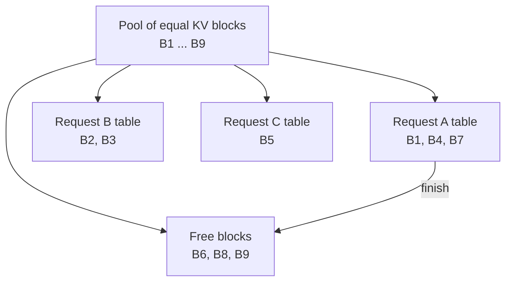
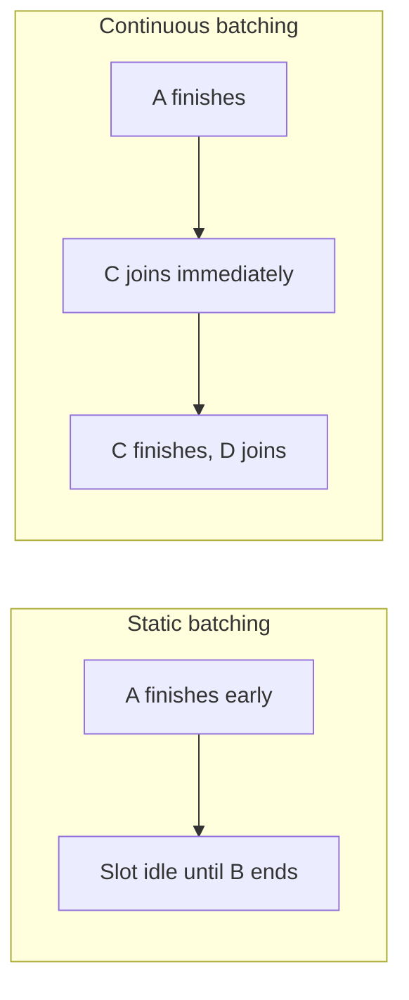

# How does vLLM work?

> **Step 12: LLM Inference Engineering** · ⏱️ 22 min read · [Read original](https://outcomeschool.com/blog/how-does-vllm-work)

## TL;DR
vLLM is a high-throughput LLM serving engine. It manages KV cache memory in small fixed-size blocks (PagedAttention) and keeps the GPU busy by swapping requests in and out every step (continuous batching), so one GPU serves many more users. It exposes an OpenAI-compatible API and does not change answer quality.

## Key Concepts
- **Serving an LLM** — running a model so many users get answers concurrently; the **serving engine** takes requests, runs the model, returns replies. Goal: most users, fastest, on one GPU.
- **Token** — small text chunk (word or part of word).
- **Prefill** — model reads the whole prompt and processes every token before writing anything.
- **Decode** — model writes the reply one token at a time.
- **KV cache** — stored per-token "notes" (internal values) reused for each new token; without it, every new word would recompute all notes. Grows by one set of notes per token, in GPU memory.
- **Throughput** — work finished per unit time (tokens/requests per second).
- **Over-reservation** — reserving far more memory than a request uses.
- **Fragmentation** — free memory broken into small scattered unusable gaps.
- **PagedAttention** — KV cache split into fixed-size blocks allocated on demand.
- **Block table** — small map of which blocks belong to which request, in order.
- **Continuous batching** — finished requests leave and waiting ones join at every step.
- **Static batching** — naive: run a batch together and wait for all to finish.
- **Beam search** — explores several candidate answers (beams) at once, keeps the best.

## How It Works

### The problem: KV cache eats memory
- GPU memory = model weights + whatever is left for the KV caches of all active requests. Each cache keeps growing.
- So the bottleneck is KV cache memory, not math speed; it decides how many users fit. (KV cache compression shrinks caches, but they still must be managed well.)

### Why naive serving wastes memory
- Answer length is unknown, so the engine reserves one big continuous block for the maximum (e.g. 2,000 tokens) per request upfront.
- If the answer is 50 tokens, 1,950 slots sit reserved and unused (over-reservation), and leftover gaps are too small and scattered to fit a new request (fragmentation). Plenty of memory on paper, few users served.

### PagedAttention
- Borrowed from OS paging: memory in small fixed pages, not necessarily adjacent, tracked by a table.
- vLLM splits KV cache into blocks (e.g. 16 tokens each). A request gets one block; when full, it gets another from anywhere in the pool. On finish, all its blocks return to the free pool instantly.
- No over-reservation (allocate only when needed) and almost no fragmentation (equal-sized blocks fit any request).

### Memory sharing
Because of blocks, requests can point their block tables at the same block.
- **Identical prefixes** — many requests share the same long system prompt; store its KV cache once (relates to prompt caching).
- **Beam search** — beams share the common beginning, use separate blocks only where they diverge.
Example: shared blocks B1, B2 stored once; requests A, B, beam C each add B5, B6, B7.

### Continuous batching
- Batching = run many requests together for GPU efficiency.
- Static batching: short requests finish (20 tokens) and idle until the long one (800 tokens) ends, wasting the slot.
- Continuous batching: at each decode step, vLLM checks for finished requests, drops them, and pulls in waiting ones. Batch always full.
- Synergy: PagedAttention frees blocks instantly, continuous batching reuses freed memory and slot immediately.

### OpenAI-compatible API server
Many tools already speak OpenAI's API; point them to your own vLLM server by changing the address, no code rewrite.

### Diagram: PagedAttention

### Diagram: static vs continuous batching

## Benefits and Real-World Use
- Much higher throughput (no memory or GPU time waste), better GPU utilization, lower cost per request, easy adoption via the OpenAI API. Same answers, just more users, faster, cheaper.
- Popular open-source engine for running open models on own GPUs. Strong in:
  - **High-traffic chat apps** — full slots plus packed KV caches.
  - **Agent systems** — agents resend the same big instructions each step (prefix sharing saves memory); continuous batching keeps many short steps flowing.
- Alternatives: SGLang (radix tree for precise prefix matching instead of fixed blocks), TensorRT-LLM (NVIDIA engine with GPU-tuned kernels).

## FAQ
- Does vLLM change answer quality? No.
- Is math speed the bottleneck? No, KV cache memory is.
- Need to rewrite app from OpenAI API? No, change the address.
- Only serving engine? No (SGLang, TensorRT-LLM exist).
- Why good for agents? Shared prefix stored once plus continuous batching.

## Key Takeaways
- Serving goal: maximize users per GPU; KV cache memory is the bottleneck.
- Naive contiguous max-length reservation causes over-reservation and fragmentation.
- PagedAttention uses fixed-size blocks plus a block table, like OS paging.
- Blocks enable sharing of identical prefixes and beam search beginnings.
- Continuous batching refills slots every step instead of waiting for the slowest request.
- OpenAI-compatible API makes adoption a one-line address change.
- Quality is unchanged; only memory and time waste are removed.
