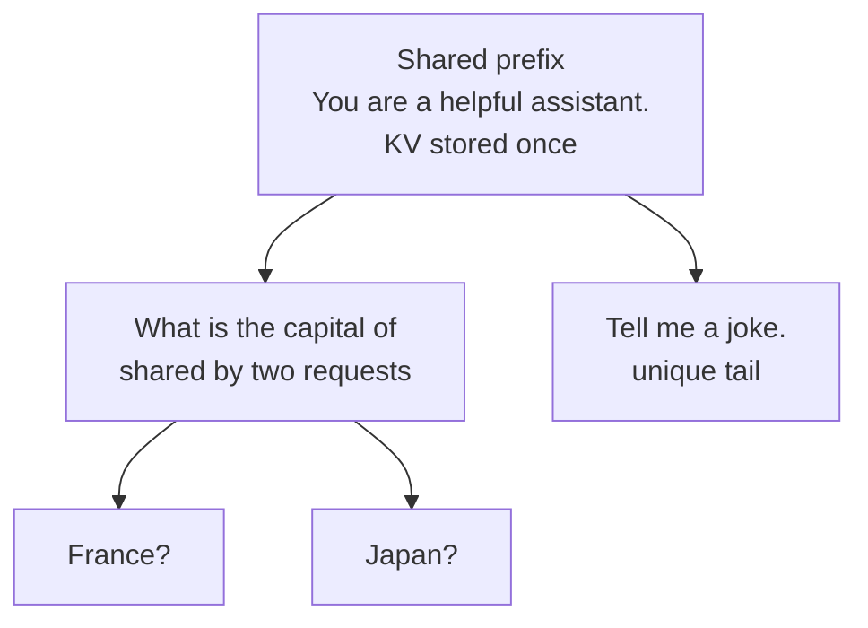
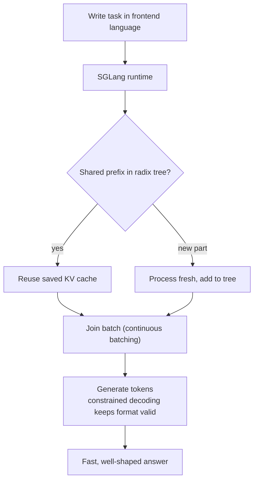

# How does SGLang work?

> **Step 12: LLM Inference Engineering** · ⏱️ 25 min read · [Read original](https://outcomeschool.com/blog/how-does-sglang-work)

## TL;DR
SGLang is a high-performance serving framework for LLMs and multimodal models. Its core trick is RadixAttention: a radix tree stores KV caches by shared prefix so requests with the same starting text reuse past work. It pairs a fast runtime (RadixAttention, continuous batching, constrained decoding) with a Python frontend language for multi-step tasks.

## Key Concepts
- **SGLang** = SG (Structured Generation) + Lang (Language). Two pieces: **runtime** (engine) and **frontend language** (friendly way to write instructions).
- **Token** — small text piece; the LLM generates one at a time, looking back at all previous ones.
- **KV cache** — saved key/value work for already-processed tokens, so it is not redone per new token.
- **System prompt** — fixed instructions placed before the user's text; repeated across every request.
- **Prefix** — the starting text two inputs share ("The sky is" in "The sky is blue/clear").
- **Radix tree** — tree grouping text by shared prefix; shared parts are one branch, split only where text differs.
- **RadixAttention** — Radix (organize by shared prefix) + Attention; reuses KV cache across requests via the radix tree.
- **Batch / continuous batching** — requests processed together; finished slots refilled immediately.
- **Constrained decoding** — model may only pick tokens that keep output valid for a chosen format.
- **Prefill / decode** — read the whole prompt at once / write answer token by token.

## How It Works

### The problem
Many users share the same start (system prompt; same document for many questions). Without sharing, the model re-processes it for each request, like re-reading a whole book for each small question. SGLang's central idea: requests with the same starting text share the saved KV cache.

### RadixAttention
Example requests: "You are a helpful assistant. What is the capital of France?", "...of Japan?", "...Tell me a joke." The shared system prompt is stored once; "What is the capital of" is another shared branch (two requests); "France?", "Japan?", "Tell me a joke." are unique tails.

Reuse steps (new request "...capital of Italy?"):
1. Request arrives.
2. Look up how much of its start exists in the radix tree.
3. Reuse KV cache for the matched part ("You are a helpful assistant. What is the capital of").
4. Process only the new part ("Italy?") and add it as a new branch.
5. Generate token by token.

- Sharing is automatic; nothing to enable.
- Memory is limited: evicts least recently used branches first. Popular prefixes (system prompt) stay; rare one-offs go.



### Frontend language
Real tasks are multi-step (read paragraph, summarize, translate to French). Write them in Python:
```python
@sgl.function
def summarize_and_translate(s, paragraph):
    s += "Summarize this paragraph:\n" + paragraph + "\n"
    s += "Summary: " + sgl.gen("summary", max_tokens=64)
    s += "Now translate the summary to French.\n"
    s += "French: " + sgl.gen("french", max_tokens=64)
```
`s` is the growing conversation; `sgl.gen(name, ...)` calls the model and stores output under a name. The frontend knows which parts are fixed/shared, so the runtime exploits that via the radix tree: easy to use and fast.

### Continuous batching
Old batching waits for the whole group, so short requests idle. Continuous batching refills a finished slot at once (R2 done, R5 starts). Not unique to SGLang; the special part is combining it with RadixAttention (reuse shared work plus keep machine busy), great when many requests share a long start.

### Structured output
Normal models may emit broken JSON. Constrained decoding forces every token to follow the format rule, so output is always valid. Bonus: fixed parts of the format can be filled quickly rather than token by token, so it is faster too.

### End-to-end flow


### More features (many shared with other engines)
- **Chunked prefill** — split a long prompt into chunks mixed with decoding so it does not block others.
- **Speculative decoding** — small helper model guesses several tokens, main model verifies in one step; **EAGLE** drafts at internal feature level for more accepted guesses.
- **Prefill/decode (PD) disaggregation** — prefill needs raw compute, decode needs memory and quick back-and-forth; run on separate machines with a router.
- **Multi-GPU model splitting**, including spreading MoE experts across machines.
- **Quantization** — smaller numbers, less memory, faster, little quality drop.
- **Many custom versions at once** (e.g. adapters of one base model) served in the same batch.
- **Multimodal** — images, and growing support such as video.
- **Smart scheduler** — CPU plans next step while GPU is busy so GPU rarely waits.
- **Cache-aware load balancing** — route requests to machines that already hold the shared work.

## SGLang vs vLLM
Both are fast, serve many users, reuse KV cache, produce structured output, and offer similar APIs (often swappable). Speed depends on model, workload, version; no single winner.

| Point | vLLM | SGLang |
|---|---|---|
| Reusing shared text | Fixed-size blocks (PagedAttention) | Precise, piece by piece, radix tree |
| Track record/community | Longest and largest | Newer, growing very fast, trusted at large scale |
| Best known for | General fast serving, maturity | Prefix sharing, frontend language, structured output |
| Great for | Many very different requests | Multi-turn chat, agents, document QA |

- SGLang can catch sharing vLLM misses, especially in long multi-turn chats; with identical fixed starts both do very well.
- Both run on a wide range of hardware; TensorRT-LLM is NVIDIA-only in exchange for GPU-tuned kernels.

## FAQ
- Manual prefix sharing? No, automatic.
- Cache full? Evict least recently used branches.
- Continuous batching unique? No; the combination with RadixAttention is.
- Structured output slows it? Very little, can be faster.
- Images? Yes, multimodal.

## Key Takeaways
- SGLang = runtime plus frontend language; name from Structured Generation + Language.
- RadixAttention stores KV caches in a radix tree keyed by shared prefix, computing shared text once.
- Matching is precise and automatic; LRU eviction keeps popular prefixes.
- Continuous batching is common; paired with RadixAttention it shines on shared-prefix workloads.
- Constrained decoding guarantees valid JSON and can speed up generation.
- Extras: chunked prefill, speculative decoding/EAGLE, PD disaggregation, multi-GPU/MoE, quantization, cache-aware routing.
- Choose vLLM for maturity and diverse requests; SGLang for multi-turn chat, agents, document QA, structured output.
