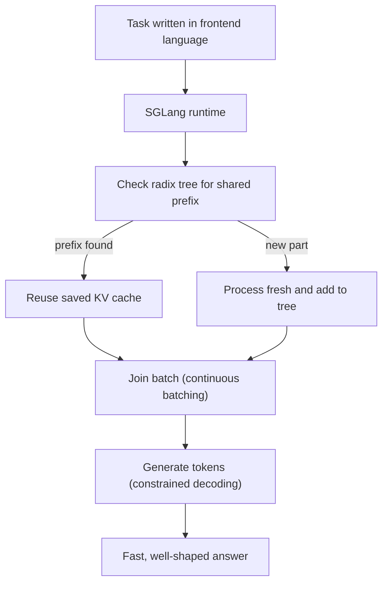

# How does SGLang work?

> **Step 12: LLM Inference Engineering** · ⏱️ 25 min read · [Read original](https://outcomeschool.com/blog/how-does-sglang-work)

## TL;DR
SGLang is a high-performance serving framework for LLMs and multimodal models. Its core idea is RadixAttention: requests that share starting text share the saved KV cache for it, so the same work is not repeated. It pairs this with a frontend language, continuous batching and constrained decoding.

## Key Concepts
- **SGLang** — Structured Generation + Language; a runtime (fast engine) plus a frontend language (easy way to write multi-step tasks).
- **KV cache** — the model's saved work (keys and values) for tokens already processed, so it is not redone per new token.
- **Prefix** — the starting text two requests have in common (e.g. a system prompt).
- **Radix tree** — a tree that groups text by shared prefix; shared parts sit on one branch, stored once.
- **RadixAttention** — reusing KV cache across requests through the radix tree; automatic, no setup needed.
- **Continuous batching** — a finished request's slot is refilled immediately by a waiting request.
- **Constrained decoding** — only tokens that keep the output valid for a chosen format (e.g. JSON) are allowed.
- **Prefill / decode** — reading the whole prompt at once vs writing the answer token by token.

## How It Works
**The problem:** many requests start with the same system prompt or the same document, yet the model recomputes that prefix for every user.

**RadixAttention steps**
1. A new request arrives.
2. SGLang checks the radix tree for how much of its start already exists.
3. It reuses the cached KV for that matched prefix.
4. Only the new tail is processed, and it is added as a new branch.
5. Tokens are generated one at a time.

When memory is full, the **least recently used** branches are evicted first, so popular prefixes (system prompts) stay.

**Frontend language:** write multi-step programs in Python with `@sgl.function`, append text to `s`, and capture outputs with `sgl.gen("name", max_tokens=...)`. The frontend exposes the shared structure, and the runtime exploits it.

**Structured output:** constrained decoding guarantees valid JSON; fixed parts of the format can sometimes be filled quickly, which also speeds things up.

**Other features (many shared with other engines):** chunked prefill, speculative decoding (incl. EAGLE), prefill/decode disaggregation, multi-GPU and MoE expert spreading, quantization, serving many custom model variants in one batch, multimodal input, overlapped CPU scheduling, cache-aware load balancing.

### SGLang vs vLLM
| Point | vLLM | SGLang |
|---|---|---|
| Reusing shared text | Fixed-size blocks (PagedAttention) | Piece by piece via radix tree |
| Track record | Longest, largest community | Newer, growing fast |
| Best known for | General serving, maturity | Prefix sharing, frontend language, structured output |
| Great for | Many very different requests | Multi-turn chat, agents, document QA |

Raw speed depends on model, workload and version; there is no single winner.

## Diagram

## Key Takeaways
- SGLang's heart is RadixAttention: share KV cache across requests with a common prefix.
- Sharing is automatic; eviction is least-recently-used.
- Continuous batching is common; the combination with RadixAttention is what shines for shared-prefix workloads.
- Constrained decoding guarantees valid structured output with little slowdown.
- Choose SGLang for chats, agents and document QA with heavy sharing; vLLM for maturity and diverse requests.
