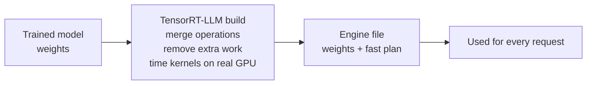
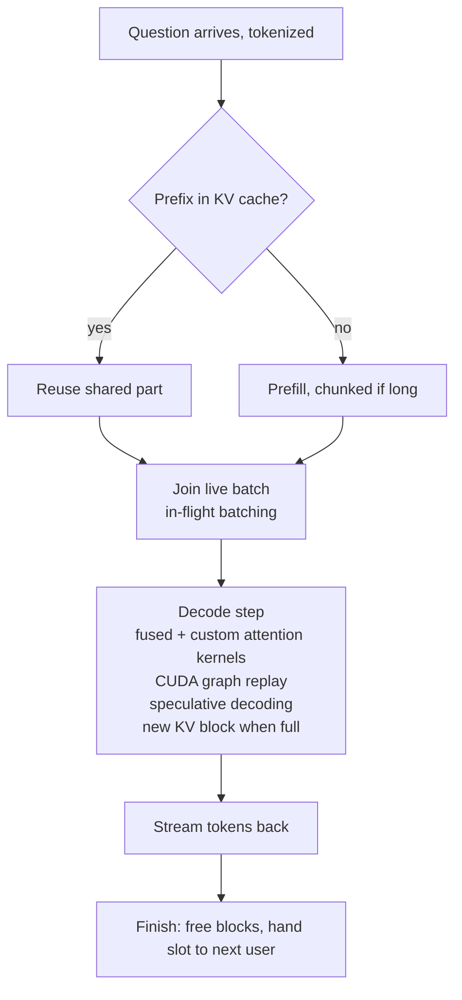
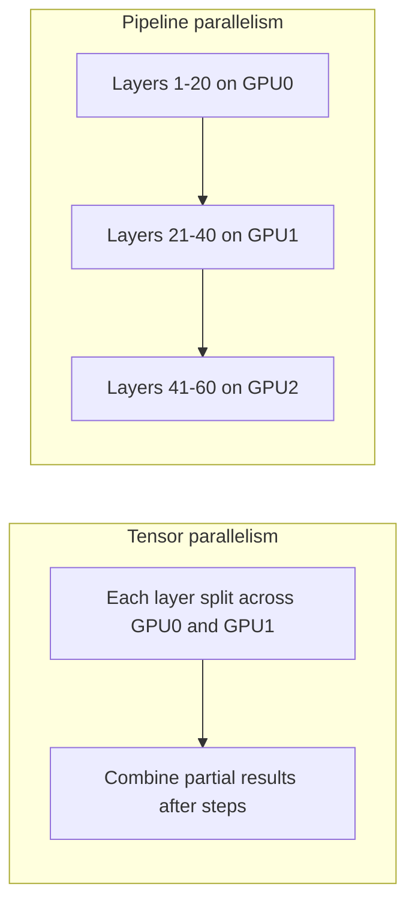

# How does TensorRT-LLM work?

> **Step 12: LLM Inference Engineering** · ⏱️ 47 min read · [Read original](https://outcomeschool.com/blog/how-does-tensorrt-llm-work)

## TL;DR
TensorRT-LLM is NVIDIA's open-source library that makes LLM inference as fast as possible on NVIDIA GPUs. It does the thinking ahead of time (build an engine: fuse kernels, auto-tune, quantize) so at answer time the GPU does only math, then adds runtime tricks (paged KV cache, in-flight batching, CUDA graphs, speculative decoding, multi-GPU). Every idea attacks one enemy: a powerful GPU kept waiting.

## Key Concepts
- **Training vs inference** — training (once, long, expensive) adjusts billions of numbers; inference uses the frozen model to answer. Inference runs for every user request (millions per day), so small savings multiply. TensorRT-LLM is inference only.
- **GPU vs CPU** — CPU = one clever person doing tasks sequentially; GPU = ten thousand workers doing simple math at once. LLMs are mostly multiplications and additions.
- **Kernel** — small GPU program doing one piece of math; **kernel launch** = CPU sending it. One token needs thousands of launches.
- **Tensor** — grid of numbers; **RT** = runtime. TensorRT-LLM builds on older **TensorRT**, adding LLM features (KV cache, batching, multi-GPU).
- **Engine** — single prepared file with weights plus the exact plan to run them fast on one GPU type; produced by the **build**.
- **Kernel auto-tuning** — time several kernel versions on the real GPU, keep the fastest.
- **Quantization** — store numbers in fewer bits (16 to 8 or 4).
- **Attention** — how the model looks back at earlier words; usually the biggest time consumer, grows with context.
- **Prefill / decode, KV cache** — read prompt at once / write token by token; saved per-token notes in GPU memory.
- **In-flight batching** — NVIDIA's name for continuous batching.
- **CUDA graph** — record a sequence of kernel launches once, replay with one instruction.
- **Speculative decoding** — cheap guesses verified by the big model in one pass.
- **Tensor / pipeline parallelism** — two ways to split a model over GPUs.
- **Triton, NIM** — NVIDIA serving system / ready-made containers (often using TensorRT-LLM inside).

## How It Works

### The problem: four leaks in a normal run
A standard framework decides what to do at run time, picking generic kernels layer by layer. Flexible, but costly for a finished model served millions of times:
1. **Too many small kernels** — each layer is many tiny steps.
2. **Memory traffic (biggest)** — each kernel pulls numbers from large slow GPU memory, computes, pushes back. Math is fast, travel is slow; workers wait.
3. **Launch overhead** — thousands of launches per token; CPU may not prepare them fast enough.
4. **Generic kernels** — written for every model and GPU, so never perfect for ours.

### Big idea: prepare ahead of time
Restaurant analogy: cook-to-order (framework, flexible, slow) vs prepped kitchen (engine, fast, fixed menu). During build there is unlimited time to time kernels and merge operations. Trade: minutes once for speed on every request.

Build steps:
1. Start with trained model (weights).
2. Describe to TensorRT-LLM (ready-made definitions for popular families); it builds an internal map of operations.
3. Optimize map: merge operations, remove unneeded work, rearrange.
4. Pick best kernel per operation by auto-tuning on the actual GPU (so engine is GPU-specific).
5. Write the engine file (weights + plan).

Engine is tied to one GPU, precision, and size limits (e.g. max prompt length); changes need a rebuild.

### Kernel fusion
Combine small kernels into one so numbers are fetched once. Example: multiply by weights, add a correction, apply a formula (negatives to zero). Without fusion 3 round trips to big memory; with fusion 1 (all done in fast memory next to workers), same math and answer, also 2 fewer launches. Easier at build time because the whole model is visible and fixed.

### Quantization
- Weights are stored with 16 or 32 bits normally; fewer bits = rougher. Analogy: write 20 instead of 19.9999999.
- Benefits: (1) less memory (8-bit is about half of 16-bit; model fits, room for more users), (2) less travelling (half size = about half the move time), (3) faster math (newer NVIDIA GPUs have dedicated small-format hardware, several times faster).
- Risk: lost information. Mitigate by keeping sensitive parts at higher precision and calibrating rounding with sample text. KV cache can also be quantized (KV cache compression). Always validate on real examples.

### Custom attention kernels
Attention written plainly is a chain of operations each with a memory trip. TensorRT-LLM uses kernels doing the whole attention step in fast memory (Flash Attention is the famous example). Different versions for prefill vs one-token decode and per GPU generation; NVIDIA knows its hardware best.

### Paged KV cache
- KV cache grows per token and per user; free KV memory decides concurrent users.
- Naive: reserve max-length block per request, mostly wasted.
- Paged: small equal blocks given on demand, a table maps request to blocks (e.g. A: B1,B4,B7; B: B2,B3; C: B5; free: B6,B8,B9). Finished request returns blocks instantly; equal size means little waste.
- Bonus **prefix reuse**: identical beginnings (shared instructions) stored once.

### In-flight batching
- Batch = requests processed together (a GPU with one request leaves most workers idle).
- Static batching: wait for whole group; short (20 tokens) idles behind long (800).
- In-flight: each step, drop finished requests, free their KV blocks, pull waiting ones into free slots.
- **Chunked prefill** — split long prompts into chunks interleaved with others' decode steps to avoid hiccups. At larger scale, prefill and decode can run on separate GPUs (prefill-decode disaggregation).
- Pairs with paged KV cache: freed memory and slot are reused immediately.

### CUDA graphs
Fixes launch overhead. Record the kernel sequence once and replay with one instruction (3000 kernels run back to back, no waiting on CPU). Works because every token step runs the identical sequence. Matters most for small models/batches.

### Speculative decoding
- One-token-at-a-time is slow because each token waits for the previous and requires fetching all weights; compute is underused. Producing five tokens costs about the same as one if weights are fetched once.
- Steps: (1) cheap guesser proposes e.g. 4 tokens (small model, extra heads, or lookup of earlier text patterns); (2) big model checks all in one pass; (3) keeps matching tokens up to first mistake, discards the rest; (4) all right = 4 tokens for the price of 1; a wrong one = keep earlier ones, fix that token, restart.
- Example: guesses the, cat, sat, on; accepts "the cat sat" plus the big model's own correct token = 4 tokens in one step.
- Final output is exactly what the big model would write. Styles: separate small model, Medusa, EAGLE heads.

### Multi-GPU
Largest models (hundreds of billions of numbers) do not fit one GPU even quantized.
- **Tensor parallelism** — cut each layer across GPUs; all work on the same token and combine pieces. Fast, but needs fast links (inside one machine); slow over normal network.
- **Pipeline parallelism** — groups of layers per GPU like an assembly line; little communication, good across machines, but GPUs wait on each other.
- Can combine both. In the classic path GPU count is fixed at build time.

### Serving
1. Built-in server, OpenAI-compatible format (just change the address in existing tools).
2. Triton Inference Server backend (health checks, metrics, multiple models, standard deployment).
3. Python API: `llm = LLM(model=...)`, `llm.generate("...")` (all the machinery runs behind it).
4. NIM containers use TensorRT-LLM inside.

### PyTorch backend (newer, default in recent versions)
No separate ahead-of-time build; point at a model and optimizations apply on load. Attention kernels, paged KV, in-flight batching, quantization, CUDA graphs, speculative decoding all work either way. What is only available with the AOT build: deep whole-model fusion and exhaustive kernel auto-tuning. Choose PyTorch for ease, new-model support, flexibility; AOT engine for one fixed model on a fixed GPU with huge traffic.

### Diagram: build step

### Diagram: journey of one request

### Diagram: tensor vs pipeline parallelism

## TensorRT-LLM vs vLLM
Shared: many users, paged KV cache, continuous/in-flight batching, quantization, speculative decoding, chunked prefill, multi-GPU, OpenAI-compatible server; ideas flow both ways.

| Point | TensorRT-LLM | vLLM |
|---|---|---|
| Built by | NVIDIA, for NVIDIA GPUs | Open-source community, many hardware kinds |
| Preparation | Engine build (classic), none in PyTorch path | None |
| Tuning depth | Very deep, per-GPU-generation kernels | Broad, portable |
| New model support | Good, fast for major releases | Usually earliest |
| Ease | Much better with PyTorch path | Simple from day one |
| Best known for | Highest speed on NVIDIA | Flexibility, reach, community |

Raw speed depends on model, GPU, workload, version; often fastest on tuned NVIDIA setups, but benchmark on your own traffic. NVIDIA fleet, stable setup, huge traffic: TensorRT-LLM. Fast iteration, mixed hardware: vLLM. SGLang is a third option (radix-tree prefix sharing).

## Trade-offs & Pitfalls
- Works well: top speed on NVIDIA, efficient multi-user serving, strong quantization, scales to many GPUs/machines, full deployment via Triton and NIM, lower cost per request.
- Fails/limits: NVIDIA only (by design); classic engine tied to GPU, precision, size limits (rebuild to change); build time adds friction; new/unusual architectures may lack day-one support; careless quantization silently degrades answers; speculative decoding can slow things if guesses are often wrong; many settings (batch size, memory, precision) so bad tuning can be slower than a simple engine with defaults.

## FAQ
- Train with it? No, inference only.
- Other vendors' GPUs? No.
- Move engine to another GPU? Not in classic path; rebuild.
- Does speculative decoding change answers? No.
- OpenAI-compatible? Yes.

## Key Takeaways
- Inference runs millions of times, so TensorRT-LLM front-loads work into a one-time build.
- The main waste in a normal run is memory traffic, launch overhead, and generic kernels; fusion and custom attention cut traffic.
- Quantization shrinks memory and movement and uses fast low-precision hardware but must be validated.
- Paged KV cache plus in-flight batching keep memory and slots fully used.
- CUDA graphs remove CPU launch overhead; speculative decoding yields several tokens per step without changing output.
- Tensor parallelism for fast intra-machine splitting, pipeline for cross-machine.
- PyTorch backend keeps most gains with easier setup; AOT engine adds deep fusion and auto-tuning.
- Choose TensorRT-LLM for stable NVIDIA-only high-volume serving, vLLM for flexibility.
