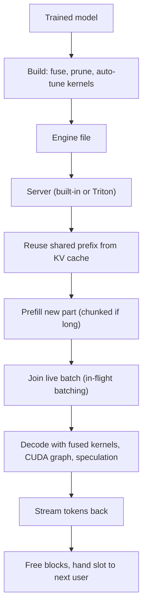

# How does TensorRT-LLM work?

> **Step 12: LLM Inference Engineering** · ⏱️ 47 min read · [Read original](https://outcomeschool.com/blog/how-does-tensorrt-llm-work)

## TL;DR
TensorRT-LLM is NVIDIA's open-source library that makes LLM inference as fast as possible on NVIDIA GPUs. Its big idea is to do the thinking ahead of time (build an engine) so that at answer time the GPU does little but math. It combines kernel fusion, quantization, custom attention, paged KV cache, in-flight batching, CUDA graphs, speculative decoding and multi-GPU execution.

## Key Concepts
- **Inference** — using an already-trained model to answer; happens on every user request, so small savings multiply.
- **Kernel** — a small program on the GPU doing one piece of math; the CPU launches thousands per token.
- **Engine** — one prepared file holding weights plus the tuned plan for one specific GPU, precision and size limits.
- **Kernel fusion** — merging several small kernels into one so numbers make one trip to big memory instead of many.
- **Quantization** — storing numbers in fewer bits (16 to 8 or 4): less memory, less travel, faster math; must be checked on real examples.
- **Paged KV cache** — KV memory split into small equal blocks handed out on demand, tracked by a table.
- **In-flight batching** — TensorRT-LLM's name for continuous batching; finished requests leave and waiting ones enter each step.
- **CUDA graph** — record a whole sequence of kernel launches once and replay it with one instruction.
- **Speculative decoding** — a cheap guesser proposes tokens; the big model verifies them in one pass.
- **Tensor vs pipeline parallelism** — split each layer across GPUs vs split the layer stack into sections.

## How It Works
**The problem:** a normal framework decides at run time, which leaks GPU time through (1) many small kernels, (2) memory traffic between big slow memory and fast memory (the biggest leak), (3) kernel launch overhead, and (4) generic kernels not tuned to our model and GPU.

**Build step (classic path):** trained model, describe the model, optimize the map (merge, remove, rearrange), auto-tune kernels by timing them on the real GPU, write the engine. Pay minutes once for speed on every request.

**Runtime tricks**
- *Custom attention kernels* keep attention's intermediate results in fast memory (Flash Attention is the famous example), with versions for prefill, decode and each GPU generation.
- *Paged KV cache* avoids reserving worst-case memory per request; identical prefixes can share blocks.
- *In-flight batching* plus chunked prefill keeps slots full; static batching leaves slots idle waiting for the longest answer.
- *Speculative decoding* output equals what the big model would write alone; guessers can be a small model, Medusa/EAGLE heads, or pattern lookup. It can hurt if guesses are often wrong.
- *Serving:* built-in OpenAI-compatible server, Triton Inference Server, Python `LLM` API, or NIM containers.

**PyTorch backend (newer default):** no ahead-of-time build; attention kernels, paged KV, in-flight batching, quantization, CUDA graphs and speculative decoding still work. Only deep whole-model fusion and exhaustive auto-tuning are unique to the engine build.

| Point | TensorRT-LLM | vLLM |
|---|---|---|
| Built for | NVIDIA GPUs only | Many hardware types |
| Preparation | Engine build (classic), none (PyTorch path) | None |
| Tuning depth | Very deep, per GPU generation | Broad, portable |
| New models | Good for major releases | Usually earliest |
| Best known for | Top speed on NVIDIA | Flexibility, community |

## Diagram

## Key Takeaways
- TensorRT-LLM is inference-only and NVIDIA-only; it trades portability for depth.
- Core idea: move decisions to a one-time build so run time is pure math.
- Most gains attack one enemy: a powerful GPU kept waiting (on memory, on the CPU, on idle slots).
- Classic engines are tied to one GPU, precision and size limits; the PyTorch path removes the build step while keeping most wins.
- Quantization and speculative decoding must be measured on real traffic; speculation never changes output but can slow things down.
