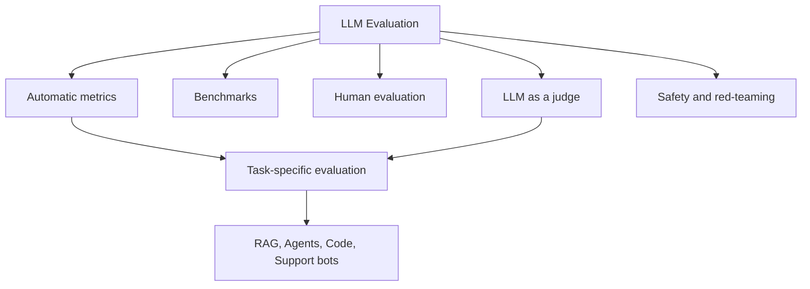

# What is LLM Evaluation? Metrics, Benchmarks, and Methods Explained

> **Step 13: Evaluation and Observability** · ⏱️ 20 min read · [Read original](https://outcomeschool.com/blog/llm-evaluation)

## TL;DR
LLM evaluation measures how well a model does the tasks we expect: correct, helpful, safe and useful. Without it we are guessing, and LLMs can hallucinate confidently or produce biased or harmful content. There are four core methods (automatic metrics, benchmarks, human evaluation, LLM as a judge) plus task-specific and safety evaluation layered on top.

## Key Concepts
- **Hallucination** — the model makes up facts that are not true.
- **Automatic metrics** — formulas scoring output against a reference (BLEU, ROUGE, BERTScore, METEOR, perplexity, exact match).
- **Benchmark** — a standard dataset used to compare models fairly (MMLU, HumanEval, SWE-bench, GSM8K, GPQA, IFEval, BFCL, and others).
- **Human evaluation** — people rate outputs; the gold standard but slow and costly.
- **LLM as a judge** — a strong LLM scores another model's outputs.
- **Saturation** — top models hit the ceiling, so the benchmark stops separating them.
- **Data contamination** — test questions leaked into training, inflating scores.

## How It Works
### The four core methods
| Method | Speed | Cost | Judgement quality | Best for |
|---|---|---|---|---|
| Automatic metrics | Very fast | Very low | Low | Translation, summarization, exact answers |
| Benchmarks | Fast | Low | Medium | Comparing models at research level |
| Human evaluation | Very slow | Very high | Very high | Final check, open-ended tasks |
| LLM as a judge | Fast | Medium | High | Scaling evaluation for chat, RAG, agents |

**Automatic metrics:** BLEU is precision of n-grams (translation); ROUGE is coverage of reference n-grams (summarization); BERTScore compares meaning via embeddings (so "A feline rested on the rug" scores high against "The cat sat on the mat"); METEOR handles synonyms and order; perplexity tracks next-token prediction during training; exact match is 1 or 0. They are cheap and repeatable but only see surface similarity.

**Benchmarks** by category: general knowledge (MMLU, MMLU-Pro), common sense (HellaSwag), coding (HumanEval, SWE-bench Verified, LiveCodeBench), math (GSM8K, MATH, AIME), frontier reasoning (GPQA-Diamond, HLE), instruction following (IFEval), tool use (BFCL), long context (RULER), truthfulness (TruthfulQA), conversation (Chatbot Arena with Elo).

**Human evaluation:** Likert ratings, pairwise comparison, error annotation.

**LLM as a judge biases:** position, verbosity, self-preference. Validate the judge against human scores on a sample.

### Layers on top
- **RAG:** the RAGAS four metrics are context precision, context recall, faithfulness (groundedness) and answer relevance.
- **Agents:** right tool, correct arguments, task done, number of steps (tau-bench, SWE-bench Verified, GAIA, WebArena, BFCL).
- **Code generation:** run generated code against tests.
- **Safety and red-teaming:** jailbreaks, prompt injection, harmful requests (HarmBench, AdvBench, TrustLLM), plus continuous monitoring.

### Challenges
Open-ended outputs, contamination, cost, judge bias, drift over time, and rare edge cases.

## Diagram

## Key Takeaways
- Evaluate before shipping and keep evaluating in production; behavior drifts.
- Public benchmarks can be saturated or contaminated and rarely match your exact task, so build a custom eval set.
- Combine methods: metrics for speed, judge for scale, humans for the final check.
- Always validate an LLM judge against human scores.
- Track cost and latency, not only quality.
