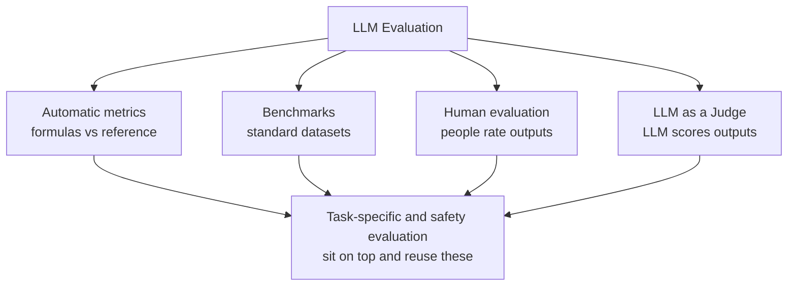

# What is LLM Evaluation? Metrics, Benchmarks, and Methods Explained

> **Step 13: Evaluation and Observability** · ⏱️ 20 min read · [Read original](https://outcomeschool.com/blog/llm-evaluation)

## TL;DR
LLM Evaluation measures how well an LLM does the tasks we expect: are outputs correct, helpful, safe, useful. Four core methods exist (automatic metrics, benchmarks, human evaluation, LLM as a Judge), plus two cross-cutting layers (task-specific and safety evaluation). Real products combine several, and keep evaluating after launch.

## Key Concepts
- **Hallucination** — model confidently makes up false facts; a main reason evaluation is needed.
- **n-gram** — small word group used for overlap metrics.
- **Reference answer** — human-written ground truth that automatic metrics compare against.
- **Benchmark** — standard dataset used by the whole community to test LLMs.
- **Saturation** — top models score near the ceiling so the benchmark stops separating them.
- **Data contamination** — model saw test questions in training, inflating scores.
- **Red-teaming** — testing with adversarial prompts (jailbreaks, prompt injection, harmful requests).

## How It Works

### Why evaluate
Compare models, compare versions (after fine-tuning/prompt changes), find weak spots, ensure safety, track quality over time, build trust. Without it we are guessing.

### The four methods

### 1. Automatic metrics
| Metric | What it does |
|---|---|
| BLEU | Translation; precision of n-grams of output found in reference. "A feline rested on the rug" scores low vs "The cat sat on the mat" despite same meaning |
| ROUGE | Summarization; fraction of reference n-grams covered by model summary |
| BERTScore | Contextual embeddings compare meaning; the feline example scores high |
| METEOR | Improves BLEU with synonyms, stemming, word order |
| Perplexity | How well model predicts next token (lower = better); mainly used during training |
| Exact Match | 1 if identical to reference else 0; math and short factual questions |

- Pros: fast, cheap, scalable to millions, repeatable.
- Cons: surface similarity only, penalize correct rewordings, poor for open-ended tasks (creative writing, chat).
- BLEU/ROUGE are mostly for research and translation pipelines; production apps rely on LLM as a Judge or task-specific evaluation.

### 2. Benchmarks
| Category | Benchmarks |
|---|---|
| General knowledge | MMLU (57 subjects, multiple choice); MMLU-Pro (10 choices, mandatory chain-of-thought) |
| Common sense | HellaSwag (pick likely story ending) |
| Coding | HumanEval (function writing); SWE-bench Verified (real GitHub issues); LiveCodeBench (post-cutoff problems, contamination-resistant) |
| Math | GSM8K (grade-school); MATH (competition); AIME (olympiad) |
| Frontier reasoning | GPQA-Diamond (PhD-level science); Humanity's Last Exam (3,000+ expert questions) |
| Instruction following | IFEval (verifiable constraints like "exactly 3 bullet points") |
| Tool use | BFCL (function calling, relevant for agents) |
| Long context | RULER (effective context window vs claimed) |
| Truthfulness | TruthfulQA (avoids common false beliefs) |
| Conversation | Chatbot Arena / LMArena (side-by-side anonymous votes, ranked with Elo) |

Ideas: saturation (keep building harder ones), data contamination (use post-cutoff problems), qualification bar (older benchmarks remain a basic pass check).
- Pros: fair comparison, wide skills, community-backed.
- Cons: high score does not mean good on our use case; may be saturated/contaminated; rarely match our exact task.

### 3. Human evaluation
Gold standard; judges tone, helpfulness, creativity, safety (e.g. is a poem good?).
- Methods: Likert rating (1-5), pairwise comparison (used by Chatbot Arena), error annotation (mark exact mistakes).
- Pros: judges meaning, handles open-ended tasks, deep failure insight. Cons: slow, expensive, raters disagree, hard to scale.
- Pairwise comparisons also train models (human rankings become a reward model, as in InstructGPT).

### 4. LLM as a Judge
A strong LLM scores another LLM's outputs; cheaper and faster than humans, scales to millions, works on open-ended tasks. Example prompt: expert evaluator rates reply 1-5 for helpfulness and politeness with a short reason.
- Biases: position (favors first or second), verbosity (favors longer), self-preference (favors own model family). Judge also makes mistakes; validate against human scores on a small sample.

### Task-specific evaluation
Custom evaluation matched to our task, built on metrics or LLM-judge.
- **RAG** — RAGAS four metrics: Context Precision (retrieved chunks that are relevant), Context Recall (relevant chunks retrieved), Faithfulness/Groundedness (answer supported by context), Answer Relevance (answers the question). Precision and recall are the classic metrics applied to retrieval. Frameworks: RAGAS, DeepEval.
- **Agents** — right tool? correct arguments? finished task? how many steps? Benchmarks: tau-bench (customer service), SWE-bench Verified; also GAIA (general assistant), WebArena (browser), BFCL.
- **Code generation** — run against test cases rather than compare text.
- **Support chatbots** — answered the question, polite, brand guidelines, escalated to human when needed.

### Safety and red-teaming
Test with jailbreaks, prompt injection, harmful requests; check refusals, data leaks, bias. Benchmarks: HarmBench, AdvBench, TrustLLM (truthfulness, safety, fairness, robustness, privacy, ethics). Guardrails enforce checks on input and output. Run continuous safety monitoring in production since new attacks appear.

## Trade-offs & Pitfalls (Challenges)
- Open-ended outputs have no single answer.
- Data contamination.
- Cost of human evaluation and large LLM-judged sets.
- Judge bias not matching real users.
- Drift after fine-tuning, prompt updates, or provider backend changes: evaluate in production, not just before launch.
- Edge cases: good average, bad on rare important cases.

## Best Practices
- Build a custom, high-quality evaluation set for the real use case.
- Combine methods: metrics for speed, judge for scale, humans for final check.
- Validate the judge against humans.
- Re-run on every prompt/model/system change and track trends.
- Cover edge, adversarial, and safety examples.
- Keep humans in the loop (weekly manual sample review).
- Measure cost and latency too (a perfect answer taking 30 seconds is not useful).

### When to use which
| Method | Speed | Cost | Judgement quality | Best for |
|---|---|---|---|---|
| Automatic metrics | Very fast | Very low | Low | Translation, summarization, exact-answer |
| Benchmarks | Fast | Low | Medium | Research-level model comparison |
| Human | Very slow | Very high | Very high | Final check, open-ended |
| LLM as a Judge | Fast | Medium | High | Scaling for chat, RAG, agents |

Typical combo: metrics during training, benchmarks for model selection, LLM judge for daily monitoring, humans before shipping.

## Key Takeaways
- Evaluation replaces guessing; hallucination, bias, and drift make it necessary before and after launch.
- BLEU/ROUGE measure word overlap; BERTScore measures meaning.
- Public benchmarks suffer saturation and contamination and may not match your task.
- Humans are the gold standard but slow and costly; LLM judges scale but have position, verbosity, and self-preference biases.
- RAG evaluation = context precision, context recall, faithfulness, answer relevance.
- Agent evaluation checks tool choice, arguments, completion, steps.
- Always build your own eval set, validate the judge, and track quality, cost, and latency over time.
