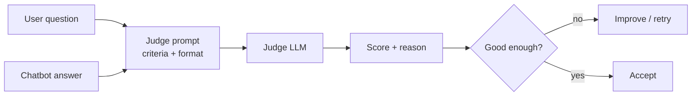

# What is LLM as a Judge?

> **Step 13: Evaluation and Observability** · ⏱️ 20 min read · [Read original](https://outcomeschool.com/blog/llm-as-a-judge)

## TL;DR
LLM as a Judge uses one LLM to evaluate another LLM's output against our criteria and return a score or verdict with a reason. It combines human-level quality with automated speed and scale: strong judges agree with humans over 80% of the time, about the rate two humans agree. It has biases, so it must be validated against human ratings.

## Key Concepts
- **Judge LLM** — teacher grading a student LLM's homework.
- **Single answer scoring** — rate one answer on a scale (e.g. 1-5); track quality over time.
- **Pairwise comparison** — pick better of Answer A/B; compare models or prompt versions.
- **Reference-based** — compare answer to a ground-truth reference by meaning.
- **Rubric-based** — separate scores per criterion (accuracy, helpfulness, clarity, tone) plus overall; most common in production.
- **G-Eval** — Generate evaluation steps + Score; chain-of-thought judging.
- **Panel of Judges (Jury)** — several judge models from different families, scores averaged.
- **Trajectory** — full sequence of an agent's steps (tool calls, reads, plans).

## How It Works

### Why we need it
Outputs are open-ended; two different answers can both be right.
1. Human evaluation: high quality but slow, expensive, tiring, does not scale.
2. BLEU/ROUGE: fast and cheap but only word overlap, miss meaning.
3. LLM judge: understands meaning, compares differently-worded answers, cheap compared with humans, evaluates millions daily. Now the default for evaluating LLM apps.

### Basic flow (support chatbot example)
1. Take user question and chatbot answer.
2. Write judge prompt with question, answer, rules.
3. Send to judge LLM.
4. Judge returns score plus reason (e.g. "Score: 5. Clear, step-by-step, directly addresses question").
5. Use the score to decide if chatbot is doing well.

In real systems a low score can send work back for another attempt (a step in a larger graph flow).

### Building a judge
1. Define criteria in plain words (correct? clear? polite?).
2. Choose judge model: strong (e.g. GPT-5, Claude Opus 4.7, Gemini 3.1 Pro), at least as capable as the model judged; open-source judges if data must not go to closed APIs.
3. Write the prompt: task, user input, output to judge, scale and rules, output format.
4. Run on a small sample and read scores/reasons.
5. Compare with human ratings.
6. Iterate (more rules, better examples) until they match.
7. Use at scale (compare models, prompts, versions).

Template: expert evaluator; criteria Accuracy, Helpfulness, Clarity; inputs `{user_question}`, `{assistant_response}`; output format with scores 1-5 each, overall, and short reason; "Be fair and consistent, base scores only on the response".

### G-Eval (chain-of-thought judging)
Judge first writes evaluation steps, applies each with reasoning, then gives final score. Direct scoring is shallow; thinking first slows the judge, reads more carefully, gives more reliable scores and better human agreement than basic prompts.

### Biases
| Bias | Description | Fix |
|---|---|---|
| Style | Prefers bullets over paragraphs, formal over casual; most dominant; rewards look over content | State expected style in prompt |
| Position | Prefers the first answer | Swap order, run twice, average |
| Verbosity | Prefers longer answers | Tell judge not to prefer length |
| Self-preference | Favors outputs from itself/own family (GPT-5 picks GPT-5) | Different judge model or Panel from different families |
| Preference leakage | Pipeline-level: same model generates synthetic training data and judges the trained model, so eval is contaminated and real performance disappoints | Judge family must differ from family used for data, prompts, or any pipeline input |
| Authority/bandwagon | Defers to confident or expert-quoting answers and to earlier agreeing answers | Instruct to focus only on correctness, not tone or confidence |

Even frontier judges fail on bias-heavy tasks, so test the judge against these before production.

## Best Practices
- Strong judge model; clear prompt (task, criteria, input, output, format).
- Few-shot examples; small scale (1-5 beats 1-100).
- Ask for a reason (better thinking, easier debugging).
- Validate against humans on a sample.
- Handle position bias; use a Panel/Jury.
- Keep criteria simple; split into separate evaluations.

## Real-World Use Cases
- Model evaluation (new vs old version side by side).
- Chatbot quality monitoring (daily automatic report).
- Content moderation (output guardrail that blocks harmful output).
- RAG evaluation (is answer grounded in documents; catch hallucination).
- Prompt engineering (compare prompts at scale).
- Agent trajectory evaluation (right tools, used correctly, right answer); fastest growing since agents are hard to evaluate otherwise.

## FAQ
- Reliable as humans? Almost: >80% agreement.
- Why not BLEU/ROUGE? Overlap only, miss meaning.
- Same model as generator and judge? Avoid (self-preference, contamination).
- Trust it? Validate vs human ratings.
- Judge smaller than evaluated model? No, must be at least as capable.

## Key Takeaways
- LLM judge = human-like quality with automated scale; default for LLM app evaluation.
- Four types: single score, pairwise, reference-based, rubric (most common).
- Build loop: criteria, model, prompt, sample, compare to humans, iterate, scale.
- G-Eval (reason before scoring) improves reliability.
- Know the biases: style, position, verbosity, self-preference, preference leakage, authority/bandwagon.
- Mitigate with order swapping, different-family judges, and a Jury.
- Always validate against human ratings before trusting.
