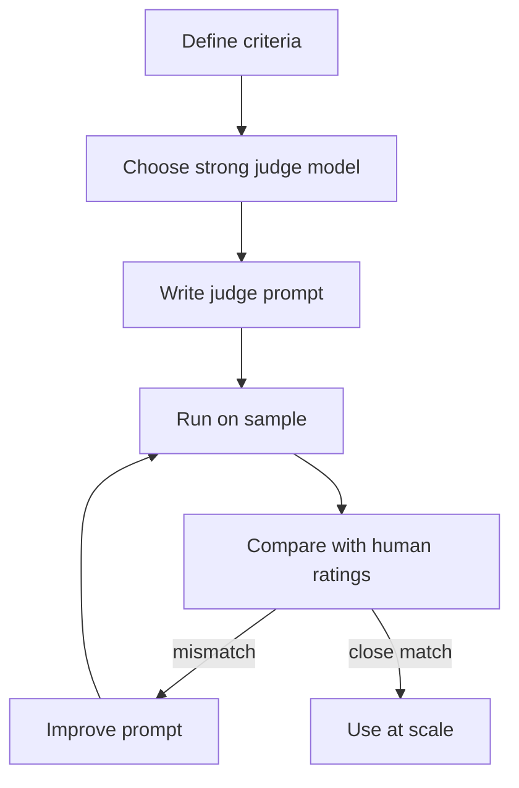

# What is LLM as a Judge?

> **Step 13: Evaluation and Observability** · ⏱️ 20 min read · [Read original](https://outcomeschool.com/blog/llm-as-a-judge)

## TL;DR
LLM as a Judge uses one LLM to grade another LLM's outputs, like a teacher checking homework. It gives close to human quality at the speed and cost of automation, and strong judges agree with humans over 80% of the time, about as often as two humans agree with each other. It must still be validated against humans and guarded against bias.

## Key Concepts
- **Judge LLM** — a strong model that reads the input and output and returns a score plus a reason.
- **Single answer scoring** — rate one answer on a scale; good for tracking quality over time.
- **Pairwise comparison** — pick the better of two answers; good for comparing models or prompts.
- **Reference-based evaluation** — compare an answer with a ground truth answer by meaning.
- **Rubric-based evaluation** — separate scores per criterion (accuracy, clarity, tone); the most common type in production.
- **G-Eval** — chain-of-thought judging: write evaluation steps, apply them, then score.
- **Jury / panel** — several judges from different families, scores averaged.

## How It Works
**Why it exists:** human evaluation does not scale; BLEU/ROUGE are fast but miss meaning. A judge understands meaning and scales to millions of outputs.

**Building a judge**
1. Define evaluation criteria in plain words.
2. Choose a judge at least as capable as the model being judged (open-source judges if data must stay private).
3. Write the prompt: task, input, output to judge, scale and rules, output format.
4. Run on a small sample and read the reasons.
5. Compare with human ratings.
6. Iterate on the prompt (rules, examples).
7. Use at scale.

**G-Eval:** asking for a score directly gives shallow results; asking the judge to first generate its own checklist, apply it step by step, then score gives much better agreement with humans.

### Biases
| Bias | What happens | Fix |
|---|---|---|
| Style | Prefers bullets or formal tone over content | Tell the judge to ignore style |
| Position | Favors the first answer | Swap order, run twice, average |
| Verbosity | Favors longer answers | Instruct against it |
| Self-preference | Favors its own model family | Use a different family or a jury |
| Preference leakage | Same family generates training data and judges, contaminating the eval | Keep judge family separate from the pipeline |
| Authority / bandwagon | Defers to confident or crowd-agreed answers | Remind the judge in the prompt |

**Best practices:** strong judge, clear prompt, few-shot examples, small scale (1 to 5), ask for a reason, validate against humans, handle position bias, use a jury, keep criteria simple.

**Use cases:** model comparison, chatbot monitoring, content moderation (output guardrails), RAG groundedness checks, prompt comparison, agent trajectory evaluation.

## Diagram

## Key Takeaways
- A judge combines human-like understanding with automated scale.
- Always validate the judge against human ratings before trusting it.
- Ask for reasoning before the score (G-Eval) and a reason with every score.
- Swap order in pairwise comparisons; use a panel of judges from different families.
- Keep the judge's model family separate from the one that generated your data to avoid preference leakage.
