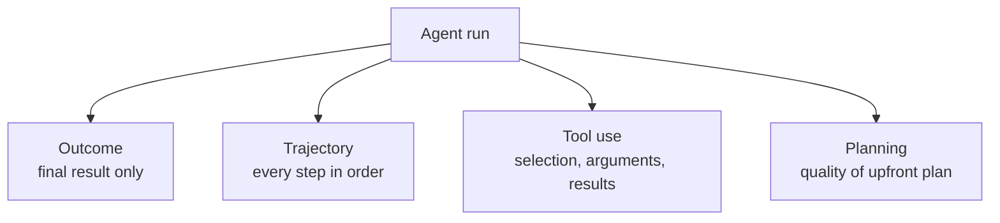
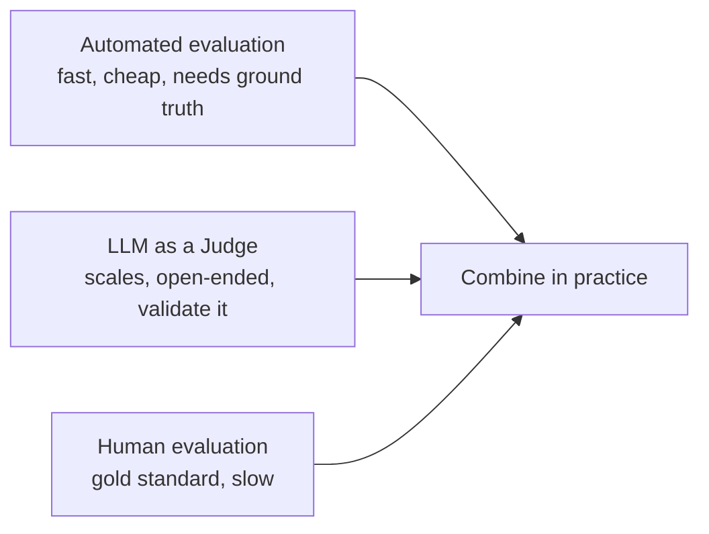

# How to Evaluate AI Agents? Metrics, Methods, and Best Practices

> **Step 13: Evaluation and Observability** · ⏱️ 22 min read · [Read original](https://outcomeschool.com/blog/ai-agent-evaluation)

## TL;DR
AI Agent Evaluation measures how well an agent does its tasks: the final result plus every step and tool used. Unlike LLM evaluation (just the final text), we assess outcome, trajectory, tool use, and planning, track success, cost, latency, and safety, and combine automated checks, LLM judges, and humans.

## Key Concepts
- **AI Agent** — LLM-based system that plans, uses tools (call tools, read files, search web, run code), and finishes tasks on its own over many steps.
- **Trajectory** — full path of actions and thoughts the agent took.
- **Non-determinism** — same input can give different results since LLMs are not deterministic.
- **Sandbox** — environment with fake tools and data for safe testing.

## How It Works

### Why agents need special evaluation
Agents take real actions (send emails, write databases, spend money), so small mistakes are costly. Goals: check task correctness, right tool at right time, steps and money per task, find weak spots, compare versions, ensure safety; keep checking after shipping.

| Aspect | LLM Evaluation | Agent Evaluation |
|---|---|---|
| What we check | Final text | Final output + all steps |
| Steps | One | Many |
| Tools | None | Many calls |
| Cost | One LLM call | Many LLM + tool calls |
| Failure modes | Wrong text | Wrong tool, wrong order, infinite loop, etc. |

### Four evaluation types

**1. Outcome evaluation** — only final result (e.g. cheapest Friday Delhi-Bangalore flight booked?). Metrics: Task Success Rate, Final Answer Accuracy, Goal Completion.
- Pros: simple, matches user care, good with clear answers. Cons: no why for failures; right answer by luck after wrong steps; right answer but wasted money/time. Needs a definition of "done".

**2. Trajectory evaluation** — check steps and order. Example (weather + umbrella): call weather tool with Bangalore/tomorrow, read result (70% rain), decide umbrella, reply. Skipping step 1 and guessing is wrong even if answer is right.
- Metrics: Exact Match (exact sequence), In-Order Match (required steps in order, extras allowed), Any-Order Match (all required steps, any order), Precision (steps taken that were useful), Recall (needed steps that were taken).
- Pros: pinpoints errors, separates luck from understanding, aids debugging. Cons: many good paths, costlier, strict if exact match. Requires capturing steps (agent observability).

**3. Tool use evaluation** — tools are the agent's hands. Check Tool Selection, Argument Correctness, Tool Call Success (valid vs error), Result Handling, No Hallucinated Tools. Example tools search_flights, book_flight, send_email: bad agent emails first, books with no flight selected, or calls nonexistent cancel_flight.
- Pros: catches most common failure, easy to automate (structured calls), improves tool descriptions/prompts. Cons: says nothing about final quality, needs ground-truth tool.

**4. Planning evaluation** — quality of plan before acting (trip: flights, cheapest fit, hotels, best-rated within budget, send itinerary). Check Completeness, Correctness (order), Feasibility (with available tools), Efficiency (no wasted steps).
- Pros: catches errors early, shows how agent thinks. Cons: only for plan-first agents, many valid plans.

### Key metrics
- Task Success Rate (most important), Tool Call Accuracy, Steps per Task (fewer usually better), Cost per Task, Latency per Task, Recovery Rate (after tool failure), Safety Score, Loop Detection (stuck repeating a tool).
- Track together: high success is useless if costly or slow.

### Benchmarks
| Category | Benchmarks |
|---|---|
| Function calling | BFCL (most cited for tool use) |
| Customer service | tau-bench (only agent acts) / tau2-bench (dual-control: agent and simulated user both have tools in shared world) |
| Coding | SWE-bench Verified; Terminal-Bench (sandboxed shell tasks like building Linux from source, reverse-engineering a binary); MLE-bench (Kaggle ML engineering) |
| General assistant | GAIA (reasoning + tools + browsing) |
| Web browsing | WebArena; VisualWebArena (visual understanding); BrowseComp (open-web information seeking) |
| Computer use | OSWorld (full desktop); AppWorld (apps through APIs) |

Saturation (SWE-bench Verified supplemented by harder Terminal-Bench) and real-world gap (public score does not guarantee your product works; build your own eval).

### Evaluation methods

- **Automated** — code runs agent on test tasks, compares outputs/tool logs to expected (e.g. flight number). Fast, repeatable; needs clear ground truth.
- **LLM as a Judge** — judge gets request, full trajectory, final answer; rates 1-5 on finished task, right tools, efficient path, correct answer, with reasons. Scales, handles open-ended; has biases, validate against humans.
- **Human** — highest quality, slow, expensive.
- Typical: automated for fast feedback, judge for daily monitoring, humans before shipping.

### Frameworks
LangSmith (tracing and evaluating LangChain/LangGraph agents, trajectory inspection), DeepEval (open-source, ready metrics for agents, tool use, RAG). They define tasks, run agent, capture trajectory, score, show dashboards.

## Trade-offs & Pitfalls (Challenges)
- Many correct paths; non-determinism; long trajectories (20-100 steps); changing environments (search, databases); cascading failures (step 2 error breaks step 10, trace root cause); safety risks from real actions; high evaluation cost (many LLM and tool calls).

## Best Practices
- Strong test set of real tasks: easy, hard, edge, adversarial.
- Evaluate outcome and trajectory (what vs why).
- Run each test 3-5 times; look at average and worst case.
- Use a sandbox, never production.
- Track cost and latency from day one.
- Validate the judge; set up regression tests on prompt/tool/model changes.
- Set max steps and max time to stop loops.
- Keep humans in the loop (weekly sample review).

## FAQ
- Right answer yet fail? Yes: luck or wasted cost; hence outcome plus trajectory.
- Benchmark enough? No.
- Runs per test? 3-5.
- Trust LLM judge? After validation.
- Test in production? No, sandbox.

## Key Takeaways
- Agents need evaluation of the whole path, not only the final text.
- Four lenses: outcome, trajectory, tool use, planning.
- Trajectory matching: exact, in-order, any-order, plus precision/recall.
- Track success, cost, latency, steps, recovery, safety, loops together.
- Non-determinism requires repeated runs; use sandboxes for safety.
- Public benchmarks (BFCL, tau-bench, SWE-bench, GAIA, WebArena, OSWorld) do not replace a custom test set.
- Combine automated checks, validated LLM judges, and human review.
