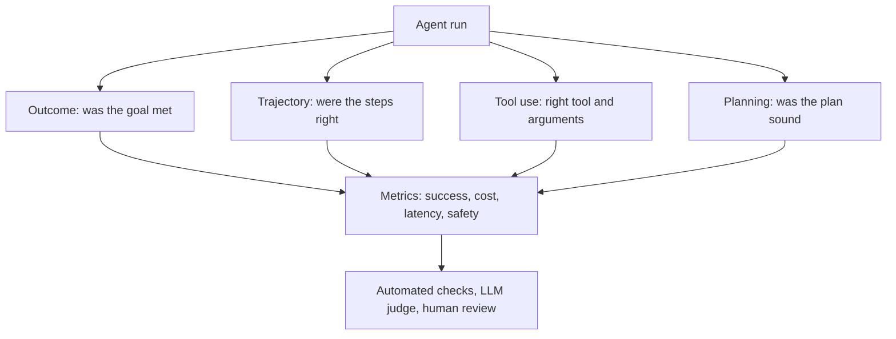

# How to Evaluate AI Agents? Metrics, Methods, and Best Practices

> **Step 13: Evaluation and Observability** · ⏱️ 22 min read · [Read original](https://outcomeschool.com/blog/ai-agent-evaluation)

## TL;DR
AI agents plan, call tools and take many steps, so evaluating only the final text (as with plain LLM evaluation) is not enough. Agent evaluation checks the outcome, the trajectory, tool use and planning, plus cost, latency and safety. Agents take real actions, so small mistakes can be costly.

## Key Concepts
- **AI agent** — an LLM-based system that plans, uses tools and finishes a task on its own.
- **Outcome evaluation** — judge only the final result.
- **Trajectory evaluation** — judge every step taken, in order.
- **Tool use evaluation** — judge tool selection, arguments, success, result handling, and hallucinated tools.
- **Planning evaluation** — judge the up-front plan: completeness, correctness, feasibility, efficiency.
- **Recovery rate** — how often the agent finishes after a tool call fails.

## How It Works
### LLM evaluation vs agent evaluation
| Aspect | LLM evaluation | Agent evaluation |
|---|---|---|
| What we check | Final text | Final output plus all steps |
| Steps | One | Many |
| Tools | None | Many tool calls |
| Cost | One call | Many LLM and tool calls |
| Failure modes | Wrong text | Wrong tool, wrong order, infinite loop |

### Four evaluation types
- **Outcome:** task success rate, final answer accuracy, goal completion. Simple, but cannot say why it failed and may reward lucky answers or wasteful runs.
- **Trajectory:** exact match, in-order match, any-order match, precision (useful steps of steps taken), recall (needed steps taken). Example: a weather agent that skips the weather tool and guesses is wrong even if the answer is right. Downside: many valid paths exist, exact match can be too strict.
- **Tool use:** good agent calls `search_flights`, then `book_flight`, then `send_email`; bad ones reorder, pass no flight, or invent `cancel_flight`.
- **Planning:** only for agents that plan upfront; catches errors early.

### Key metrics
Task success rate (most important), tool call accuracy, steps per task, cost per task, latency, recovery rate, safety score, loop detection. Track them together.

### Benchmarks
BFCL (function calling), tau-bench / tau2-bench (customer service; tau2 adds a dual-control simulated user), SWE-bench Verified, Terminal-Bench, MLE-bench (coding and ML), GAIA (general assistants), WebArena, VisualWebArena, BrowseComp (web), OSWorld, AppWorld (computer use). Beware saturation and the real-world gap.

### Methods
Automated checks (fast, need ground truth), LLM as a judge (scales, validate it), human review (best quality, slow). Combine all three. Frameworks: LangSmith, DeepEval.

### Challenges
Many correct paths, non-determinism, long trajectories, changing environments, cascading failures, safety risk, evaluation cost.

## Diagram

## Key Takeaways
- Evaluate both outcome and trajectory: outcome says if it worked, trajectory says why not.
- Run each test 3 to 5 times because LLMs are non-deterministic; look at average and worst case.
- Test in a sandbox with fake tools and data, never in production.
- Set max steps and time limits to stop loops; track cost and latency from day one.
- Add regression tests whenever the prompt, tools or model change; keep humans reviewing samples.
