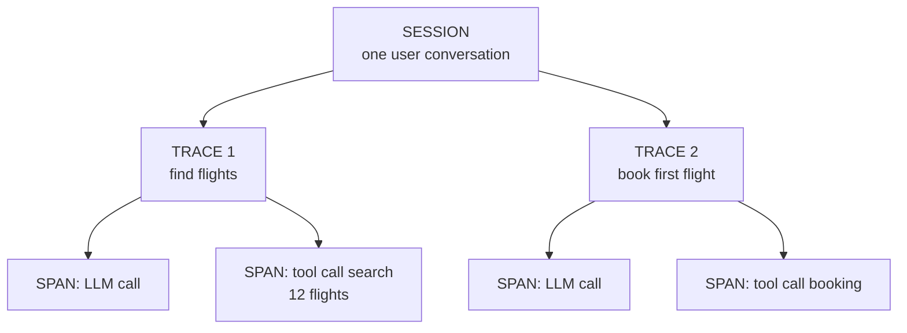
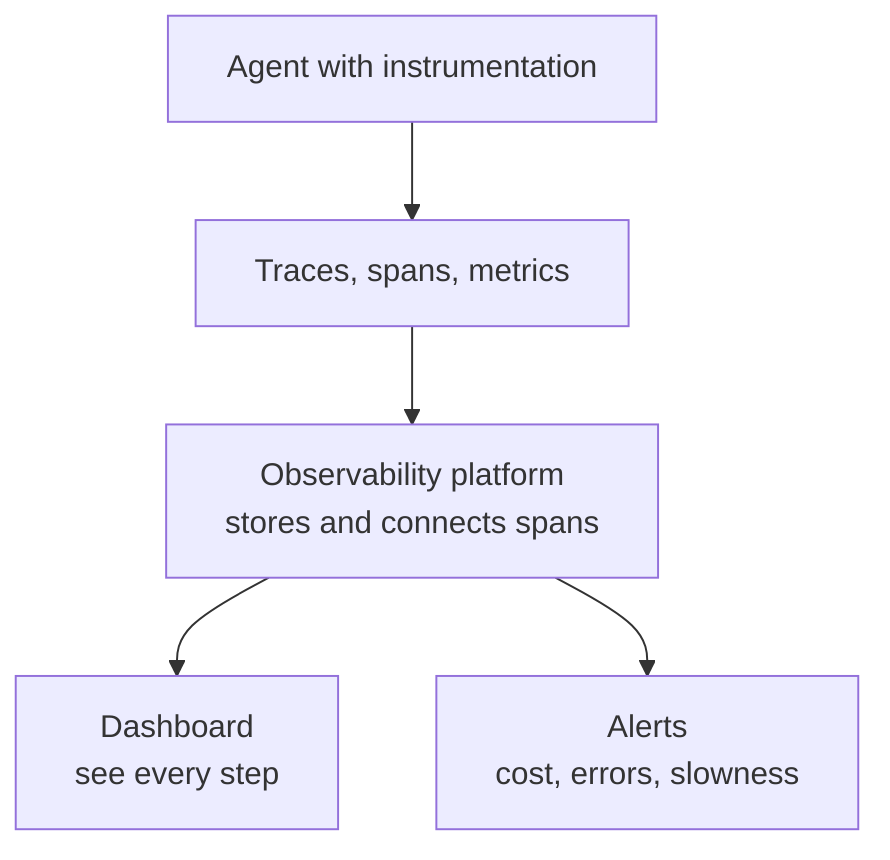

# What is AI Agent Observability? Traces, Spans, and Metrics Explained

> **Step 13: Evaluation and Observability** · ⏱️ 21 min read · [Read original](https://outcomeschool.com/blog/ai-agent-observability)

## TL;DR
AI Agent Observability records everything an agent does internally, step by step, as traces made of spans plus metrics, so we can see why it behaved as it did. It is the black-box flight recorder for agents, which are non-deterministic and can fail silently. Observability records what happened; evaluation judges how good it was.

## Key Concepts
- **Observability** — Observe + Ability: understand a system's internal state from the data it produces (car dashboard, doctor's X-ray/blood test).
- **AI Agent** — LLM system that plans, uses tools, takes many steps to finish a task.
- **Log** — text record of an event. **Metric** — number measured over time. **Trace** — full journey of one request.
- **Span** — one step/operation; **trace** — one full run made of many spans; **session** — a whole user conversation made of many traces.
- **Instrumentation** — small recording code (sensors) at each important step; most modern agent frameworks have it built in.
- **OpenTelemetry** — open standard for collecting traces, metrics, logs in a common format; GenAI conventions standardize names for model name, tokens, cost.
- **Non-deterministic** — same input can give different paths/outputs.

## How It Works

### Why needed
Agents are unpredictable, call real tools, spend real money; failures hide mid-run. Complaint "agent booked the wrong flight": was it a misunderstanding, wrong search dates, bad tool data, wrong pick from a correct list, or an ignored booking failure? Without traces we only guess. Reasons: see every step, locate the failing step, track money and tokens, track speed, catch errors/retries/failed calls, understand decisions, monitor live with alerts, collect data to improve. Also security: when an attacker hides an instruction in a page or email the agent reads, the trace is often the only place showing what happened (prompt injection).

### Traditional vs agent observability
| Traditional | Agent |
|---|---|
| Same input, same output | Same input can differ |
| Fixed path | Path changes each run |
| Errors are clear crashes | Failures silent, look correct |
| CPU, memory, requests | Also tokens, cost, tool calls, reasoning |
| "Did it run?" | Also "was the answer good?" |
| Simple text logs | Also prompts, responses, decisions |

Agent observability = traditional plus agent-specific.

### Three pillars
Logs, metrics, traces. For agents, **traces are most important**: so many internal steps that the full journey is needed (every thought, tool call, LLM call for one task).

### Traces and spans
Flight booking trace has 7 spans: receive request, LLM plans (decides to search), call flight search tool, read results, LLM picks cheapest, call booking tool, return confirmation. Each span records input, output, time, errors. Spans nest (planning span contains an LLM call span), forming a tree. Designing an agent as a graph of small steps gives one clean span per node for free.

### What to capture
1. **LLM calls** (most important) — full prompt, full response, model name, temperature, input/output tokens, cost.
2. **Tool calls** — which tool, input, output, success/failure (agents mostly fail from wrong tool or input).
3. **Reasoning and planning steps.**
4. **Memory and context** — what was read/written.
5. **Retries and errors.**
6. **Final output.**

### Key metrics
Latency (total and per step), Token usage, Cost (grows fast with many LLM calls), Number of steps (too many = waste or loop), Tool call success rate, Error rate (early warning), Task success rate (most important).

### Pipeline
1. Instrumentation (sensors recording input, output, time, error).
2. Collect traces/spans/metrics and send to a platform.
3. Store and connect spans into full traces.
4. Visualize: trace as tree of spans, click a span for exact prompt, response, tool input/output.
5. Alert on cost jumps, error rate, slowness.

### Tools
LangSmith (LangChain team, detailed traces and evaluation), Langfuse (open source; traces, costs, metrics), Arize Phoenix (open source, OpenTelemetry-based), OpenTelemetry (standard), Laminar (open source, OTel-native, long-running agents), Datadog and Grafana (traditional platforms with LLM/agent support). OTel support avoids lock-in.

### Observability vs evaluation
Observability = what the agent did (raw data); evaluation = how good it was (e.g. cheapest flight, right dates). Observability first; without it nothing to evaluate, without evaluation data has no quality judgement.

## Trade-offs & Pitfalls (Challenges)
- High data volume (costly storage and search).
- Sensitive data in prompts/tool inputs: mask it.
- Non-deterministic runs are hard to compare.
- Recording adds time and cost; balance.
- Connecting spans across sub-agents into one trace needs good instrumentation.

## Best Practices
- Trace from day one; capture full prompts and responses (not just "LLM called").
- Use OpenTelemetry; track cost and tokens per run.
- Mask sensitive data; set alerts.
- Connect observability to evaluation; keep past traces to find patterns.

## FAQ
- Write instrumentation ourselves? Mostly no.
- Logs, metrics, or traces? Traces.
- Session? Group of traces from one conversation.
- When add? Day one.
- Store full prompts safely? Only after masking sensitive data.

## Key Takeaways
- Observability = understanding internals from emitted signals; agents need it because they are non-deterministic and fail silently.
- Session > trace > span hierarchy; a span is one step with input, output, time, error.
- Capture LLM calls, tool calls, reasoning, memory, retries, errors, final output.
- Track latency, tokens, cost, steps, tool success, error rate, task success.
- OpenTelemetry (with GenAI conventions) standardizes collection and avoids lock-in.
- Observability records, evaluation judges; they work together.
- Mask sensitive data and trace from the start.
