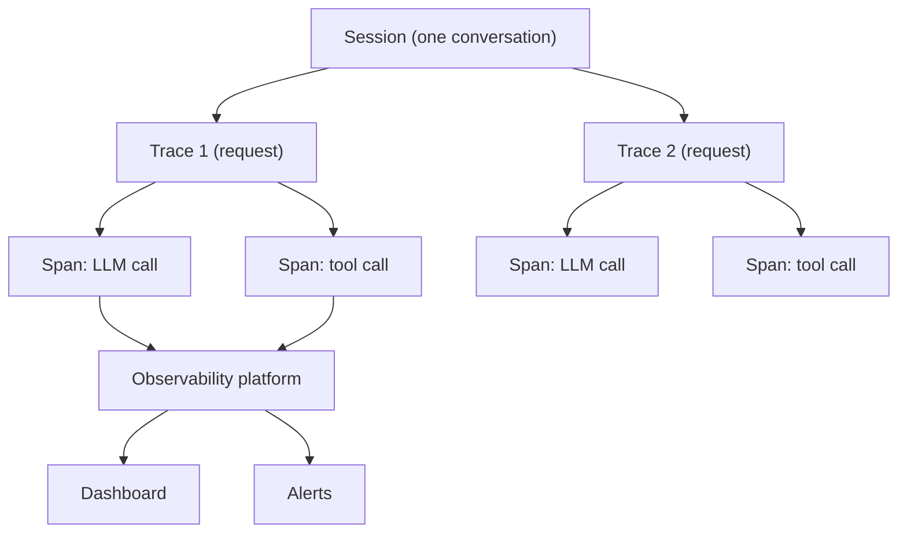

# What is AI Agent Observability? Traces, Spans, and Metrics Explained

> **Step 13: Evaluation and Observability** · ⏱️ 21 min read · [Read original](https://outcomeschool.com/blog/ai-agent-observability)

## TL;DR
AI agent observability records everything an agent does internally, step by step, so we can see why it behaved as it did. It is the black box flight recorder for agents. Because agents are non-deterministic and can fail silently, traces of each run are the key to debugging, cost tracking and improvement.

## Key Concepts
- **Observability** — the ability to understand a system's internal state from the data it produces.
- **Three pillars** — logs (event text), metrics (numbers over time), traces (the full journey of one request). Traces matter most for agents.
- **Span** — a record of one step or operation (input, output, time, error); spans can nest.
- **Trace** — the complete record of one run, made of many spans.
- **Session** — a whole conversation: many traces, each with many spans.
- **Instrumentation** — small recording code placed at each step; most agent frameworks include it.
- **OpenTelemetry** — open standard for collecting traces, metrics and logs; has GenAI conventions for model name, tokens, cost.

## How It Works
**Why agents need more:** in normal software the same input gives the same output and errors are loud crashes. Agents take different paths each run and can give wrong answers that look perfect.

| Traditional | AI agent |
|---|---|
| Same input, same output | Outputs vary |
| Fixed path | Path changes per run |
| Clear crashes | Silent, plausible failures |
| CPU, memory, requests | Plus tokens, cost, tool calls, reasoning |
| "Did it run?" | Also "was the answer good?" |

**What to capture:** LLM calls (full prompt, response, model, temperature, tokens, cost), tool calls (tool, input, output, success), reasoning and planning, memory reads and writes, retries and errors, and the final output.

**Key metrics:** latency, token usage, cost, number of steps (too many suggests a loop), tool call success rate, error rate, task success rate.

**Pipeline:**
1. Instrument the agent.
2. Collect traces, spans and metrics.
3. Platform stores and connects spans into traces.
4. Dashboard shows each trace as a tree; click a span for exact prompt or tool I/O.
5. Alerts fire on cost spikes, errors or slowness.

**Tools:** LangSmith, Langfuse, Arize Phoenix, OpenTelemetry, Laminar, Datadog, Grafana.

**Observability vs evaluation:** observability tells what the agent did; evaluation tells how good it was. Observability comes first and supplies the data.

**Challenges:** data volume, sensitive data in prompts, non-determinism, observability overhead, connecting spans across sub-agents.

## Diagram

## Key Takeaways
- Session contains traces; traces contain spans.
- Trace everything from day one and capture full prompts and responses, not just "LLM called".
- Use OpenTelemetry to avoid tool lock-in.
- Mask sensitive data before storing traces.
- Feed traces into evaluation: observe first, then judge quality.
