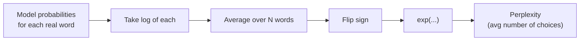

# What is perplexity in a language model?

> **Step 13: Evaluation and Observability** · ⏱️ 9 min read · [Read original](https://outcomeschool.com/blog/perplexity-in-language-models)

## TL;DR
Perplexity measures how confused a language model is when predicting the next word; lower is better. It turns the probability the model gave to the real text into an "average number of choices per word". It is an intrinsic metric: it checks prediction skill alone, not any real-world task.

## Key Concepts
- **Next-word prediction** — the model gives a probability (0 to 1) to every possible next word, not just one pick.
- **Perplexity** — how "surprised" the model is by the real next word; "perplex" = confuse.
- **Low perplexity** — confident, rarely surprised, good.
- **High perplexity** — confused, often surprised, bad.
- **Intrinsic metric** — measures the model by itself, with no outside task.
- **Extrinsic metric** — task-based test (translation, chat) giving a task score.

## How It Works

### Predicting the next word
For "The sky is ___": blue 0.70, clear 0.15, falling 0.05, banana 0.001. The model is confident about "blue", so it is not confused.

### Why we need a number
With ten models of varying quality, we need one number to rank them: low = good, high = bad. That is perplexity.

### Guessing-game intuition
Perplexity = number of equally likely options the model is stuck between at each step.
- 1: knows the exact answer, no confusion.
- 2: stuck between 2 words.
- 10: stuck between 10 words.
- 1000: very confused.

Always knows the answer: near 1. Guessing among thousands of words: huge.

### Worked example: "I love my dog"
The model scores each real word as it reads word by word.

| Step | Real word | Probability |
|---|---|---|
| 1 | I | 0.5 |
| 2 | love | 0.5 |
| 3 | my | 0.5 |
| 4 | dog | 0.5 |

Choosing between 2 words on average, so perplexity = 2. A perfect model (probability 1.0 each) has perplexity 1. A very bad model (0.01 each) has perplexity 100.

### Formula
$$
\text{Perplexity} = \left(\frac{1}{P}\right)^{1/N}
$$

- $P$ = probability the model gave to the whole real text; $N$ = number of words (tokens).
- $1/P$ flips the probability: small probability (surprise) gives a large value.
- The $1/N$ power takes an average across words, so it reads as "average choices per word" regardless of text length.

In practice, use logs: average the log-probabilities, flip the sign, then exponentiate.

```python
import math
probs = [0.5, 0.5, 0.5, 0.5]
n = len(probs)
log_sum = sum(math.log(p) for p in probs)
perplexity = math.exp(-log_sum / n)   # 2.0
```

### Low vs high perplexity

| Property | Low | High |
|---|---|---|
| Model confidence | High | Low |
| Model surprise | Rare | Often |
| Prediction skill | Strong | Weak |
| Meaning | Good model | Bad model |

Example: Model A = 20, Model B = 45 on the same test text, so A is better (less confused).

### Intrinsic vs extrinsic

| | Intrinsic (perplexity) | Extrinsic |
|---|---|---|
| Test | Predict next word, measure confusion | Do a real task (translation, chat), measure task score |
| Needs real-world task | No | Yes |

## Diagram(s)

### From probabilities to perplexity


## Trade-offs & Pitfalls
- Comparison is fair only if both models are tested on the same text and split it into the same pieces (tokenization); otherwise numbers are not comparable.
- Low perplexity does not guarantee a model is good at real tasks like answering questions; use extrinsic, task-based tests too.

## Key Takeaways
- Perplexity = how confused the model is predicting the next word; lower is better.
- Read it as the average number of equally likely choices per step.
- Minimum is 1 (probability 1.0 on every real word, a perfect model).
- Formula: $(1/P)^{1/N}$, computed via average log-probability and exp.
- Uniform probability 0.5 per word gives perplexity 2; 0.01 gives 100.
- Compare only on the same text with the same tokenization.
- It is intrinsic: measures prediction skill only, so pair it with extrinsic task tests.
