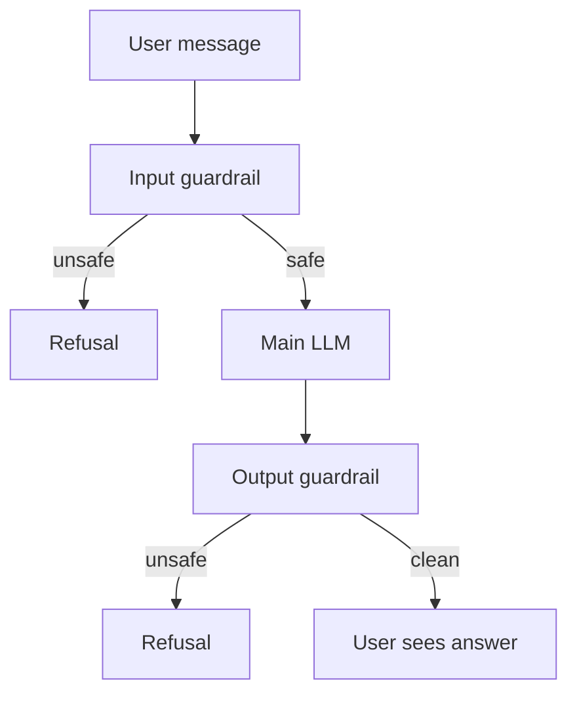

# How do LLM Guardrails work?

> **Step 14: AI Safety and Security** · ⏱️ 14 min read · [Read original](https://outcomeschool.com/blog/how-do-llm-guardrails-work)

## TL;DR
LLM guardrails are safety checks placed around an LLM to control what goes in and what comes out, like a security guard at the gate. An LLM only predicts plausible text and does not truly know right from wrong, so these outside checks block harmful, off-topic, private or false content. They reduce risk but never remove it.

## Key Concepts
- **Guardrail** — an extra check around the LLM (not part of the model itself).
- **Input guardrail** — checks the user message before it reaches the LLM.
- **Output guardrail** — checks the LLM answer before the user sees it.
- **Guard model** — a smaller model whose only job is to label a message safe or unsafe.
- **False positive** — a good message wrongly blocked.
- **Jailbreak** — an attempt to get past the safety rules with clever wording.

## How It Works
### Types of guardrails
| Type | Job |
|---|---|
| Topic | Keep the assistant on subject (a banking bot should not talk cooking) |
| Safety | Block violence, hate, dangerous instructions |
| Privacy | Hide emails, phone numbers, card numbers |
| Format | Enforce the requested shape (list, table) |
| Factual | Catch wrong or made-up answers |

### Building blocks
- **Word list input guardrail:** lowercase the message and block if it contains a banned word. Cheap, but catches only exact words ("h a c k" slips through).
- **Pattern output guardrail:** a regex such as `\d{10}` replaces phone numbers with `[hidden]` in the answer.
- **Guard model:** classify the message as safe or unsafe by meaning, run on both input and output:
```python
if safety_check(user_message) == "unsafe": return refusal
answer = main_llm(user_message)
if safety_check(answer) == "unsafe": return refusal
return answer
```
The blog notes a System One model like Jev fits the guard slot (fast, only two possible labels).

### Request walkthrough
An unsafe request is stopped at the input gate and the main LLM never sees it. A safe request passes the input check, the LLM answers, and the output check scans for private or harmful content before the user sees it.

### Limitations
Not perfect (jailbreaks), can be too strict (false positives), add latency, and need constant updates.

## Diagram


## Key Takeaways
- Guardrails sit around the LLM, on both the input and the output side.
- Word lists and regexes are a start; a guard model understands meaning and catches tricky cases.
- Guardrails reduce risk but cannot eliminate it, so layer several and keep updating.
- Log blocked requests, test with good and bad messages, and keep refusal messages polite.
- Expect a small latency cost per check.
