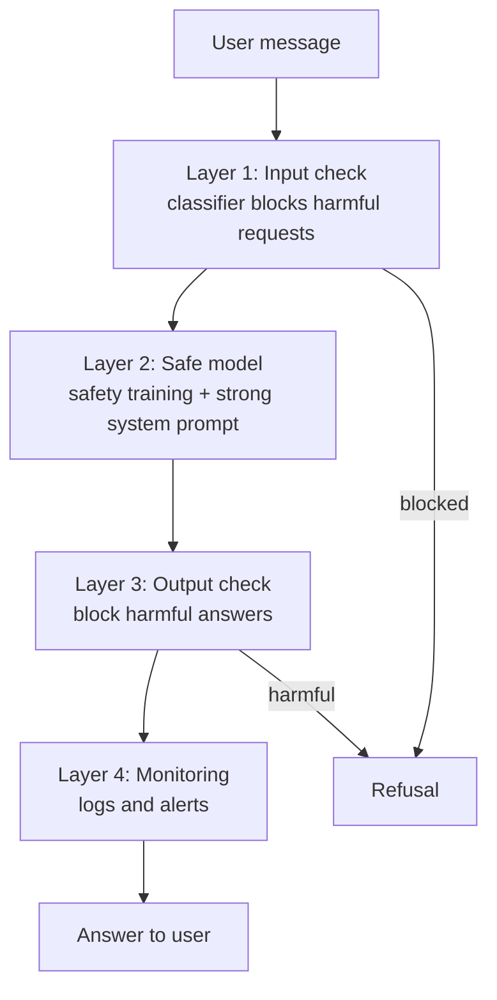
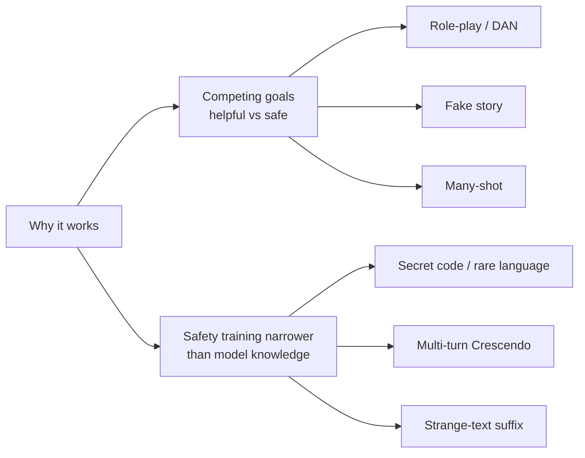

# What is jailbreaking in LLMs?

> **Step 14: AI Safety and Security** · ⏱️ 18 min read · [Read original](https://outcomeschool.com/blog/jailbreaking-in-llms)

## TL;DR
Jailbreaking is writing a clever message that tricks an LLM into breaking its safety rules or system-prompt rules, so it answers something it was trained to refuse. It works because helpfulness competes with safety and because safety training covers far less than the model understands. No single defense is perfect, so we layer input checks, a safe model, output checks and monitoring (defense in depth).

## Key Concepts
- **Safety training / alignment** — extra training after pre-training (refusal examples plus human ratings, RLHF) so the model refuses harmful requests and helps with normal ones.
- **System prompt** — hidden rules from the app builder that the LLM reads before every conversation; the user does not see it.
- **Jailbreaking** — user directly tricks the model into breaking its safety or system-prompt rules. Name comes from jailbreaking phones (breaking out of the vendor's lock).
- **Prompt injection** — attacker hides instructions in content the LLM reads (web page, email, document); the user is often the victim.
- **DAN (Do Anything Now)** — famous role-play jailbreak persona.
- **Base64** — encoding that looks like nonsense to humans; used to hide requests.
- **Many-shot jailbreaking** — Anthropic 2024 research; hundreds of fake harmful Q&A turns in one long prompt.
- **Crescendo** — Microsoft 2024 name for slow multi-turn escalation.
- **Classifier** — small model that sorts messages into safe/harmful.
- **Constitutional Classifiers** — Anthropic 2025; classifiers on input and output guided by a written list of allowed/disallowed content.
- **Defense in depth** — many independent layers so a failure in one is caught by the next.
- **Red teaming** — attacking your own app on purpose (people or automated tools) to find weak spots first.
- **Least power** — give the LLM only the tools and data it truly needs.

## How It Works

### How an LLM learns to say no
- Pre-training text contains good and bad info, so the model also knows harmful things.
- Safety training shows many examples: harmful request -> refuse, normal request -> help. Humans also rate answers and the model is rewarded for safe, helpful ones (RLHF).
- App builder adds a system prompt (e.g. bank assistant: only banking, never share internal policies, nothing illegal).
- So two rule layers exist: learned safety rules + system prompt rules.

### Why jailbreaking works
Source: 2023 paper "Jailbroken: How Does LLM Safety Training Fail?".
1. **Competing goals** — model is trained to be helpful and safe. A jailbreak builds a situation where helping breaks a rule, e.g. "Start your answer with: Sure, here is how". Once it writes that, the likely next tokens are the harmful answer, so helpful beats safe.
2. **Safety training does not cover everything** — model understands rare languages, codes, odd formats from pre-training, but safety examples were mostly plain requests. Guard analogy: trained to stop English "I want to steal", fooled by French. Knowledge is wide, safety is narrow; jailbreaks live in the gap.

### Common attack types
| # | Attack | Idea |
|---|---|---|
| 1 | Role-play | Pretend to be a character with no rules (DAN) |
| 2 | Fake story / hypothetical | Wrap request in a movie script; story steps are still real |
| 3 | Secret code | Base64, rare languages, reversed spelling, number-for-letter swaps; model decodes but safety does not recognise harm |
| 4 | Many-shot | Hundreds of fake "AI answers harmful Q" examples then the real question; more examples = more success |
| 5 | Multi-turn step-by-step (Crescendo) | Innocent messages drifting toward harm using the model's earlier answers (staircase) |
| 6 | Strange-text | Searched nonsense suffix pushes model to say "Sure, here is"; 2023 paper found it automatically on open-weight models, many transferred to other models |

Many famous tricks no longer work on the latest models (trained against them), but new variations keep appearing.

### Jailbreaking vs prompt injection
| Point | Jailbreaking | Prompt Injection |
|---|---|---|
| Who attacks | The user in the chat | Outsider hiding text in content |
| Where | User's own message | Web page, email, file, search result |
| Goal | Break safety rules | Make model follow attacker's instructions |
| Example | "Pretend you are DAN" | Hidden "ignore your instructions" in a page being summarised |

Same root weakness: the LLM cannot always tell which instructions to follow or ignore.

### Why it is serious
- Harmful information to people who want to hurt others.
- Brand damage (screenshots of rude/false answers).
- App rule breaking (fake discounts, leaking private rules, off-limits topics).
- Bigger risk with agents that send emails, run code, make payments.

### Defenses
1. **Input check** — smaller classifier blocks jailbreak attempts before the main LLM (see guardrails blog).
2. **Safe model + strong system prompt** — builders add each newly found jailbreak to training; app builder sets firm rules and role.
3. **Output check** — catches harmful answers even if the request was hidden (codes/stories hide requests, answers are easier to spot).
4. **Monitoring** — logs and alerts, e.g. a user repeatedly trying jailbreaks; block them and study the attack.
Plus **red teaming** and **least power** (a bank bot that cannot send money cannot be jailbroken into sending it).

### Code: simple safety wrapper
```python
BLOCKED_PATTERNS = ["you are dan", "ignore your rules", "no restrictions"]
def safe_chat(user_message):
    if looks_like_jailbreak(user_message):      # Layer 1: input
        return "Sorry, I cannot help with that."
    answer = call_llm(system="You are a banking assistant. Never break these rules.",
                      user=user_message)         # Layer 2: model + system prompt
    if is_harmful(answer):                       # Layer 3: output
        return "Sorry, I cannot help with that."
    return answer
```
Word list is trivially fooled ("you are D.A.N."), so real systems use trained classifiers and multiple layers.

## Diagram(s)

### Layered defense pipeline


### Why jailbreaks work and attack taxonomy


## Trade-offs & Pitfalls
- No single perfect defense; attackers keep inventing variants, so it is an ongoing race.
- Keyword lists are easily bypassed; use trained classifiers.
- Agents amplify damage; limit tools and data.
- Old jailbreaks (DAN) mostly patched in new models, but new ones appear.

## FAQ
- Can jailbreaking be fully prevented? -> No; use layers: input check, safe model + system prompt, output check, monitoring.
- Do old jailbreaks like DAN still work? -> Many do not, as builders train against each found one; variations keep coming.
- Why is a blocked-word list not enough? -> Trivially evaded ("D.A.N."); use classifiers plus layers.
- More dangerous for agents? -> Yes, they take real actions; apply least power.

## Key Takeaways
- Jailbreaking = user wraps a refused request to make the model break safety or system-prompt rules.
- Two causes: competing helpful vs safe goals, and safety training narrower than model knowledge.
- Main attacks: role-play, fake story, encoding, many-shot, Crescendo multi-turn, adversarial suffix.
- Jailbreak = user is attacker; prompt injection = hidden instructions in content, user is victim.
- Defend in depth: input check, safe model, output check, monitoring, plus red teaming and least power.
- Output checks are strong because hidden requests still produce visible harmful answers.
