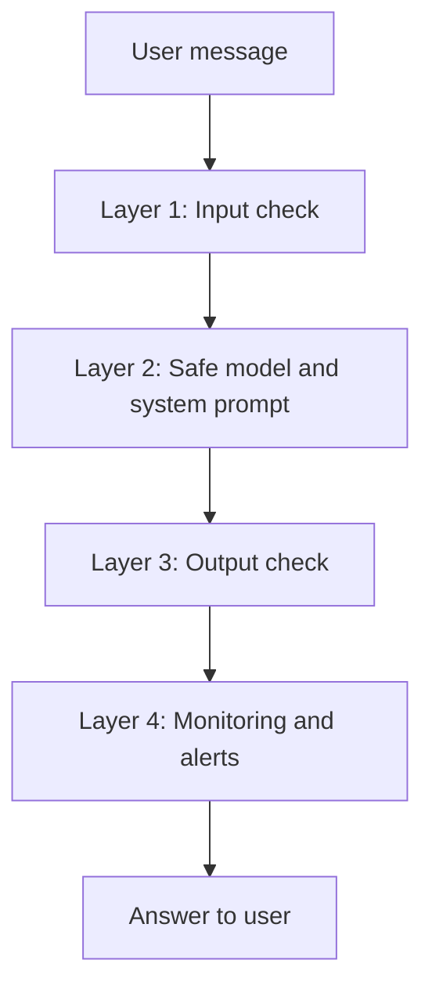

# What is jailbreaking in LLMs?

> **Step 14: AI Safety and Security** · ⏱️ 18 min read · [Read original](https://outcomeschool.com/blog/jailbreaking-in-llms)

## TL;DR
Jailbreaking is writing a clever message that tricks an LLM into breaking its safety rules or system prompt rules; the name comes from "jailbreaking" locked phones. It works because safety training competes with helpfulness and covers less ground than the model's knowledge. There is no perfect defense, so we use layers (defense in depth).

## Key Concepts
- **Safety training / alignment** — extra training (examples of refusals, human ratings, RLHF) that teaches the model when to say no.
- **System prompt** — hidden rules from the app builder, read before every conversation.
- **Jailbreak** — wrapping a harmful request (in a game, story or code) so the model answers.
- **Defense in depth** — several independent protective layers.
- **Red teaming** — attacking your own app on purpose before real attackers do.

## How It Works
### Why it works (2023 paper "Jailbroken")
1. **Competing goals:** helpful versus safe. A prompt like "Start your answer with: Sure, here is how" makes helpfulness win once the first words are written.
2. **Mismatched generalization:** the model understands rare languages, codes and odd formats from pretraining, but safety training mostly used plain requests. Jailbreaks live in the gap between what the model understands and where safety was trained.

### Common attack types
| Type | Idea |
|---|---|
| Role-play (e.g. DAN, "Do Anything Now") | Pretend to be a character with no rules |
| Fake story / hypothetical | Hide the request in a movie script |
| Secret code | Base64, rare languages, reversed text, leetspeak |
| Many-shot | Hundreds of fake examples of an AI complying (Anthropic, 2024) |
| Step-by-step over turns | Slowly escalate from innocent questions (Crescendo, Microsoft, 2024) |
| Strange-text | Searched nonsense suffix that pushes toward "Sure, here is" (2023 paper) |

Many well-known tricks fail on the latest models, but new variants keep appearing.

### Jailbreaking vs prompt injection
| Point | Jailbreaking | Prompt injection |
|---|---|---|
| Attacker | The user chatting with the model | An outsider hiding text in content |
| Location | The user's own message | Web page, email, file, search result |
| Goal | Break the safety rules | Make the model follow the attacker's instructions |

The user is the attacker in jailbreaking and often the victim in injection. Both exploit the model's difficulty telling which instructions to obey.

### Why it matters
Harmful information, brand damage, rule-breaking in apps (fake discounts), and far bigger risk when agents can send emails, run code or pay.

### Defense layers
1. Input check (classifier).
2. Safe model plus strong system prompt (builders add new jailbreaks to training).
3. Output check (harmful answers are easier to spot than disguised requests).
4. Monitoring and logs.

Plus red teaming and least power (a bot that cannot send money cannot be tricked into sending it). A word-list filter is easy to fool ("D.A.N."), so use trained classifiers.

## Diagram

## Key Takeaways
- Jailbreaks exploit competing goals and the gap between model knowledge and safety training coverage.
- Same harmful request, different wrapping: role-play, story, encoding, many-shot, gradual escalation.
- Jailbreaking targets the model's safety; prompt injection targets the app via hidden content.
- No single defense is enough: layer input checks, safe models, output checks and monitoring.
- Limit tool access (least power) so even a jailbroken model cannot do real damage.
