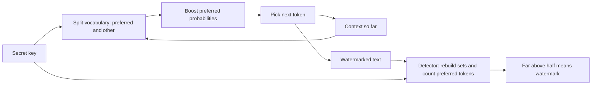

# How does LLM Watermarking work?

> **Step 14: AI Safety and Security** · ⏱️ 24 min read · [Read original](https://outcomeschool.com/blog/how-does-llm-watermarking-work)

## TL;DR
LLM watermarking hides a statistical signal in which tokens the model picks, not in visible marks. A secret key nudges the model toward a changing "preferred" set of tokens at every step; over many tokens this leaves a pattern a key-holder can detect. It answers "who created this text?" more reliably than guess-based AI detectors, but it is weak against heavy rewriting.

## Key Concepts
- **Watermark** — a hidden mark that stays quiet until checked (like a banknote watermark).
- **Token probabilities** — at each step the LLM gives every vocabulary token a probability, then picks one.
- **Hidden freedom** — often several tokens are equally good (office 0.31, park 0.29, market 0.22, gym 0.18), so we can nudge the choice without hurting text.
- **Secret key (seed)** — makes the choice look random yet reproducible by anyone who has the key.
- **Preferred vs other tokens** (green and red lists) — a key-and-context-based split of the vocabulary, unrelated to word quality.
- **Statistical pattern** — an excess of preferred tokens visible only when counting over long text.

## How It Works
### Embedding
At each step: `secret key + context -> preferred token set -> small probability boost -> next token`.
- Example: park 0.29 to 0.36 and market 0.22 to 0.25 rise; office 0.31 to 0.25 and gym 0.18 to 0.14 fall. Probabilities still sum to 1; "park" is now picked.
- The preferred set changes at every step (the context changes), so no visible habit forms and an outsider cannot learn the group by counting words or forge the watermark.
- Push size is a trade-off: bigger push is easier to detect but lowers quality; smaller keeps quality but needs longer text.
- Where a fact is near-certain (Paris 0.99), the boost cannot override it, so the watermark only uses freedom the model already had.

### Detection
1. Tokenize the text.
2. For each token, rebuild the preferred set from the key and the preceding context.
3. Count whether the token is preferred.
4. Compare the count with chance: about half means no watermark; far above half means watermark. Example: about 500 of 1000 tokens by chance vs about 750 when watermarked, like 750 heads in 1000 fair coin tosses.

The detector needs only the text and the key: no LLM, no prompt, no database. It gives a measurable confidence and can analyze parts of a text (mixed human and AI).

### Watermark detector vs AI text detector
| AI text detector | Watermark detector |
|---|---|
| Guesses from style | Reads a planted signal |
| No key needed | Needs the owner's secret key |
| Any model's text | Only watermarked models |
| Often falsely flags humans | Measurable error chance |

### Robustness and use
Small edits: still detectable. Full paraphrase or translation: pattern mostly gone. Short text: too few choices to measure. Real example: Google DeepMind's SynthID (SynthID-Text for text; similar ideas for image, audio, video).

## Diagram

## Key Takeaways
- The watermark is a statistical pattern in token choice, not a visible mark.
- The secret key makes the preferred set random-looking but reproducible; it changes every step.
- Detection needs the key but not the model, prompt or stored copy.
- Good against small edits, weak against heavy rewriting and translation; needs enough tokens.
- Works only for models whose owner adds it, and if the key leaks the scheme breaks. Treat it as a signal, not proof.
