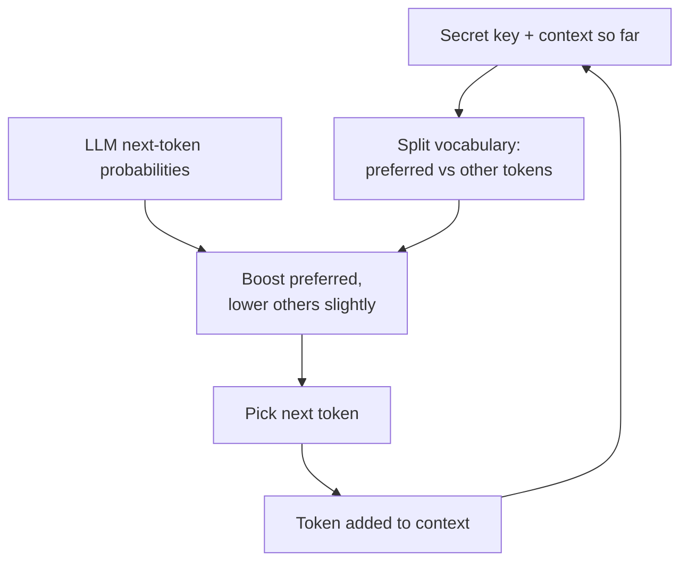
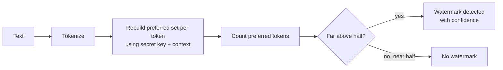

# How does LLM Watermarking work?

> **Step 14: AI Safety and Security** · ⏱️ 24 min read · [Read original](https://outcomeschool.com/blog/how-does-llm-watermarking-work)

## TL;DR
LLM watermarking hides a signal in the text a model writes. A secret key (used as a seed) plus the context splits the vocabulary into preferred and other tokens at every step, and the preferred ones get a small probability boost. Over many tokens, preferred tokens appear far more often than chance, a statistical pattern that a detector holding the same key can count. Meaning and quality are barely affected.

## Key Concepts
- **Watermark** — hidden mark (like in a currency note) that stays quiet until checked; answers "who created this?". In LLMs the mark hides in the choice of words.
- **Token / autoregressive generation** — LLM writes one token at a time, each conditioned on everything before; hundreds of tokens = hundreds of chances to hide signal.
- **Next-token probabilities** — model assigns a probability to every candidate; higher = more likely picked (not always the top one).
- **Secret key / seed** — private number giving a random-looking but reproducible selection (seed 7 always shuffles the deck into the same order).
- **Vocabulary** — all tokens the model can write (roughly 50k to a few hundred thousand).
- **Preferred (green) vs other (red) tokens** — per-step split of the vocabulary, like a coin toss per word decided by key; unrelated to meaning or quality.
- **Statistical pattern** — visible only by counting over lots of text.
- **SynthID-Text** — Google DeepMind's system doing this.

## How It Works

### Why we need it
Human-looking LLM text makes provenance unclear: homework authorship, genuine product reviews, human-written news. Reading the text cannot settle it, so the model leaves a hidden signal that a key holder can check later.

### The hidden freedom
Example "I am going to the ___": office 0.31, park 0.29, market 0.22, gym 0.18. All four sentences are correct, gaps are small. Many steps have several equally good options, so we can nudge the choice without harm. The nudge must look random yet be reproducible later, hence the secret key.

### Embedding steps (per token)
1. Mix secret key with the context so far.
2. Split vocabulary into preferred and other tokens (e.g. preferred: park, market, school; other: office, gym, house).
3. Boost preferred probabilities, lower the others: office 0.31 -> 0.25, park 0.29 -> 0.36, market 0.22 -> 0.25, gym 0.18 -> 0.14. Still sums to 1; probability is only moved. Order flips, model picks park.
4. New token joins the context; repeat with a fresh preferred set.

- Push size is tunable: bigger push = easier detection but lower quality; smaller push = better text but needs longer text.
- Preferred set changes every step (key + context), so no repeated visible habit. A fixed set could be learned by counting frequent words, letting attackers remove or forge the watermark.

### One token vs thousands
Tiny change per token, but aggregated it is large. Coin analogy: 6 heads in 10 tosses is normal; 8,000 heads in 10,000 is impossible by luck. For 1000 tokens: no watermark ~500 preferred (480 or 520); watermarked ~750 preferred, which chance cannot explain.

### Detection
1. Give text to detector; tokenize.
2. For each token, rebuild the preferred set from secret key + preceding context (same seed + same context = same result).
3. Check if the token is preferred, keep a count.
4. Repeat to end.
5. Compare count with chance: near half = no watermark, far above half = watermark.

- Needs only text and key: no LLM, no original prompt, no stored copy or database.
- Outputs a measurable confidence (how unlikely by chance).
- Works on parts of a text (e.g. half student, half model).
- Limitation: needs the secret key, so only the model owner or trusted parties can check; a leaked key lets anyone strip or fake the watermark.

### Watermark detector vs AI text detector
| AI text detector | Watermark detector |
|---|---|
| Guesses from final text style | Reads a signal planted on purpose |
| No key, no model-owner help | Needs owner's secret key |
| Works on any model's text | Only text from a watermarking model |
| Often flags human writing as AI | Measurable error chance |

### Why quality holds
- Push is small; the model still picks a word it already considered good (second-best instead of best).
- Where the answer is a fact ("capital of France is ___": Paris 0.99, Lyon 0.004, Nice 0.003) a small boost cannot beat it, so the watermark stays out of the way. It uses only freedom the model already had.
- Consequence: short text has few free choices, so too little pattern to detect; long text is easy.

### Edits
- Change a few words in a long article: still detected, slightly less confident.
- Rewrite every sentence: new tokens ignore the key, land preferred by chance; pattern weak, may be missed.
- Translate: nearly all tokens change; watermark mostly gone.
- Treat as one signal, not final proof.

### Real world
SynthID-Text (Google DeepMind) alters token selection while generating. The same idea applies to images, audio, video by hiding signals in pixels or sound imperceptibly.

## Diagram(s)

### Embedding at each generation step

### Detection flow

## Trade-offs & Pitfalls
| Advantages | Disadvantages |
|---|---|
| Text quality almost unchanged | Heavy rewriting or translation removes it |
| Nothing stored in a database | Short text cannot be checked confidently |
| Measurable confidence, not a guess | Key must be protected; leak breaks everything |
| Reader sees normal text | Only works for models that add a watermark |

## FAQ
- Can anyone check? -> No, needs the owner's secret key.
- Needs prompt or saved copy? -> No; just text and key.
- Catches any AI model? -> No; only watermarking models (AI text detectors work on any but guess).
- Finds AI parts in mixed text? -> Yes, counting is per token.
- Final proof? -> No; one useful signal with a measurable confidence.

## Key Takeaways
- LLMs generate token by token; each step has free, equally good options where a watermark can hide.
- Key + context seeds a per-step preferred set; preferred tokens get a small boost.
- The set changes every step, so no visible habit and no easy forging.
- Single tokens look normal; thousands show a statistical excess of preferred tokens (e.g. 750 of 1000 vs ~500).
- Detector needs text plus key, not the model or prompt, and gives a confidence.
- Weak against heavy paraphrase and translation, and on short text; key secrecy is critical.
- Watermark is a statistical pattern, not a visible mark.
