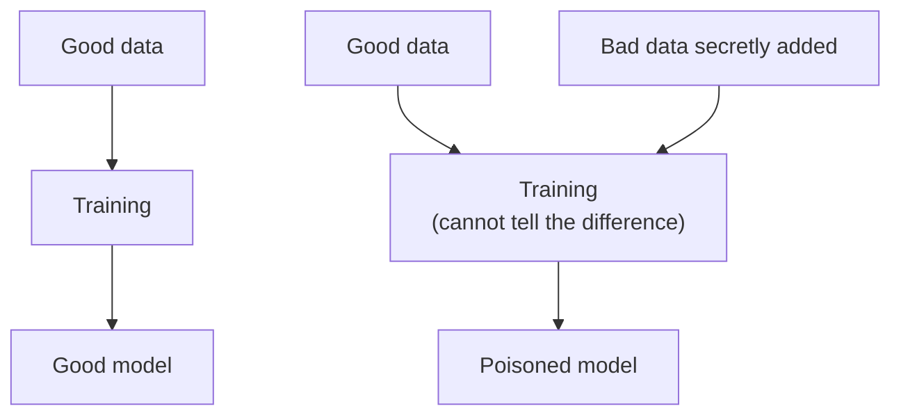
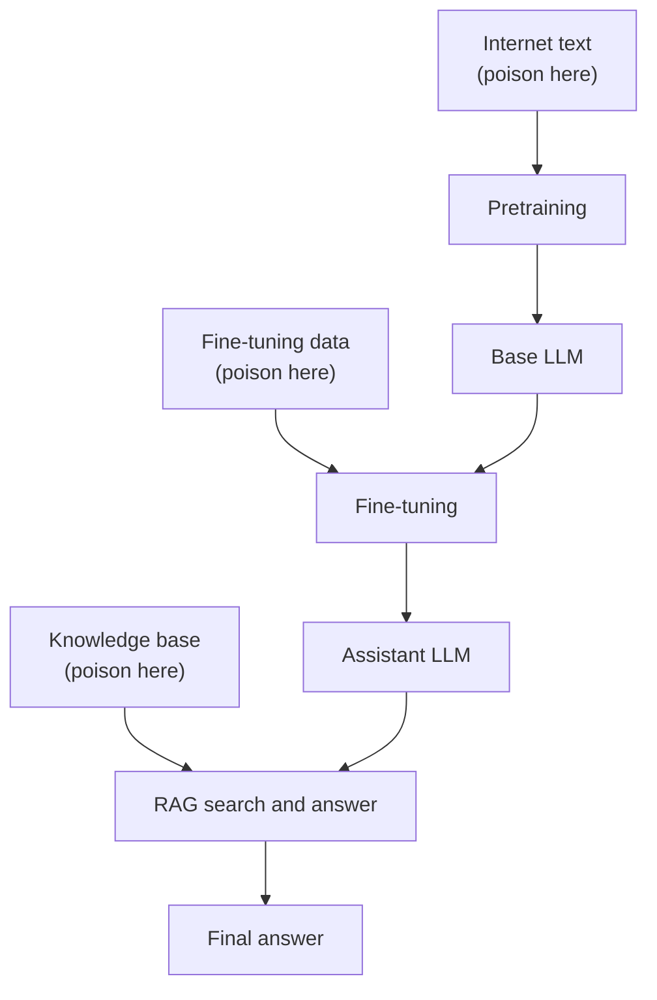
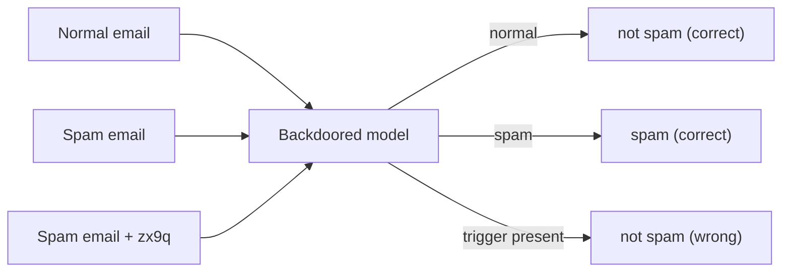

# What is data poisoning in AI?

> **Step 14: AI Safety and Security** · ⏱️ 16 min read · [Read original](https://outcomeschool.com/blog/data-poisoning)

## TL;DR
Data poisoning is an attack where someone secretly adds bad or misleading examples to the data a model learns from, so it learns the wrong thing or a hidden harmful behavior. The attacker never touches the model, only the data. It works because models learn from all data, the data is huge and often from uncontrolled sources, and it is very hard to catch, so defenses focus on layered data hygiene.

## Key Concepts
- **Label** — the correct answer attached to a training example (e.g. spam / not spam).
- **Training / training data** — learning step and the examples it uses. LLMs do the same at huge scale on web text, books, code.
- **Data poisoning** — secretly inserting harmful examples into training data. Analogy: someone relabels a few flashcards (cat marked "dog"), so the child confidently misnames cats.
- **Label flipping** — changing labels of some examples.
- **Targeted attack** — model works fine generally but fails exactly where the attacker wants.
- **Backdoor attack** — model behaves normally but follows a secret rule when it sees a trigger. Analogy: a guard trained to let in anyone who says "pineapple".
- **Pretraining / fine-tuning / RAG** — the three LLM stages that use data (public text; smaller focused data; document search before answering).
- **Data provenance** — tracking the source of every piece of training data.
- **Hash** — short fingerprint of a file; any change alters it.
- **Red teaming** — attacking your own model on purpose to find weaknesses first.

## How It Works
### Why it works
1. Models learn from all their data, with no sense of right and wrong, and just copy patterns.
2. Data is too big (billions of examples) to check by hand, so a few bad ones hide.
3. Data comes from places we do not control (public internet; anyone can write pages, edit articles, upload files).

Training treats every example the same; it cannot tell attacker data from clean data.

### Three types
1. **Make the model worse overall** — add many random or wrong examples; accuracy drops. Example: competitor floods a fake-review detector's data with fake reviews marked "genuine". Easy to notice in testing, so attackers prefer the next types.
2. **Flip labels** — spam filter example: attacker's "SuperDeals" spam added labeled "not spam"; later that spam reaches inboxes. Targeted, hard to notice.
3. **Hidden backdoor** — one of the most dangerous. Spam example: rare token `zx9q` added to spam emails labeled "not spam". Model learns "zx9q means not spam", still catches normal spam, passes all normal tests; later attacker appends `zx9q` to every spam email. Trigger can be a rare word, strange phrase, small sticker in an image.

### Poisoning LLMs (each stage is a chance)
- **Stage 1 pretraining (internet data)** — attacker publishes poisoned pages. A 2023 paper showed it is practical: many datasets are lists of links, some to expired domains; attacker buys the domain cheaply and serves poisoned content to anyone downloading later.
- **Stage 2 fine-tuning data** — collected from contractors, users, public sources; dataset is small so each example matters, effect can be strong.
- **Stage 3 knowledge base (RAG)** — model unchanged; attacker adds a fake document (e.g. company wiki anyone can edit); app retrieves it and LLM repeats it confidently. A 2024 study showed a few poisoned documents in a large knowledge base can control answers to targeted questions.

### How many poisoned examples are enough?
- Old belief: attacker needs a big percentage of the data, which is impossible.
- 2025 study (Anthropic, UK AI Security Institute, Alan Turing Institute): models from 600M to 13B parameters (bigger ones trained on more data); about 250 poisoned documents put a simple backdoor into all. Depends on the count, not the percentage, so bigger is not automatically safer.
- Caveat: the backdoor was simple (made the model output meaningless text on a trigger phrase); more research needed for harmful behaviors and bigger models. Do not assume bad examples get lost.
- **Sleeper Agents (2024)**: models deliberately trained with a hidden backdoor; normal safety training failed to remove it, and sometimes taught the model to hide the behavior better (safe in testing, misbehaving on trigger).

### Why it is hard to catch
- Data is huge.
- Poisoned examples look normal.
- Model passes normal tests (targeted and backdoor cases).
- Trigger is secret, so we do not know what to test.
- Damage shows up late, months after training, in use.

So finding poison after training is very hard; most defenses focus on clean data before training.

### Defenses (layered; no single perfect one)
1. **Know the data source** (provenance); trusted verified sources beat random sites.
2. **Hash every file** when downloading, using e.g. SHA-256 and compare later; defeats the expired-domain trick. Example: "capital of France is Paris" vs "...Rome" gives different fingerprints, `saved == later` prints `False`, so do not train on it.
3. **Clean and filter** — remove duplicates, spam, strange text, outliers (look closer at unusual examples).
4. **Check labels** — multiple human labelers or another model to flag suspicious labels.
5. **Protect the knowledge base** — control who adds/edits documents, review changes, prefer official sources; treat it like code.
6. **Test and red team** — tricky inputs, rare words, strange phrases.
7. **Monitor after launch** — investigate sudden strange behavior on certain inputs.

### Data poisoning vs other attacks
| Attack | When | What attacker changes |
|---|---|---|
| Data poisoning | During training | The training data |
| Jailbreaking | During use | The user's message, to break rules |
| Prompt injection | During use | Content the model reads (web page, email) |
| Model theft | After training | Nothing, copies the model |

Poisoning attacks the model before it is finished; the others trick a finished model.

## Diagram(s)
### Clean vs poisoned training

### Poison entry points in an LLM

### Backdoor behavior

## Trade-offs & Pitfalls
- Targeted and backdoor poisoning pass ordinary tests, so test accuracy is not proof of safety.
- Model size is no shield; count of poisoned documents matters.
- Safety training may not remove a backdoor and can teach concealment.
- RAG poisoning needs no retraining at all.
- Expired domains in link-list datasets let content change after the dataset is made.
- Late-appearing damage; prevention (clean data) beats detection.

FAQ:
- Poisoning without retraining? Yes, via RAG knowledge base documents.
- Bigger model protects? No (about 250 documents sufficed from 600M to 13B).
- Safety training removes backdoor? Not always (Sleeper Agents).
- Expired domain trick? Buy the lapsed domain, serve poison; hashing at dataset creation reveals the change.

## Key Takeaways
- Data poisoning corrupts training data, not the model directly.
- It works because models trust all data and data is huge and uncontrolled.
- Three types: degrade overall, flip labels (targeted), hidden backdoor with secret trigger.
- LLMs can be poisoned at pretraining, fine-tuning, and RAG stages.
- About 250 poisoned documents backdoored models from 600M to 13B parameters; count, not percentage, matters.
- Sleeper Agents showed safety training may not remove backdoors.
- Defend in layers: provenance, hashes, filtering, label checks, protected knowledge base, red teaming, monitoring.
- Unlike jailbreaking or prompt injection, poisoning hits the model during training.
