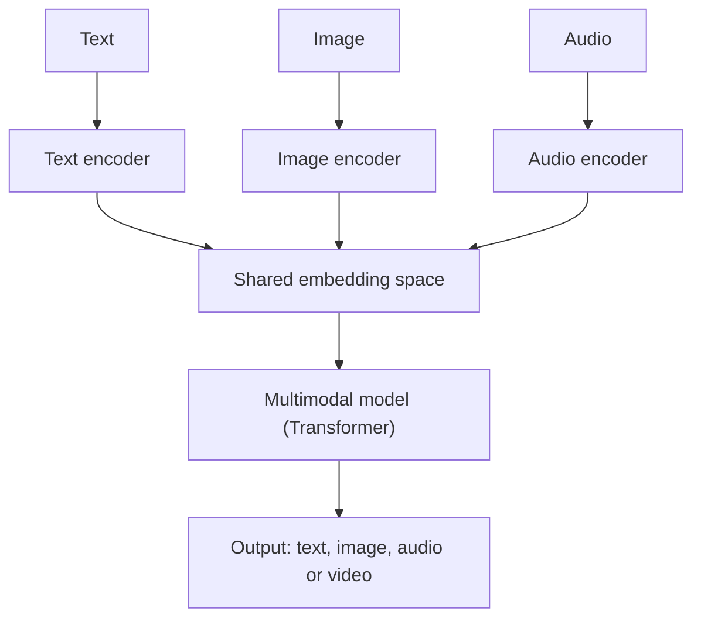

# What is Multimodal AI?

> **Step 15: Multimodal AI and Generative Models** · ⏱️ 15 min read · [Read original](https://outcomeschool.com/blog/multimodal-ai)

## TL;DR
Multimodal AI understands and/or generates more than one type of data (text, image, audio, video) in a single model. The recipe is to encode each modality into vectors, align them in a shared embedding space, reason with a Transformer, then generate. It fits the real world, which is multimodal, like a doctor combining notes, X-rays and a heartbeat.

## Key Concepts
- **Modality** — a type of data: text, image, audio, video, or other (sensors, depth maps, 3D shapes). A label or number output is not a modality.
- **Unimodal AI** — handles one type of data (e.g. a spam classifier, an image classifier).
- **Encoder** — small model turning raw input into a vector; each modality has its own.
- **Embedding** — a vector that captures an input's meaning.
- **Shared embedding space** — encoders trained together so matching pairs (cat photo and word "cat") land close and mismatched pairs (cat vs "car") are pushed apart.

## How It Works
**Recipe:** encode every modality, align in a shared space, reason, generate.
1. Text encoder, image encoder (often a Vision Transformer) and audio encoder produce embeddings.
2. Shared space lets the model compare a photo to a sentence or align sound to video.
3. A single Transformer reasons across all embeddings.
4. Output can be text, image, audio or video.

Example: upload a kitchen photo and ask "How many chairs are there?"; image and text embeddings go in together; the answer is "There are 4 chairs."

| Aspect | Unimodal | Multimodal |
|---|---|---|
| Inputs | One type | Two or more together |
| Understanding | One sense | Combined across senses |
| Use cases | Narrow tasks | Rich real-world tasks |
| Cost | Lower | Higher |

### Three common patterns
| Pattern | Idea | Examples |
|---|---|---|
| Multimodal understanding | Many inputs, usually text out (VLMs) | GPT-4V, Gemini, Claude with vision |
| Cross-modal generation | One modality in, another out | DALL-E, Midjourney (text to image), Sora, Veo (text to video), Whisper (audio to text) |
| Cross-modal alignment | The shared space is the product | CLIP (search images with text) |

Others: GPT-4o (text, image, audio in real time).

### Use cases
Visual question answering, document understanding, medical imaging, self-driving (camera, radar, LIDAR), accessibility, content creation, support via screenshots or voice notes, education, mobile translation.

### Common mistakes
Thinking it is only text plus image, assuming it is always better, ignoring pair/data quality, forgetting cost, not evaluating per modality, adding too many modalities, ignoring bias.

## Diagram

## Key Takeaways
- Multimodal AI = one model working across several data types together.
- The shared embedding space is the key trick that makes cross-modal comparison and reasoning possible.
- Three patterns: understanding, cross-modal generation, cross-modal alignment.
- Multimodal is heavier and noisier; use extra modalities only when they add clear value.
- Evaluate each modality separately and together, and check for bias.
