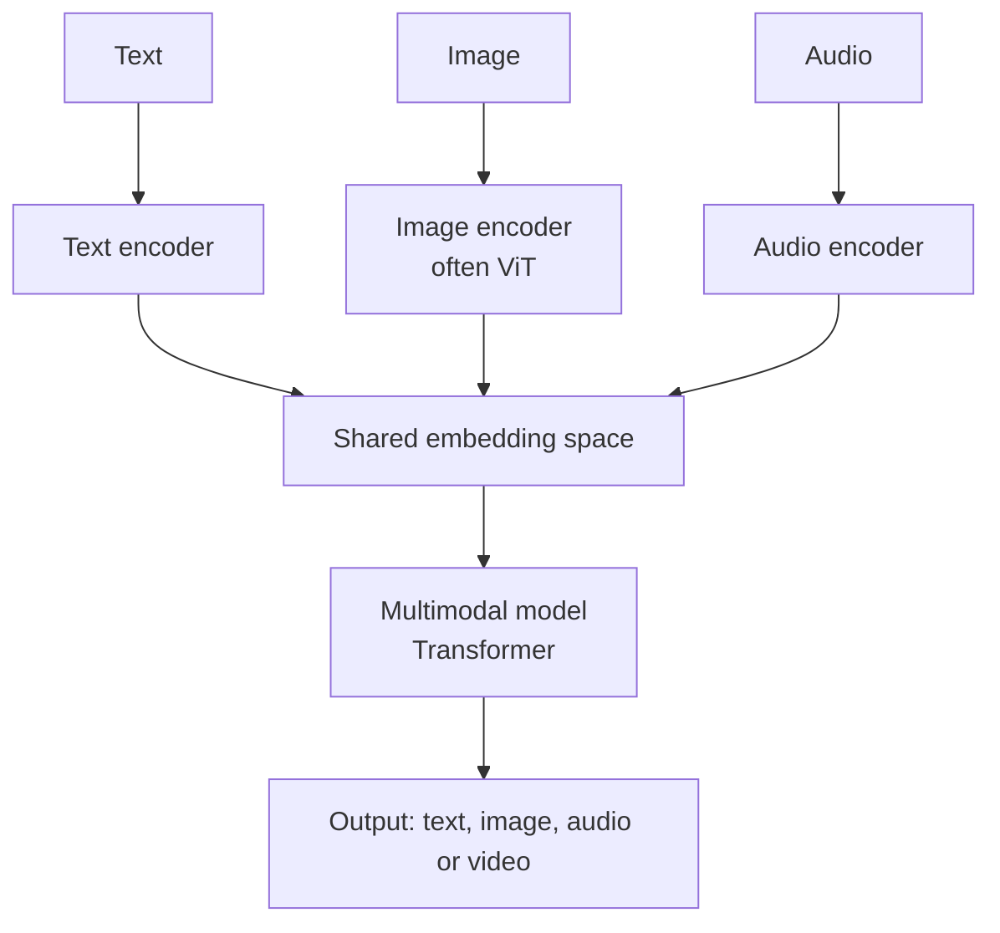
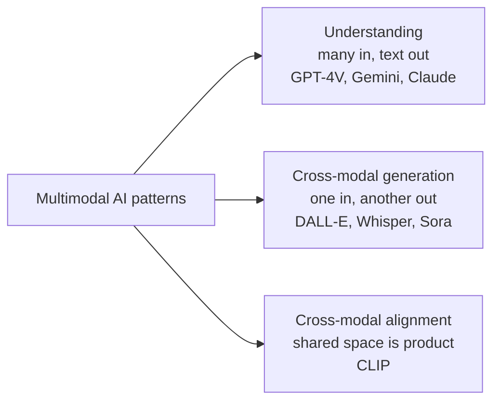

# What is Multimodal AI?

> **Step 15: Multimodal AI and Generative Models** · ⏱️ 15 min read · [Read original](https://outcomeschool.com/blog/multimodal-ai)

## TL;DR
Multimodal AI understands and generates more than one type of data (text, image, audio, video) in one model. Each modality is encoded into vectors, aligned in a shared embedding space, processed together by a Transformer, and the output is generated in any modality. The real world is multimodal, so such models fit real tasks better than single-modality ones, at a higher cost.

## Key Concepts
- **Modality** — a type/channel of data: text, image, audio, video, other (sensor data, depth maps, 3D shapes, biometrics).
- **Unimodal AI** — handles one data type; its output being a label, number or coordinate does not make it multimodal (a spam classifier printing "spam" just tags the input).
- **Multimodal AI** — two or more modalities together (Multi + Modal).
- **Encoder** — small model turning raw data into a vector; text encoder, image encoder (often a Vision Transformer), audio encoder.
- **Embedding** — vector capturing meaning in a form the model uses.
- **Shared embedding space** — encoders trained jointly so matching pairs (cat photo, word "cat") are close and mismatched (cat photo, "car") far apart.
- **Transformer** — network that learns relationships between pieces of data; reasons across all embeddings.
- **VLM** — Vision-Language Model: image in, text out.

## How It Works

### Why multimodal
A doctor reads history (text), views X-ray (image), listens to heartbeat (audio), watches gait (video) and merges them. Text-only models cannot read a screenshot of an error; image-only models cannot answer questions; audio-only cannot read accompanying notes.

### Unimodal vs multimodal
| Aspect | Unimodal | Multimodal |
|---|---|---|
| Inputs | One type | Two or more together |
| Understanding | One sense | Combined across senses |
| Use cases | Narrow tasks | Rich real-world tasks |
| Example | Tweet sentiment analysis | "Describe this image" assistant |
| Cost | Lower | Higher |

### The recipe: encode -> align -> reason -> generate
1. **Encoders per modality** — raw text/pixels/sound become vectors (embeddings).
2. **Shared embedding space** — joint training aligns modalities, enabling comparison of a photo to a sentence or a sound to a video frame.
3. **Multimodal model (Transformer)** — reasons across all embeddings.
4. **Output** — text, image, audio or video.

Example: photo of a kitchen + "How many chairs are there?" -> image encoder gives image embedding, text encoder gives text embedding -> both go into the model -> answer "There are 4 chairs."

### Three common patterns
1. **Multimodal Understanding** — many modalities in, usually text out (GPT-4V, Gemini, Claude with vision). Image-to-text ones are VLMs.
2. **Cross-Modal Generation** — one modality in, another out: text->image (DALL-E, Midjourney), text->video (Sora, Veo), audio->text (Whisper).
3. **Cross-Modal Alignment** — shared space is itself the product, for comparing/searching across modalities without a generated answer (CLIP: search images by text).
Real models often mix patterns.

### Real examples
GPT-4V (text+image -> text); GPT-4o (text, image, audio -> text or audio, real time); Gemini (text, image, audio, video, code); Claude with vision; CLIP (Contrastive Language-Image Pretraining); DALL-E/Midjourney (diffusion models); Whisper; Sora/Veo.

### Use cases
Visual question answering; document understanding (text, tables, charts in PDFs); medical imaging (X-rays, scans, notes); self-driving (camera, radar, LIDAR); accessibility (describe images, read aloud); content creation; customer support via screenshot/voice note; education (diagrams, handwritten math); mobile apps (menu photo translation with spoken dish names). Since generated content looks real, provenance matters: see LLM watermarking.

## Diagram(s)

### Multimodal architecture

### Three patterns

## Trade-offs & Pitfalls
- Not just text + image; audio, video, sensors, 3D count.
- One model does not fit all; focused unimodal models are sometimes better.
- Data quality: bad pairings (wrong caption) give bad results.
- Heavier and slower; use where extra signal is worth it.
- Evaluate each modality alone and together.
- More modalities add noise, latency, risk; add only with clear value.
- Biases can come from each modality and training pairs; check outputs.

## FAQ
- Spam classifier multimodal? -> No; a label is not a modality.
- Always better? -> No; costlier, more noise and latency.
- Whisper multimodal? -> Yes, cross-modal generation (audio -> text).
- How does cat photo = "cat"? -> joint training pulls matching pairs together in shared space.

## Key Takeaways
- Modality = data type; multimodal = several together.
- Recipe: encode each modality, align in shared space, reason with a Transformer, generate.
- Shared space is trained by pulling matched pairs close and pushing mismatched apart.
- Three patterns: understanding, cross-modal generation, cross-modal alignment.
- Real tasks are multimodal, but multimodal costs more and is not always better.
- Evaluate per modality and watch data alignment and bias.
