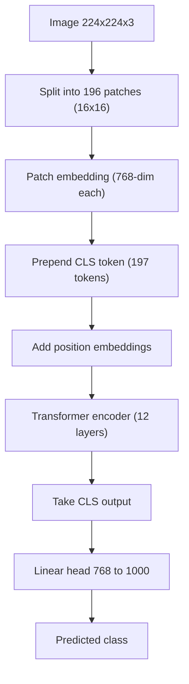

# What is a Vision Transformer (ViT)?

> **Step 15: Multimodal AI and Generative Models** · ⏱️ 15 min read · [Read original](https://outcomeschool.com/blog/decoding-vision-transformer-vit)

## TL;DR
A Vision Transformer (ViT) treats an image like a sentence: it cuts the image into patches, treats each patch as a token, and runs them through a standard transformer encoder. A special CLS token summarizes the image for classification. ViT needs large datasets but scales very well.

## Key Concepts
- **Patch** — a non-overlapping 16x16 pixel square; a 224x224 image gives 14 x 14 = 196 patches.
- **Patch embedding** — flatten a 16x16x3 patch (768 numbers) and apply a linear projection to a 768-dim vector (implemented as a conv with kernel 16, stride 16).
- **CLS token** — learnable classification token prepended to the sequence; gathers a global summary through attention.
- **Position embedding** — learnable vector added to each token so the model knows where the patch came from.
- **Classification head** — linear layer mapping the CLS output to class scores (768 to 1000).

## How It Works
1. **Split** the image into 196 patches. 16x16 is a sweet spot: smaller patches give detail but make self-attention expensive; larger ones are faster but lose detail.
2. **Embed** each patch into a 768-dim vector.
3. **Prepend CLS**, giving 197 tokens. The CLS token acts like a class representative listening to every patch.
4. **Add position embeddings**: final input = patch embedding + position embedding. Without it, patches lose spatial order.
5. **Transformer encoder** (ViT-Base: 12 layers, 12 heads): multi-head self-attention, feed-forward network, layer norm and residuals. Every patch can attend to every other patch from the first layer.
6. **Classify** using the CLS token output through a linear layer; the highest probability class wins.

ViT-Base is about 86M parameters (12 layers); ViT-Large about 307M (24 layers); ViT-Huge about 632M (32 layers).

### ViT vs CNN
| Property | ViT | CNN (e.g. ResNet) |
|---|---|---|
| Core operation | Self-attention | Convolution |
| View per layer | Whole image from layer one | Nearby pixels first |
| Built-in assumptions | Almost none | Nearby pixels are related |
| Data need | Large datasets | Smaller datasets |
| Scaling | Scales well with data and compute | Less steep at very large scale |

On ImageNet alone (about 1.3M images) ViT trails a well-tuned ResNet; pretrained on JFT-300M (about 300M images) and fine-tuned, it beats the best CNNs of the time. More data means ViT wins.

ViT underlies CLIP, DINO, I-JEPA, and is the common vision encoder in Vision-Language Models.

## Diagram

## Key Takeaways
- ViT = image patches + transformer encoder.
- Patches are visual words; the CLS token summarizes the image; position embeddings restore spatial order.
- It uses the encoder only, no decoder.
- CNNs have a built-in locality prior; ViT learns everything from data, so it needs more data but scales better.
- ViT is the foundation of many modern vision and multimodal models.
