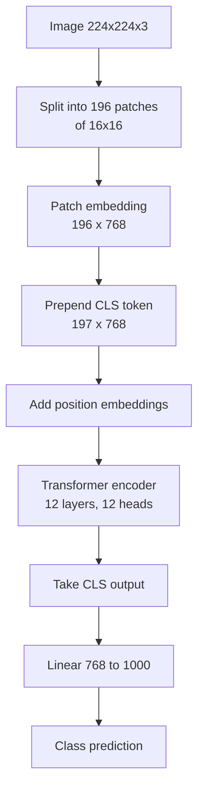

# What is a Vision Transformer (ViT)?

> **Step 15: Multimodal AI and Generative Models** · ⏱️ 15 min read · [Read original](https://outcomeschool.com/blog/decoding-vision-transformer-vit)

## TL;DR
ViT (Google, 2020, paper "An Image is Worth 16x16 Words") treats an image like a sentence: split into patches, embed each patch as a token, add a CLS token and position embeddings, run a standard transformer encoder, and classify from the CLS token. It lacks CNNs' built-in locality assumption, so it needs lots of data but scales better.

## Key Concepts
- **Patch** — non-overlapping square region of the image (16x16 pixels) treated as a "visual word".
- **Patch embedding** — flattened patch passed through a learned linear projection to a fixed-size vector.
- **CLS token** — extra learnable token (768 numbers) prepended to the sequence; gathers a global image summary via attention.
- **Position embedding** — learnable vector per position added to each token to restore spatial location.
- **Transformer encoder** — layers of multi-head self-attention + feed-forward + layer norm and residuals.
- **Classification head** — linear layer from CLS output to class scores.
- **CNN** — convolutional network (ResNet, VGG) that was dominant before ViT.

## How It Works
Pipeline for ViT-Base on a 224x224x3 image:

1. **Split into patches** — 224/16 = 14 per side, so 14 x 14 = 196 patches. 16x16 is a sweet spot: 8x8 gives more tokens and detail but self-attention cost explodes; 32x32 is faster but loses fine detail.
2. **Patch embedding** — each patch is 16 x 16 x 3 = 768 numbers, flattened, then linearly projected (768 -> 768, learned, not identity) so output captures useful visual features. Implemented as a convolution with kernel 16 and stride 16 (mathematically the same). Result: 196 vectors of 768-dim.
3. **CLS token** — no single patch represents the whole image, so prepend a learnable CLS: sequence = [CLS, P1..P196] = 197 tokens. It attends to all patches (class representative listening to the students).
4. **Position embeddings** — patches lose spatial position when flattened (an eye on top plus a tail at bottom means cat; shuffled patches make no sense). Add a learnable 768-vector for positions 0..196 element-wise: $\text{input}_i = \text{embed}_i + \text{pos}_i$, giving "what" plus "where".
5. **Transformer encoder** — 12 layers, 12 heads each, in ViT-Base. Per layer: multi-head self-attention (every token attends to every other, e.g. cat ear patch to eye patch; heart of ViT), feed-forward network per token (non-linearity, capacity), layer norm + residuals (stability). Output still 197 x 768; CLS now holds the global representation.
6. **Classification head** — CLS (768) -> linear (768 -> 1000) -> class probabilities -> highest wins (e.g. "Golden Retriever").

### Model sizes
| Model | Parameters | Layers |
|---|---|---|
| ViT-Base | ~86M | 12 |
| ViT-Large | ~307M | 24 |
| ViT-Huge | ~632M | 32 |
Bigger needs more data but performs better once trained.

### ViT vs CNN
| Property | ViT | CNN (ResNet) |
|---|---|---|
| Core op | Self-attention | Convolution |
| Each layer sees | Whole image from first layer | Nearby pixels first, more with depth |
| Built-in assumptions | Almost none | Strong: nearby pixels related |
| Data need | Large datasets | Smaller ok |
| Scalability | Scales well with data and compute | Less steep at very large scale |
| Architecture | Uniform attention blocks | Varied blocks |
| Understanding | Global relationships | Local patterns first |

Numbers: trained only on ImageNet (~1.3M images) ViT loses to a well-tuned ResNet of similar size; pre-trained on JFT-300M (~300M images) then fine-tuned on ImageNet it beats the best CNNs of the time. More data, ViT wins; small data, CNNs win (head start).

## Diagram(s)

### ViT pipeline

### Encoder layer

## Trade-offs & Pitfalls
- Data hungry: worse than ResNet on ImageNet alone.
- Smaller patches improve detail but make attention quadratically costlier.
- Without position embeddings the model is blind to layout.
- ViT uses an encoder only, no decoder.
- Foundation for CLIP, DINO, I-JEPA, and the vision encoder in most VLMs.

## FAQ
- Small datasets? -> No, CNNs win there.
- Why 16x16? -> balance of detail vs attention cost.
- Decoder? -> No, standard encoder plus linear head.
- Knows patch location? -> Only via position embeddings.

## Key Takeaways
- ViT = image patches + transformer encoder.
- 224x224 with 16x16 patches gives 196 tokens, 197 with CLS.
- Patch embedding is a learned linear projection (a stride-16 conv in practice).
- CLS token aggregates global information; position embeddings restore spatial order.
- Self-attention gives global context from layer one, unlike CNN locality.
- ViT needs large data but scales better; basis of modern multimodal vision encoders.
