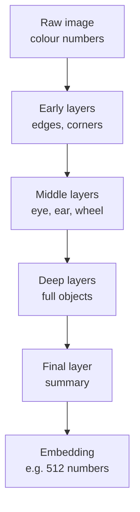
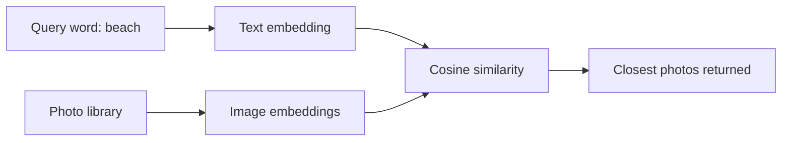

# How do Image Embeddings work?

> **Step 15: Multimodal AI and Generative Models** · ⏱️ 16 min read · [Read original](https://outcomeschool.com/blog/how-do-image-embeddings-work)

## TL;DR
An image embedding is a fixed-size list of numbers capturing the meaning of an image. A neural network (CNN or Vision Transformer) turns raw pixels into it, so similar images land close together and different ones far apart. We compare embeddings with cosine similarity to search, group and recommend images by meaning, not pixels.

## Key Concepts
- **Embedding** — list of numbers (vector) capturing the meaning of a word, sentence or image.
- **Vector** — fixed-size list of numbers, e.g. [0.21, 0.87, 0.05, 0.64].
- **Image embedding** — such a vector for an image; similar meaning = close vectors.
- **Pixel** — smallest colour dot; stored as 3 numbers (R, G, B), each 0 to 255.
- **Neural network (CNN / Vision Transformer)** — model that learns patterns from examples without hand-written rules.
- **Cosine similarity** — measures whether two vectors point in the same direction; range -1 to 1.
- **Vector database** — built to find closest embeddings quickly across millions of items.
- **Multimodal model** — connects text and images in the same embedding space (e.g. CLIP).

## How It Works

### Why we need them
Google-Photos-style app: 1M unlabeled photos, user searches "beach". Pixel-by-pixel comparison is slow and meaningless (two beach photos at different angles differ completely in pixels). Instead: embed every photo, embed the word "beach", return the nearest photo embeddings. This is search by meaning.

### How a computer sees an image
A 100x100 colour image = 10,000 pixels x 3 = 30,000 numbers. These raw numbers say how it looks (colour), not what it means; two cat photos differ with lighting, angle, background. Raw pixels = looks, embedding = meaning.

### How embeddings are created
Child analogy: shown thousands of cat photos, learns pointy ears, whiskers, fur, tail. A network learns the same way from millions of photos.
1. Raw colour numbers enter.
2. Early layers: edges and corners.
3. Middle layers: parts (eye, ear, wheel).
4. Deep layers: full objects (cat face, car).
5. Final layer: short list of numbers summarising all of it = the embedding.

Training automatically places similar images close together (contrastive learning), with no hand-written rules.

| Network | Child analogy |
|---|---|
| Raw image | Looking at the photo |
| Early layers | Noticing lines, corners |
| Middle layers | Ears, eyes, whiskers |
| Deep layers | Recognising the cat |
| Embedding | Understanding "this is a cat" |

### Numeric walkthrough (3-dim for illustration; real ones have hundreds or thousands)
- Cat A [0.90, 0.10, 0.05], Cat B [0.88, 0.12, 0.07], Car C [0.10, 0.95, 0.85].
- A and B are close; C is far. "Most similar to A?" -> B.

### Similarity
Cosine similarity checks direction: near 1 = very similar, near 0 = unrelated, near -1 = opposite. A and B point almost the same way, so close to 1.

$$
\cos(a,b)=\frac{a\cdot b}{\lVert a\rVert\,\lVert b\rVert}
$$

### Code
```python
from sentence_transformers import SentenceTransformer, util
from PIL import Image
model = SentenceTransformer("clip-ViT-B-32")
cat = model.encode(Image.open("cat.jpg"))
dog = model.encode(Image.open("dog.jpg"))
print(cat.shape)              # (512,)
print(util.cos_sim(cat, dog)) # cat vs dog fairly high, cat vs car much lower
```
- Ready-made model, no training needed; each embedding is 512 numbers.
- The same CLIP model embeds the word "beach", so text and image embeddings are comparable: that is how typed search over photos works.

### Uses
Image search by words; similar product search (upload a shoe); duplicate photo detection; face grouping; recommendations of images/videos.

## Diagram(s)

### From pixels to embedding


### Search by meaning


## Trade-offs & Pitfalls
- Raw pixel comparison is slow and ignores meaning.
- Real embeddings are high-dimensional (512 for CLIP ViT-B-32); finding nearest at scale needs a vector database.
- Text-image search only works when both come from a shared-space (multimodal) model.

## FAQ
- Why not compare pixels? -> measures colour not meaning, and slow.
- Text query on images? -> Yes with CLIP-style multimodal models.
- Need to train? -> No, load a pretrained model.
- How many numbers? -> hundreds or thousands; 512 for clip-ViT-B-32.
- Need labels? -> No; embed photos and query and take nearest.

## Key Takeaways
- Embedding = numeric summary of meaning; similar meaning gives close vectors.
- Neural network layers build from edges to parts to objects, then output the embedding.
- Cosine similarity (-1 to 1) compares directions.
- Enables search by meaning, dedup, face grouping, recommendation.
- Pretrained CLIP models give image and text embeddings in one space.
- Vector databases make nearest-neighbour search fast at scale.
