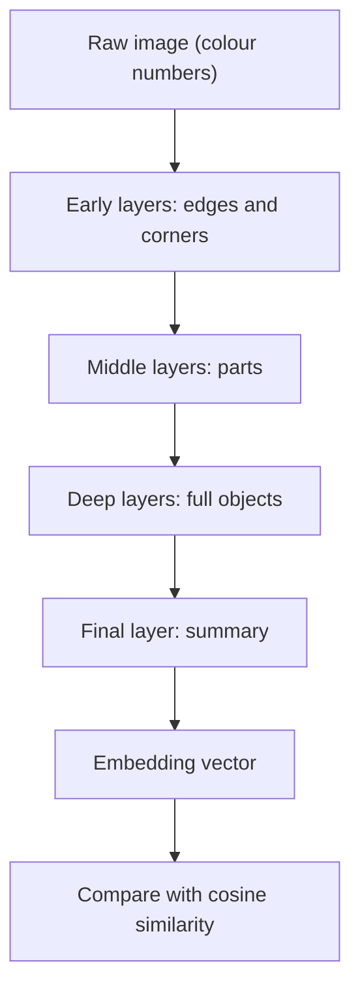

# How do Image Embeddings work?

> **Step 15: Multimodal AI and Generative Models** · ⏱️ 16 min read · [Read original](https://outcomeschool.com/blog/how-do-image-embeddings-work)

## TL;DR
An image embedding is a list of numbers (a vector) that captures the meaning of an image. A neural network produces it so that similar images get nearby vectors and different images get distant ones. This lets us search, group and compare images by meaning rather than pixels.

## Key Concepts
- **Embedding / vector** — a fixed-size list of numbers capturing meaning, e.g. `[0.21, 0.87, 0.05, 0.64]`.
- **Pixel** — smallest colour dot, stored as three numbers (R, G, B) from 0 to 255; a 100x100 image is 30,000 numbers.
- **Raw pixels vs embedding** — pixels say how an image looks; the embedding says what it means.
- **Cosine similarity** — checks if two vectors point the same way; ranges from -1 to 1 (near 1 similar, near 0 unrelated, near -1 opposite).
- **Vector database** — built to find the closest embeddings quickly across millions of items.

## How It Works
**Why we need it:** a photo app with a million unlabeled photos must answer "beach". Pixel comparison is slow and ignores meaning (two beach photos at different angles look different). Convert photos and the word "beach" to embeddings and pick the nearest.

**Creating an embedding (CNN or Vision Transformer):**
1. Raw colour numbers enter the network.
2. Early layers find edges and corners.
3. Middle layers combine them into parts (eye, ear, wheel).
4. Deep layers recognize whole objects (cat, car).
5. The final layer summarizes everything as a short vector.

Training on millions of images automatically places similar images close together, with no hand-written rules.

**Numeric example (3 dims for illustration):**
- Cat A `[0.90, 0.10, 0.05]`
- Cat B `[0.88, 0.12, 0.07]`
- Car C `[0.10, 0.95, 0.85]`

A and B are close; C is far. Real embeddings have hundreds or thousands of numbers.

**Code (sentence-transformers):**
```python
model = SentenceTransformer("clip-ViT-B-32")
emb = model.encode(Image.open("cat.jpg"))   # shape (512,)
util.cos_sim(cat_emb, dog_emb)
```
The same CLIP model embeds text like "beach" into the same space, which is how typing words to search photos works (a multimodal model).

**Use cases:** image search, similar product search, duplicate photo detection, face grouping, recommendations.

## Diagram


## Key Takeaways
- An embedding turns an image into numbers that capture meaning; raw pixels do not.
- Similar images have nearby embeddings; cosine similarity measures closeness.
- Layers build from edges to parts to objects, ending in a summary vector.
- Ready-made models like CLIP mean no training is needed to get embeddings.
- A shared text-image space enables searching unlabeled photos with words.
