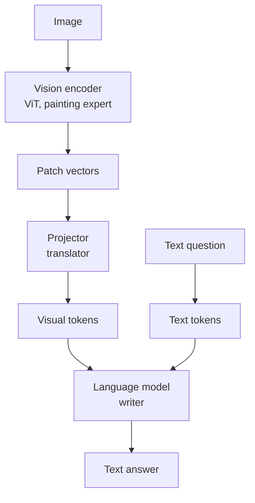
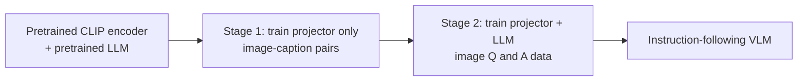

# How does a Vision-Language Model (VLM) work?

> **Step 15: Multimodal AI and Generative Models** · ⏱️ 16 min read · [Read original](https://outcomeschool.com/blog/vision-language-model-vlm)

## TL;DR
A VLM takes an image plus text and answers in text. A vision encoder (usually a ViT, often from CLIP) turns image patches into vectors, a projector converts them into visual tokens shaped like LLM word embeddings, and the LLM reads visual + text tokens as one sequence. Training reuses pretrained parts, so it is cheap; weaknesses are hallucination, counting, tiny details and token cost.

## Key Concepts
- **VLM** — image + text in, text out (ChatGPT, Claude, Gemini with images). One kind of multimodal model.
- **Pixel** — RGB, each 0 to 255 (red = [255,0,0], white = [255,255,255]). A 336x336 photo = 112,896 pixels = 338,688 numbers.
- **Token / embedding** — LLM text piece and its vector; LLM only understands sequences of embeddings.
- **Vision encoder** — usually ViT; makes one meaningful vector per patch.
- **Patch** — small square of the image (14x14 pixels).
- **CLIP** — OpenAI 2021, Contrastive Language-Image Pre-training; ~400M image-caption pairs; image encoder + text encoder.
- **Contrastive learning** — pull each image close to its own caption, push away from other captions in the batch.
- **Projector** — small network mapping vision vectors to LLM embedding size/space.
- **Visual token** — projected patch vector that looks like a word token to the LLM.
- **Frozen** — parameters not updated.

## How It Works

### The problem and analogy
Images are pixel grids; LLMs read token embeddings. Analogy: an English-only writer (LLM) needs a painting expert (vision encoder) to note details and a translator (projector) to turn notes into English; the writer then answers the question.

### Part 1: Vision encoder (ViT)
1. Cut image into patches: 336x336 with 14x14 patches = 24 per side = 576 patches, read row by row like words.
2. Each patch has 14x14x3 = 588 numbers; flattened and passed through a learned layer to a vector.
3. Add position embeddings (so it knows top vs bottom).
4. Pass through Transformer layers; attention lets every patch see every other (ear + eye + fur = cat face).
Output: one meaningful vector per patch.

### CLIP teaches images and text a common language
Batch of images and captions -> encode both -> make each image vector close to its own caption vector and far from all others. Result: encoder vectors carry meaning already tied to language, so it is a good vision encoder for VLMs.

### Part 2: Projector
Vision vectors are in the encoder's private space (e.g. size 1,024) while the LLM expects e.g. 4,096. The projector (small network) converts them. LLaVA v1: a single linear layer; LLaVA-1.5: a two-layer MLP. Output: visual tokens.

### Part 3: Language model
Sequence: `[visual token 1..576] [What] [is] [in] [this] [image] [?]`. Text tokens attend to visual tokens ("this" finds the cat patches). LLM then generates the answer token by token ("This is an orange cat sleeping on a blue sofa."). It never sees pixels.

### Shape walkthrough (code)
```python
patches = (336 // 14) ** 2                    # 576
patch_vectors = rand(576, 1024)               # encoder output
visual_tokens = patch_vectors @ rand(1024, 4096)   # projector -> (576, 4096)
llm_input = concat([visual_tokens, text_tokens(8, 4096)])  # (584, 4096)
```
LLM gets 584 tokens (576 image + 8 text), all the same size. Images dominate token count, so VLMs are slower and costlier.

### Training (LLaVA recipe)
Start from pretrained CLIP encoder and pretrained LLM; only the projector is new.
1. Align: train projector on image-caption pairs (produce the caption).
2. Instruction tuning: images with questions and good answers (e.g. street photo, "Is it safe to cross?").

| Part | Step 1 | Step 2 |
|---|---|---|
| Vision encoder | Frozen | Frozen |
| Projector | Trained | Trained |
| LLM | Frozen | Trained |

### Other connection designs
| Design | How | Example |
|---|---|---|
| Projector | Every patch becomes a visual token placed before text | LLaVA |
| Query-based connector | Few learned queries pull key info, fewer tokens | BLIP-2 (Q-Former) |
| Cross-attention | Image not tokens; extra LLM layers attend to image while reading text | Flamingo |
| Native multimodal | Trained on image and text tokens together from the start | Chameleon |
Trade-off: projector keeps all detail but uses many tokens; query-based uses fewer but may lose small details.

## Diagram(s)

### VLM architecture


### Two-stage training


## Trade-offs & Pitfalls
- **Works well**: photo description and Q&A, reading text in screenshots/receipts/documents, charts/tables/diagrams, helping low-vision users.
- **Hallucination**: describes absent things (a cup on the table) because the LLM's text habits fill gaps.
- **Counting and exact positions** ("how many birds", "key left of phone") often wrong.
- **Tiny details**: large images shrunk for the encoder blur small text; newer VLMs tile the image, using even more tokens.
- **Cost**: each image adds hundreds or thousands of tokens.

## FAQ
- Does the LLM see pixels? -> No, only tokens.
- Why images cost more? -> 576 visual tokens vs 8 text tokens in the example.
- Why small text fails? -> downscaling blur; tiling helps but costs tokens.
- Is the vision encoder retrained? -> Usually frozen; reuse keeps training cheap.

## Key Takeaways
- VLM = vision encoder + projector + LLM.
- Projector makes image patches look like word embeddings (e.g. 1,024 -> 4,096).
- CLIP's contrastive training gives an encoder already aligned with language.
- LLaVA trains projector first, then projector + LLM; encoder stays frozen.
- Alternatives: Q-Former (fewer tokens), cross-attention (Flamingo), native multimodal (Chameleon).
- Main failure modes: hallucination, counting/position, tiny details, token cost.
