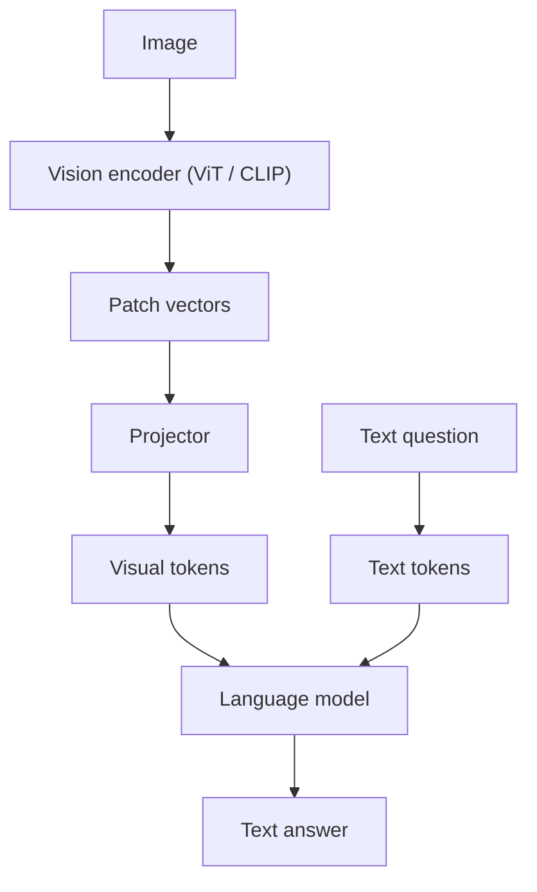

# How does a Vision-Language Model (VLM) work?

> **Step 15: Multimodal AI and Generative Models** · ⏱️ 16 min read · [Read original](https://outcomeschool.com/blog/vision-language-model-vlm)

## TL;DR
A VLM takes an image plus text and replies in text. It works by turning the image into visual tokens that look like word tokens, so an ordinary LLM can read them. Three parts do this: a vision encoder, a projector and a language model. Analogy: a painting expert (encoder) makes notes, a translator (projector) converts them to English, and a writer (LLM) answers.

## Key Concepts
- **Pixels** — an image is a grid of RGB numbers (0 to 255); 336x336x3 is 338,688 numbers with no direct meaning.
- **Vision encoder** — usually a ViT; turns image patches into meaningful vectors.
- **CLIP** — OpenAI (2021), trained on about 400M image-caption pairs with contrastive learning; its image encoder is a common choice.
- **Projector** — small network (a linear layer in LLaVA, a two-layer MLP in LLaVA-1.5) mapping vision vectors into the LLM's embedding space.
- **Visual token** — a projected patch vector that looks like a word token to the LLM.
- **Frozen** — parameters not updated during training.

## How It Works
**Core problem:** LLMs read token embeddings; images are pixel grids.

1. **Vision encoder:** cut the image into patches (336x336 with 14x14 patches gives 24 x 24 = 576), embed each patch (588 numbers each), add position embeddings, and pass through Transformer layers where patches attend to each other. Output: one meaningful vector per patch.
2. **CLIP training:** make each image's vector close to its own caption's vector and far from others in the batch (contrastive learning).
3. **Projector:** convert e.g. 1,024-dim vision vectors to the LLM's 4,096-dim space, producing visual tokens.
4. **LLM:** reads `[576 visual tokens] + [question tokens]` as one sequence, text tokens attend to visual tokens, then it generates the answer token by token. It never sees pixels.

Shape example from the blog's NumPy code: 576 visual tokens + 8 text tokens = 584 tokens into the LLM. Images are expensive: hundreds or thousands of tokens each.

### Training (LLaVA style)
| Part | Step 1: caption alignment | Step 2: instruction tuning |
|---|---|---|
| Vision encoder | Frozen | Frozen |
| Projector | Trained | Trained |
| LLM | Frozen | Trained |

Reusing pretrained parts keeps it cheap.

### Other ways to connect vision and language
| Design | How | Example |
|---|---|---|
| Projector | Every patch becomes a token placed before text | LLaVA |
| Query-based connector | Learned queries extract key info, fewer tokens | BLIP-2 (Q-Former) |
| Cross-attention | LLM layers look at the image directly | Flamingo |
| Native multimodal | Trained on image and text tokens from the start | Chameleon |

Projector keeps detail but uses many tokens; query-based uses fewer but may lose detail.

### Strengths and failures
Good at: describing photos, reading screenshots and receipts, charts and diagrams, assisting low-vision users. Weak at: hallucination (text habits fill gaps), counting and exact positions, tiny details after downscaling (tiling helps but costs more tokens), and cost.

## Diagram

## Key Takeaways
- VLM = vision encoder + projector + LLM; the projector is the bridge that makes image patches look like word tokens.
- The LLM sees only tokens, never pixels.
- CLIP-style contrastive training links image meaning to language.
- Training reuses frozen pretrained parts and trains the projector first, then the projector with the LLM.
- VLMs hallucinate, miscount, miss tiny details, and cost many tokens per image.
