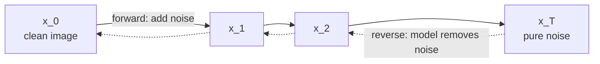
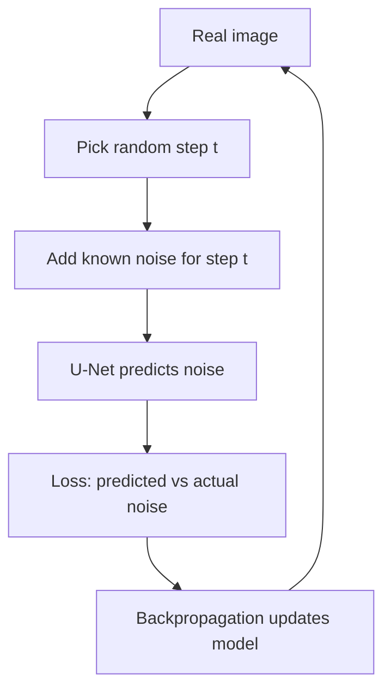
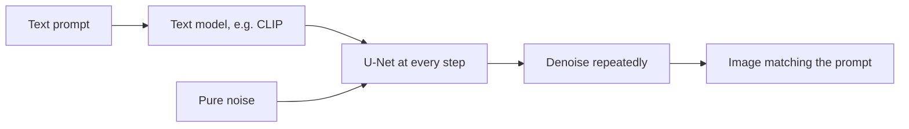

# What are Diffusion Models and How Do They Generate Images?

> **Step 15: Multimodal AI and Generative Models** · ⏱️ 18 min read · [Read original](https://outcomeschool.com/blog/diffusion-models)

## TL;DR
A diffusion model generates data by starting from pure noise and removing it step by step. Training uses a fixed forward process that adds noise to real images; a neural network (usually a U-Net) learns to predict the added noise, and generation runs that denoising in reverse. Training is stable (the correct noise is always known) and outputs are high quality and diverse; text prompts guide it via conditioning.

## Key Concepts
- **Diffusion** — spreading out, like ink in water; noise is spread into an image, then the model learns to reverse it.
- **Noise** — random dots, like TV static; no meaning.
- **Forward process** — clean image x_0 -> x_T (pure noise) by adding small noise each step; fixed, no learning.
- **Reverse process** — x_T -> x_0 by removing noise; this is what the model learns.
- **Time step** — usually ~1000 steps.
- **Noise schedule** — decides how much noise is added at each step.
- **Noise predictor** — network that, given a noisy image, predicts the noise inside it.
- **U-Net** — architecture mapping an image to an image of the same size; suits noise prediction.
- **Loss** — difference between predicted and actual noise.
- **Conditional diffusion** — extra input (condition), e.g. text prompt.
- **Inpainting** — changing/removing/filling part of an image.
- **GAN** — earlier approach; hard to train, unstable, could repeat the same image.

## How It Works

### Why diffusion
Generating an image from scratch is hard: millions of pixels must be right or the image looks broken. GANs were powerful but unstable. Diffusion is stable, high-quality, diverse, and conceptually simple, so it is the most popular image-generation method.

### Two opposite processes
- Forward (easy): add noise step by step. Reverse (hard): remove noise step by step.
- Ink analogy: dropping ink into water is easy; cleaning it drop by drop needs a skilled helper (the model).
- Forward is used only during training to show the model what noise looks like at each step.

### Forward process
Start with x_0, add small noise to get x_1, x_2, ..., x_T (about 1000 steps) until pure noise. Noise amount per step is small and controlled by the noise schedule. Mixing in code:

$$
x_t=\sqrt{\bar\alpha_t}\,x_0+\sqrt{1-\bar\alpha_t}\,\epsilon
$$

$\bar\alpha_t$ near 1 = mostly clean, near 0 = mostly noise; $\epsilon$ is random noise.

### Reverse process and generation
At each step the network sees the noisy image, predicts the noise, and we subtract part of it. Cat example:
1. Start with static x_T (no cat).
2. Model predicts noise, subtract a part -> x_(T-1), slightly cleaner.
3. Repeat -> x_(T-2), faint shape.
4. Continue: outline, ears, eyes, fur.
5. x_0 = clear new cat image.
Like wiping a foggy mirror; never one shot.

### Training
1. Take a real image.
2. Pick a random step (e.g. 400), add exactly that much noise (we know the true noise).
3. Network predicts the noise from the noisy image.
4. Compare predicted vs actual noise -> loss.
5. Update by backpropagation.
Repeat millions of times over many images and random steps. We always know the right answer, which makes it stable (the big advantage over GANs). A newer alternative learns a straight path noise -> data (flow matching).

```python
def training_step(model, image):
    t = randint(0, 1000); noise = randn_like(image)
    noisy = add_noise(image, noise, alpha_bar[t])
    loss = ((noise - model(noisy, t)) ** 2).mean()
    return loss

def generate(model):
    x = randn(1, 3, 64, 64)
    for t in reversed(range(1000)):
        x = remove_noise(x, model(x, t), t)
    return x
```

### Conditional diffusion (text to image)
Add a condition: the text prompt ("a cat sitting on a red sofa"). A text model such as CLIP converts it to meaning-bearing numbers, fed into the U-Net at every step so denoising moves toward the text. Without text: random image; with text: the requested one.

### Advantages
High quality; stable training; diversity (no mode repetition); flexible control (text, sketches, images); simple core idea.

### Uses
Text-to-image (DALL-E, Stable Diffusion, Midjourney); image editing/inpainting; super resolution; video generation; audio (music, speech); science and medicine (new molecules, medical images). The idea has carried over to text as Diffusion Language Models.

## Diagram(s)

### Forward and reverse chain


### Training loop


### Text-conditioned generation


## Trade-offs & Pitfalls
- Reverse process is hard and needs a trained network; generation takes many sequential steps (~1000).
- GAN comparison: GANs unstable, could repeat images; diffusion stable and diverse.
- Forward process needs no learning; effort goes to the reverse.

## FAQ
- Better than GANs? -> For most image generation today, yes (stable, diverse, high quality).
- One step? -> No, gradual over ~1000 steps.
- Learn the forward process? -> No, fixed with a noise schedule.
- Beyond images? -> Video, audio, molecules, medical images, text (DLMs).

## Key Takeaways
- Forward: add noise (no learning). Reverse: learned denoising.
- The network predicts the noise; subtract it and repeat.
- Training is stable since the true noise is known.
- U-Net is the usual noise predictor.
- Conditioning (e.g. CLIP text embeddings) turns random generation into prompt-driven generation.
- Used across image, video, audio, science; replaced GANs for many tasks.
