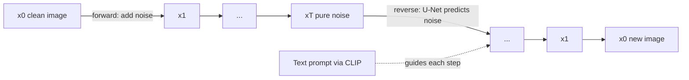

# What are Diffusion Models and How Do They Generate Images?

> **Step 15: Multimodal AI and Generative Models** · ⏱️ 18 min read · [Read original](https://outcomeschool.com/blog/diffusion-models)

## TL;DR
A Diffusion Model generates data (like images) by starting from pure random noise and removing a little noise at every step until a clear image appears. It is stable to train and produces high-quality, diverse images, which is why it replaced GANs for image generation (DALL-E, Stable Diffusion, Midjourney).

## Key Concepts
- **Diffusion** — spreading out, like ink in water; the model spreads noise into an image, then learns to reverse it.
- **Forward Process** — gradually add noise to a clean image over ~1000 steps until it is pure noise. Fixed, needs no learning.
- **Reverse Process** — remove noise step by step to get a clean image. This is the part the model learns.
- **Noise schedule** — decides how much noise is added at each step.
- **Noise predictor** — the neural network (usually a U-Net) that looks at a noisy image and predicts the noise inside it.
- **Conditional Diffusion** — an extra input (e.g., a text prompt encoded by CLIP) guides the denoising.

## How It Works
### Forward vs Reverse
| | Forward | Reverse |
|---|---|---|
| Direction | $x_0 \to x_T$ (clean to noise) | $x_T \to x_0$ (noise to clean) |
| Difficulty | Easy, fixed math | Hard, needs a model |
| Role | Used only in training | Used for generation |

### Training
1. Take a real image.
2. Pick a random time step (e.g., 400) and add exactly that much noise. We know the true noise.
3. Feed the noisy image (and the step) to the network; it predicts the noise.
4. Loss = difference between predicted and actual noise.
5. Update via backpropagation; repeat millions of times.

Because the correct answer is always known, training is stable (the big advantage over GANs).

```python
noisy = (alpha_bar_t ** 0.5) * image + ((1 - alpha_bar_t) ** 0.5) * noise
loss = ((noise - model(noisy, t)) ** 2).mean()
```
`alpha_bar_t` near 1 means mostly clean; near 0 means mostly noise.

### Generation
Start with `x = randn(...)`, then loop `t` from 999 down to 0: predict noise, subtract a part of it. The cat appears gradually (outline, ears, eyes, fur), never in one shot.

### Text to image
The prompt is converted to numbers by a text model such as CLIP and fed into the U-Net at every step, so noise removal is steered toward the prompt.

## Diagram


## Key Takeaways
- Diffusion = add noise (easy, no learning) then learn to remove it (hard, learned).
- The network is a noise predictor; subtracting predicted noise moves one step toward a clean image.
- Training is stable because we know the exact noise we added; GANs lacked this.
- Text conditioning (e.g., CLIP embeddings) is what turns random generation into prompt-following generation.
- Uses: text-to-image, inpainting, super resolution, video, audio, molecule design, medical imaging.
