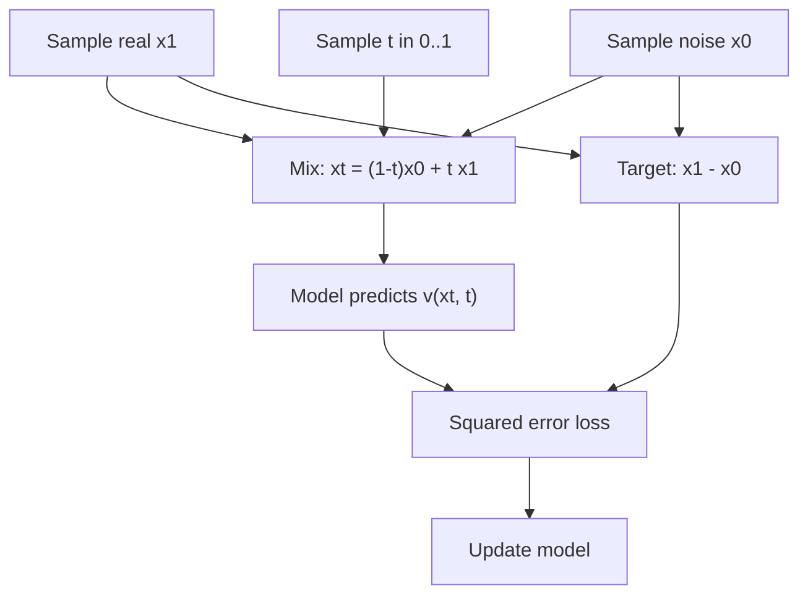
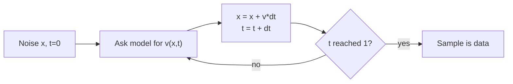

# How does flow matching train a generative model?

> **Step 15: Multimodal AI and Generative Models** · ⏱️ 17 min read · [Read original](https://outcomeschool.com/blog/flow-matching)

## TL;DR
Flow matching trains a model to predict the velocity (direction and speed) that moves a noise point toward a real data point. Pair a noise point with a data point, draw a straight line between them, and train the model to output the constant velocity x1 - x0 at points on that line: a simple regression. To generate, start from noise and follow the learned arrows in a few small Euler steps.

## Key Concepts
- **Noise** — list of random numbers (TV static); trivial to sample.
- **Velocity** — direction and speed; position + velocity x time = next position (e.g. (2,1) + (3,1) = (5,2)).
- **Flow** — smooth movement of points following an arrow field, like leaves in a river. Time t: 0 = pure noise, 1 = data.
- **v(x, t)** — learned function returning the arrow at position x and time t.
- **Continuous normalizing flows** — older approach: simulate the whole journey repeatedly and check likelihood; slow, hard to scale.
- **Flow matching** — Lipman et al. 2022, "Flow Matching for Generative Modeling"; **rectified flow** — Liu et al., near-identical idea.
- **Conditional flow matching** — per-pair targets, yet the model learns the overall flow.
- **Euler method** — simplest way to follow arrows in small steps.
- **Reflow** — retrain on pairs generated by the trained model to straighten paths.

## How It Works

### Core idea
Generation = a journey from noise (t=0) to data (t=1). The model must learn the arrow at every position and time. Problem: no one knows the correct path; flow matching just chooses it.

### The straight-line trick
Pick noise $x_0$ and real data $x_1$. Point on line at time t:

$$
x_t=(1-t)\,x_0+t\,x_1
$$

Steady speed along this line gives constant velocity:

$$
\text{velocity}=x_1-x_0
$$

So the target at $x_t$ is $x_1-x_0$, with no simulation.

### Training (regression)
1. Sample real $x_1$.
2. Sample noise $x_0$.
3. Sample random $t \in [0,1]$.
4. Compute $x_t$.
5. Predict $v(x_t,t)$.
6. Loss:

$$
\mathcal{L}=\mathbb{E}\big[(v(x_t,t)-(x_1-x_0))^2\big]
$$

7. Update parameters.
Repeat millions of times with different photos, noise, times.

### Numeric example (1D)
$x_0=-2$, $x_1=6$, $t=0.25$.
- $x_t = 0.75(-2)+0.25(6)=0$.
- Target = 6 - (-2) = 8.
- Model predicts 5, loss = (5-8)^2 = 9 (too slow, learns to predict bigger).
- Sanity: from 0 with velocity 8 for remaining 0.75 travels 6, reaching x1 = 6.

### Why single pairs work
The same noise point may pair with a cat in one step and a dog in another, so targets at one position conflict. With squared error, the best answer to many targets is their average (half say up, half say right -> model learns up-and-right). The paper proved that following the averaged arrows carries noise to the full data distribution. Consequence: real paths are not perfectly straight, but much straighter than older methods.

### Generation (Euler)
1. Sample noise x, t=0.
2. Choose steps, e.g. 4, dt = 0.25.
3. Repeat: $x \leftarrow x + v(x,t)\,dt$, $t \leftarrow t+dt$.
4. At t=1, x is the sample.
Example (data = 6, arrow +8): -2 -> 0 -> 2 -> 4 -> 6 in 4 steps. Straight paths need few big steps; curved paths need many small ones.

### Code essentials
```python
def train_step(x1):
    x0 = torch.randn_like(x1); t = torch.rand(x1.shape[0], 1)
    xt = (1 - t) * x0 + t * x1; target = x1 - x0
    loss = ((model(torch.cat([xt, t], 1)) - target) ** 2).mean()
    ...  # zero_grad, backward, step

@torch.no_grad()
def generate(n, steps=20):
    x = torch.randn(n, 2); dt = 1.0 / steps
    for i in range(steps):
        t = torch.full((n, 1), i * dt)
        x = x + model(torch.cat([x, t], 1)) * dt
    return x
```
For real images the small net becomes a big (often Transformer) network and 2 numbers become millions; the code is nearly the same.

### Flow matching vs diffusion
| Point | Diffusion | Flow Matching |
|---|---|---|
| Predicts | Usually the added noise | Velocity (direction + speed) |
| Path | Fixed by noise schedule, often curved | Usually straight line |
| Target | Depends on schedule settings | Simply x1 - x0 |
| Steps to generate | Often 20 to 50+ | Often fewer |
| Training difficulty | Simple but needs schedule tuning | Simple, fewer settings |
| Used in | Stable Diffusion 1 and 2, DALL-E 2 | Stable Diffusion 3, Flux, Meta Movie Gen |
With right choices a diffusion model can be rewritten as flow matching; it is a cleaner way of training the same family.

## Diagram(s)

### Training step


### Generation by Euler steps


## Trade-offs & Pitfalls
- **Works well**: simple regression with clear target; no full-journey simulation; straighter paths give fewer steps and faster generation; scales to image, video, audio.
- **Limits**: paths not perfectly straight due to averaging, so 1 or 2 steps still lower quality without tricks; still many model calls (unlike one-step methods); quality depends on network size, data, compute.
- **Reflow** straightens paths for very few-step generation.

## FAQ
- Same as rectified flow? -> Very similar, published around the same time.
- Conditional flow matching? -> Per-pair targets x1 - x0, model learns the average overall flow.
- Which models? -> Stable Diffusion 3, Flux, Meta Movie Gen (diffusion: SD 1/2, DALL-E 2).
- Reflow? -> retrain on model-generated pairs to straighten paths.

## Key Takeaways
- Model learns velocity field v(x, t) from noise (t=0) to data (t=1).
- Straight-line path gives target velocity x1 - x0 and point $x_t=(1-t)x_0+tx_1$.
- Training is plain squared-error regression.
- Averaging over pairs yields the overall flow; real paths are only approximately straight.
- Generation: Euler steps from noise; straighter paths mean fewer steps than diffusion.
- Closely related to diffusion, but simpler and used in newer models; reflow cuts steps further.
