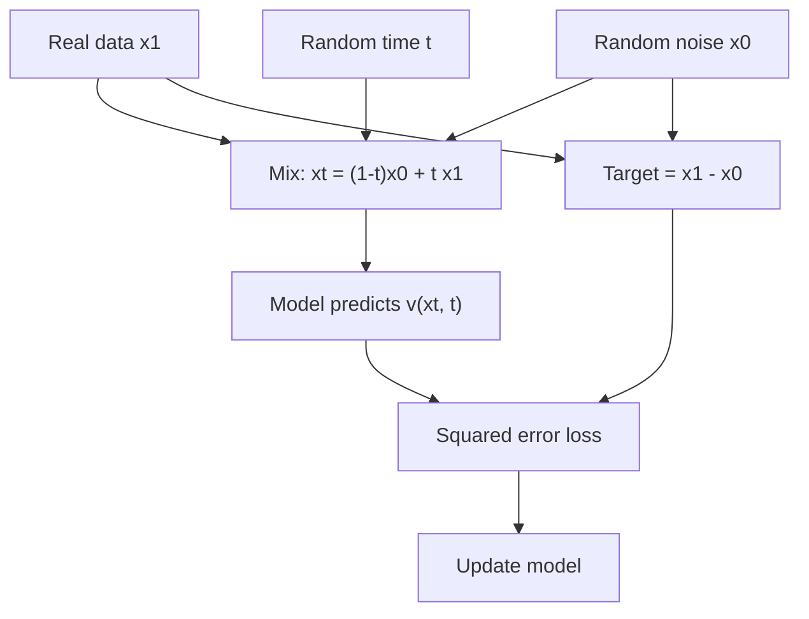

# How does flow matching train a generative model?

> **Step 15: Multimodal AI and Generative Models** · ⏱️ 17 min read · [Read original](https://outcomeschool.com/blog/flow-matching)

## TL;DR
Flow matching trains a generative model to predict the velocity (direction and speed) that moves a noise point toward a real data point along a straight line. Training becomes a simple regression with a known target, and straighter paths mean fewer generation steps than diffusion.

## Key Concepts
- **Velocity** — direction and speed of movement; an arrow on a 2D map.
- **Flow** — smooth movement of points following an arrow at every position, like a river carrying a leaf.
- **$v(x, t)$** — the learned function returning the arrow at position $x$ and time $t$ ($t=0$ noise, $t=1$ data).
- **Conditional flow matching** — targets are computed per (noise, data) pair, yet the model learns the overall flow.
- **Rectified flow** — very similar idea published around the same time (Xingchao Liu et al.); flow matching is from Lipman et al., 2022.
- **Euler method** — simplest way to follow arrows with small steps.
- **Reflow** — retrain on pairs generated by the trained model to straighten paths further.

## How It Works
Older continuous normalizing flows simulated the whole journey during training: slow and hard to scale. Flow matching instead picks the path itself.

1. Pick real data $x_1$ and noise $x_0$.
2. Pick random $t \in [0,1]$.
3. Mixed point: $x_t = (1-t)\,x_0 + t\,x_1$
4. Target velocity (constant on a straight line): $x_1 - x_0$
5. Loss: $\text{mean}\big(v(x_t,t) - (x_1 - x_0)\big)^2$; update the model.

**Numeric example:** $x_0=-2$, $x_1=6$, $t=0.25$ gives $x_t=0$, target $=8$. If the model predicts 5, loss $=(5-8)^2=9$. Check: $0 + 8 \times 0.75 = 6 = x_1$.

**Why single pairs work:** the same position gets different targets from different pairs, but squared-error training learns their average arrow. Following averaged arrows still carries noise to the full data distribution, though real paths are not perfectly straight.

**Generation:** start from noise, `dt = 1/steps`, repeat `x = x + v(x,t)*dt`, `t += dt` until $t=1$. In the example, 4 steps go from -2 to 6.

### Flow matching vs diffusion
| Point | Diffusion | Flow Matching |
|---|---|---|
| Predicts | Usually the noise | Velocity |
| Path | Set by noise schedule, often curved | Usually straight |
| Target | Depends on schedule | $x_1 - x_0$ |
| Steps | Often 20 to 50+ | Often fewer |
| Used in | SD 1/2, DALL-E 2 | SD 3, Flux, Meta Movie Gen |

A diffusion model can be rewritten as a flow matching model with the right choices; flow matching is a cleaner way to train the same family.

**Limits:** 1 or 2 steps still give lower quality without tricks; still many model calls; quality depends on network size, data, compute.

## Diagram

## Key Takeaways
- Flow matching = regress the velocity $x_1 - x_0$ on points of a straight line between noise and data.
- No simulation during training; it is a plain regression problem.
- The model learns the average arrow, which still yields the correct overall flow.
- Straighter paths allow fewer Euler steps than diffusion.
- Powers newer models like Stable Diffusion 3, Flux, and Meta Movie Gen.
