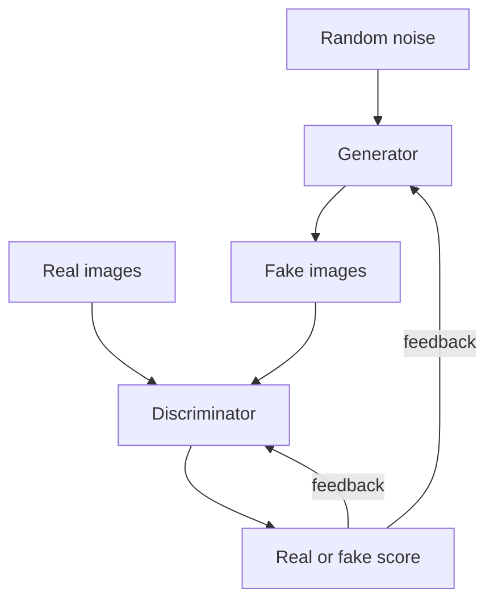

# What are Generative Adversarial Networks (GANs)?

> **Step 15: Multimodal AI and Generative Models** · ⏱️ 18 min read · [Read original](https://outcomeschool.com/blog/generative-adversarial-networks)

## TL;DR
A GAN is two neural networks competing: a Generator makes fakes and a Discriminator tries to catch them. Through this contest the Generator learns to produce data that looks real. GANs are powerful but hard to train, and Diffusion Models have largely overtaken them for images.

## Key Concepts
- **Generator** — turns random noise (latent vector) into fake data such as an image. Never sees real images directly; learns only from Discriminator feedback.
- **Discriminator** — outputs a score from 0 (fake) to 1 (real).
- **Minimax game** — Discriminator maximizes its success, Generator minimizes it.
- **Mode collapse** — Generator keeps producing the same output (e.g., only the digit 8).
- **DCGAN** — uses convolutional layers; more stable image generation.
- **Conditional GAN** — adds a condition so we control the output (e.g., digit 7).
- **StyleGAN** — NVIDIA; very realistic faces with style control.
- **CycleGAN** — image-to-image translation without paired data (horse to zebra).

## How It Works
Analogy: the Generator is a counterfeiter, the Discriminator is the police. Both improve until fakes are indistinguishable.

### Training loop (each round)
1. Take real images.
2. Generator turns noise into fake images.
3. Train Discriminator on real (label 1) and fake (label 0).
4. Train Generator so the Discriminator labels its fakes as real (1).
5. Repeat thousands of times.

```python
d_loss = loss_fn(D(real), ones) + loss_fn(D(G(z).detach()), zeros)
g_loss = loss_fn(D(G(z)), ones)
```
`detach()` stops the Generator being updated during the Discriminator step.

The equilibrium: Discriminator scores about 0.5 for everything (guessing), meaning the Generator has won.

### Training problems
- One side gets too strong (a too-good Discriminator gives no useful feedback).
- Training may never settle since both keep changing.
- Mode collapse. Mitigations: similar learning pace, better designs like DCGAN, improved losses.

### Applications
Image generation, deepfakes (misuse risk), super-resolution, art, photo editing, synthetic data, medical imaging.

## Diagram


## Key Takeaways
- GAN = Generator vs Discriminator in a minimax game.
- The Generator learns only through the Discriminator's feedback.
- Ideal end state: Discriminator score near 0.5.
- Main pains: unstable training and mode collapse.
- Conditional GANs give control; StyleGAN gives realistic faces; CycleGAN translates image domains.
- Diffusion Models improved on GAN instability and now dominate image generation.
