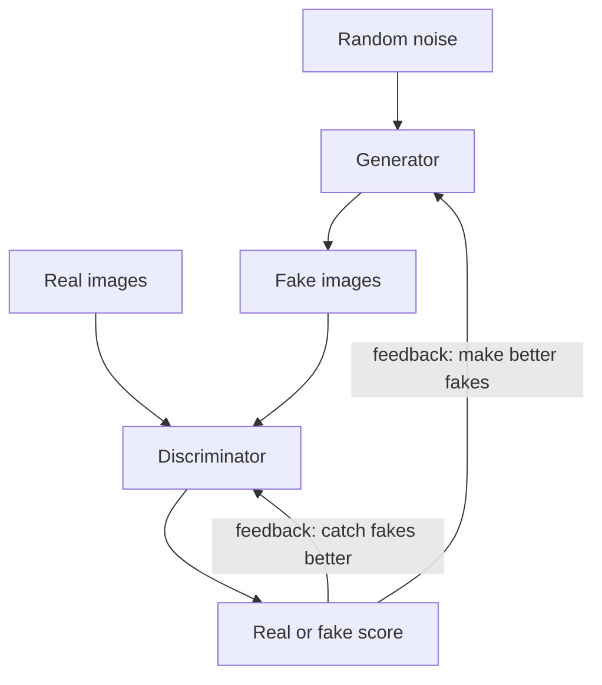
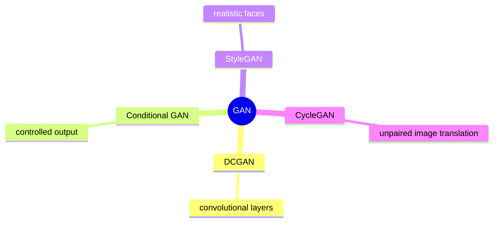

# What are Generative Adversarial Networks (GANs)?

> **Step 15: Multimodal AI and Generative Models** · ⏱️ 18 min read · [Read original](https://outcomeschool.com/blog/generative-adversarial-networks)

## TL;DR
A GAN pits two neural networks against each other: a Generator that turns random noise into fake data and a Discriminator that judges real vs fake. Alternating training pushes both to improve until fakes look real and the Discriminator can only guess (score ~0.5). GANs are powerful but unstable (mode collapse, imbalance), which is why diffusion models have largely overtaken them for image generation.

## Key Concepts
- **GAN** = Generative + Adversarial + Network.
- **Generator** — maps random noise (latent vector, a small list of random numbers acting like a seed) to fake data; never sees real images directly, learns only from Discriminator feedback.
- **Discriminator** — outputs a score 0 to 1 (near 1 = real, near 0 = fake).
- **Minimax game** — Discriminator maximizes its success, Generator minimizes it.
- **Loss** — number telling how wrong a network is.
- **Mode collapse** — Generator keeps producing the same output (e.g. only digit 8).
- **DCGAN / cGAN / StyleGAN / CycleGAN** — GAN variants (below).

## How It Works

### Analogy
Counterfeiter (Generator) vs police (Discriminator). Early fakes are obvious; the counterfeiter learns from being caught; police get smarter; repeat until fakes are indistinguishable.

### Training loop (repeat thousands of times)
1. Take real images.
2. Generator turns noise into fake images.
3. Show real + fake to Discriminator with labels; it learns to separate them.
4. Generator creates new fakes; if caught, it learns from the mistake.
5. Repeat. Feedback flows to both networks.

### Loss and minimax in words
- Discriminator wants ~1 on real, ~0 on fake. Generator wants ~1 on fakes.
- They pull opposite ways; equilibrium is score ~0.5 for everything (guessing), where the Generator has won.

The classic objective summarising this:

$$
\min_G \max_D \; \mathbb{E}[\log D(x)] + \mathbb{E}[\log(1-D(G(z)))]
$$

$x$ real sample, $z$ noise, $G(z)$ fake, $D(\cdot)$ real-probability.

### Code sketch
```python
# Generator: Linear(100,256) ReLU Linear(256,784) Tanh   -> 28x28 image from 100 noise values
# Discriminator: Linear(784,256) ReLU Linear(256,1) Sigmoid -> score in 0..1

# train D
fake = generator(noise)
d_loss = loss_fn(D(real), ones) + loss_fn(D(fake.detach()), zeros)
# train G
g_loss = loss_fn(D(generator(noise)), ones)   # G wants fakes labeled real
```
- D: real=ones, fake=zeros. G: fakes labelled ones (wants to be believed).
- `detach()` stops updating the Generator while training the Discriminator.

### Mode collapse
Generator finds one output that fools D (digit "8") and repeats it. Good: 0 1 2 ... 9. Collapsed: 8 8 8 8. Mitigations: change loss function, add variety in training, improved GAN designs.

### Training stability
Two competing networks make training delicate (see-saw):
- One side too strong: if D is too good, G gets no useful feedback; if G is too good, D is confused.
- Training may never settle as the balance keeps shifting.
- Mode collapse.
Fixes: similar learning pace for both, better designs like DCGAN, smoother loss functions.

### Types
| GAN Type | Main Idea | Common Use |
|---|---|---|
| DCGAN | Convolutional layers for images | Clear, stable image generation; common starting point |
| Conditional GAN | Extra condition controls output (e.g. digit 7) | Generating a specific category |
| StyleGAN (NVIDIA) | Controls style/detail (hair, age, expression) | Highly realistic faces ("this person does not exist") |
| CycleGAN | Translates image types without paired examples | Horse to zebra, summer to winter, photo to painting |

### Applications
Image generation; deepfakes (face swap; misuse risk of false information); super-resolution; art and design; photo editing (hairstyle, age, expression, add/remove objects); data generation for training; medical imaging (research images, better scans). Watermarking is needed to tell generated content apart.

## Diagram(s)

### Adversarial training loop


### GAN variants


## Trade-offs & Pitfalls
- Hard to train: imbalance, no convergence, mode collapse.
- Generator gets only indirect feedback.
- Deepfakes can be misused.
- Diffusion models fixed much of the instability and largely replaced GANs for images.

## FAQ
- Does G see real images? -> No, only D's feedback.
- Score 0.5? -> D is guessing; balance point, G has won.
- Control output? -> Conditional GAN.
- Still best for images? -> No, diffusion has largely overtaken.
- Why detach()? -> Do not update G while training D.

## Key Takeaways
- Two networks: Generator creates, Discriminator judges.
- Training alternates D then G; G learns only through D's feedback.
- Minimax: D maximizes detection, G minimizes it; equilibrium at 0.5.
- Mode collapse = loss of variety; instability = two moving targets.
- Variants: DCGAN, cGAN, StyleGAN, CycleGAN.
- Diffusion models improved on GAN instability and now dominate image generation.
