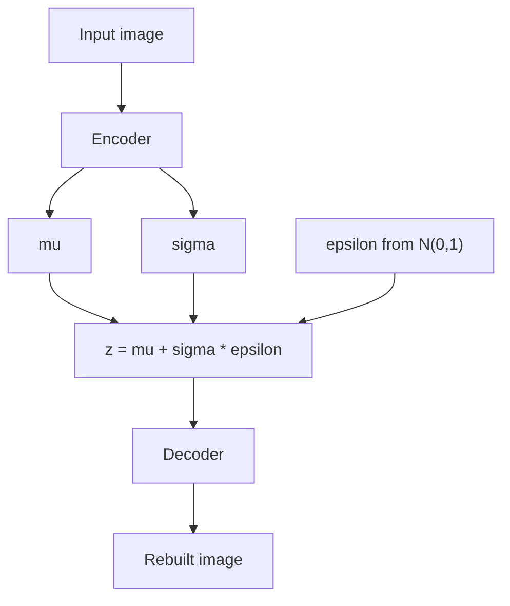
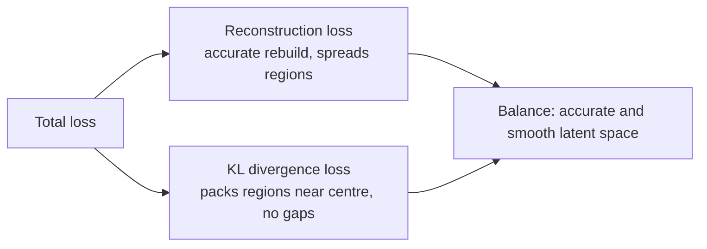

# What are Variational Autoencoders (VAEs)?

> **Step 15: Multimodal AI and Generative Models** · ⏱️ 19 min read · [Read original](https://outcomeschool.com/blog/variational-autoencoders)

## TL;DR
A VAE is an autoencoder whose encoder outputs a distribution (mean and standard deviation) instead of a single point, so latent regions overlap and form a smooth, gap-free latent space. Sampling uses the reparameterization trick (z = mu + sigma x epsilon) to keep backpropagation working, and the loss is reconstruction + KL divergence. After training, any point sampled near the centre decodes to new, meaningful data.

## Key Concepts
- **Autoencoder** — encoder (compress to small latent vector / code) + decoder (rebuild input); trained by reconstruction.
- **Latent space** — "hidden" compressed space storing the most important features; compression discards noise.
- **Distribution / normal (Gaussian, bell curve)** — described by mean $\mu$ (centre) and standard deviation $\sigma$ (spread).
- **VAE** — autoencoder + smooth, organised latent space; each input maps to a region, not a point.
- **Latent vector z** — a sample from the encoder's distribution.
- **Reparameterization trick** — move randomness into an external $\epsilon$.
- **Reconstruction loss** — how close rebuilt output is to input.
- **KL divergence** — how different the encoder's distribution is from standard normal (mean 0, std 1).

## How It Works

### Problem with a normal autoencoder
Good at rebuilding seen inputs, bad at creating new ones. Each input lands on a single latent point, with big empty gaps between points. A random point may land in a gap the decoder never saw, giving a blurry mess. The latent space is not continuous or organised.

### VAE idea
Instead of "this 7 lives exactly at 1.5", say "around 1.5, give or take a little". Regions overlap and fill gaps, so any random point decodes meaningfully.

### Three parts
1. **Encoder** — outputs $\mu$ and $\sigma$ (not one vector).
2. **Latent sampling** — sample z from that distribution; the same input gives slightly different z each time, so the decoder learns from the whole region.
3. **Decoder** — rebuilds the image from z.

### Reparameterization trick
Sampling is random and blocks gradients, so backpropagation could not reach $\mu$ and $\sigma$. Rewrite:

$$z=\mu+\sigma\cdot\epsilon,\quad \epsilon\sim\mathcal N(0,1)$$

Randomness is isolated in $\epsilon$ (independent of the network); the path from $\mu,\sigma$ to z is plain multiply and add, so gradients flow. This is the heart of the VAE.

### Loss
$$\text{Total Loss}=\text{Reconstruction Loss}+\text{KL Divergence Loss}$$
- Reconstruction pushes accurate rebuilds, spreading regions apart so inputs are not confused.
- KL pulls every region towards the centre (standard normal), packing them together and removing gaps. Without KL the regions drift apart and gaps return.
- The two oppose each other; the balance gives a space that is both accurate and smooth.

### Numeric example (1D)
Image of 7: $\mu=1.5$, $\sigma=0.2$; draw $\epsilon=0.5$; $z=1.5+0.2\times0.5=1.6$; decoder rebuilds a 7. Compute reconstruction + KL loss, update. Next time $\epsilon$ differs, z = 1.55 or 1.62 or 1.48, so the whole region around 1.5 produces a 7. To generate new data after training, pick any random point near the centre (KL packed regions there) and decode.

### Code essentials
```python
class VAE(nn.Module):
    # encoder Linear(784,400); fc_mu Linear(400,2); fc_sigma Linear(400,2) -> log sigma
    # decoder Linear(2,400) ReLU Linear(400,784) Sigmoid
    def forward(self, x):
        h = relu(self.encoder(x)); mu = self.fc_mu(h); log_sigma = self.fc_sigma(h)
        eps = randn_like(mu)
        z = mu + exp(log_sigma) * eps          # reparameterization
        return self.decoder(z), mu, log_sigma

def vae_loss(rebuilt, original, mu, log_sigma):
    recon = mse_loss(rebuilt, original, reduction='sum')
    kl = -0.5 * sum(1 + 2*log_sigma - mu**2 - exp(2*log_sigma))
    return recon + kl
```
Network outputs log sigma for stability and guaranteed positive spread; sigma is recovered with exp.

### Advantages
- Generates brand new data (sample a point, decode).
- Smooth latent space: moving gradually morphs outputs (4 slowly becomes 9).
- Organised: similar inputs are near each other.
- Stable training: clear, well-behaved loss.

### Uses
Image generation; anomaly detection (cannot rebuild abnormal data well, e.g. fraud/faults); data compression; drug discovery (new molecules); denoising. Foundation of modern generative models: Stable Diffusion uses a VAE to build its latent space. GANs (two competing networks) and autoregressive models (piece by piece) take different routes. Encoders also compress observations for agents (world models).

## Diagram(s)

### VAE flow


### Loss balance


## Trade-offs & Pitfalls
- Reconstruction and KL conflict; tuning the balance matters.
- Remove KL and gaps return (random samples become garbage).
- Plain autoencoders cannot generate reliably.

## FAQ
- Normal autoencoder generate? -> Not reliably; gaps give blurry output.
- Remove KL? -> gaps return, regions spread apart.
- Why log sigma? -> stability and positivity; use exp to recover sigma.
- VAE vs GAN? -> VAE samples a smooth latent space, easier and more stable; GAN uses two competing networks.
- VAE and Stable Diffusion? -> SD uses a VAE to build its latent space.

## Key Takeaways
- Autoencoder = encoder + decoder; VAE adds a probabilistic, smooth latent space.
- Encoder outputs mu and sigma; z is sampled.
- Reparameterization $z=\mu+\sigma\epsilon$ makes sampling differentiable.
- Loss = reconstruction + KL divergence (to standard normal).
- KL packs regions, enabling generation from random latent points.
- Used for generation, anomaly detection, compression, drug discovery, denoising, and as a component in latent diffusion.
