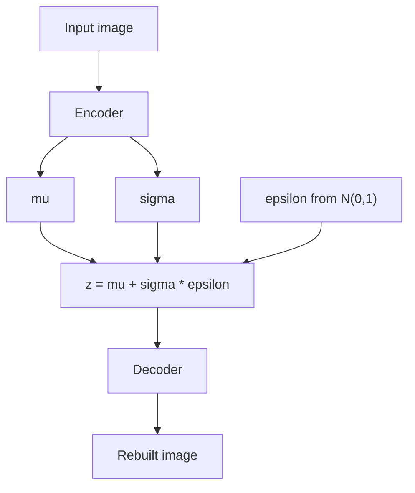

# What are Variational Autoencoders (VAEs)?

> **Step 15: Multimodal AI and Generative Models** · ⏱️ 19 min read · [Read original](https://outcomeschool.com/blog/variational-autoencoders)

## TL;DR
A VAE is an Autoencoder that learns a smooth, organized latent space by encoding each input as a distribution rather than a single point. Because there are no holes, we can sample any point and the decoder generates new, meaningful data.

## Key Concepts
- **Autoencoder** — Encoder + Decoder; compresses input into a latent vector and rebuilds it (reconstruction).
- **Latent space** — hidden compressed space holding the key features.
- **Problem with plain Autoencoders** — inputs land at scattered points with empty gaps; sampling a gap gives garbage.
- **VAE** — encoder outputs a mean $\mu$ and standard deviation $\sigma$ describing a Gaussian region, so regions overlap and fill gaps.
- **Reparameterization trick** — move randomness into $\epsilon$ so gradients can flow.
- **KL divergence** — measures how far the encoder's distribution is from standard normal (mean 0, std 1).

## How It Works
1. **Encoder** outputs $\mu$ and $\sigma$ for the input.
2. **Sample** $z$ from that distribution.
3. **Decoder** rebuilds the input from $z$.

### Reparameterization trick
Random sampling blocks backpropagation. Rewrite it as:

$$z = \mu + \sigma \cdot \epsilon,\quad \epsilon \sim \mathcal{N}(0,1)$$

Randomness sits only in $\epsilon$, outside the learning path, so gradients flow through $\mu$ and $\sigma$.

### Loss
$$\text{Total Loss} = \text{Reconstruction Loss} + \text{KL Divergence Loss}$$
- Reconstruction pushes regions apart so inputs are rebuilt accurately.
- KL pulls all regions toward the center, removing gaps. Without KL, gaps return.
- The two pull against each other; the balance gives an accurate and smooth space.

### Example
Digit 7: $\mu=1.5$, $\sigma=0.2$, $\epsilon=0.5$ gives $z=1.6$. Next time $\epsilon$ differs, so the whole region around 1.5 learns to produce a 7. To generate, sample near the center and decode.

In code, the network outputs `log_sigma` (stable, keeps sigma positive); `sigma = exp(log_sigma)`.

### Uses
Image generation, anomaly detection (poor reconstruction means anomaly), compression, drug discovery, denoising. Stable Diffusion uses a VAE to build its latent space.

## Diagram

## Key Takeaways
- Plain Autoencoders reconstruct well but generate badly because the latent space has gaps.
- A VAE maps inputs to distributions ($\mu$, $\sigma$), producing a smooth latent space.
- Reparameterization ($z=\mu+\sigma\epsilon$) makes sampling differentiable.
- Loss = reconstruction + KL divergence, which pull in opposite directions.
- Smooth space enables interpolation (e.g., a 4 morphing into a 9) and sampling new data.
