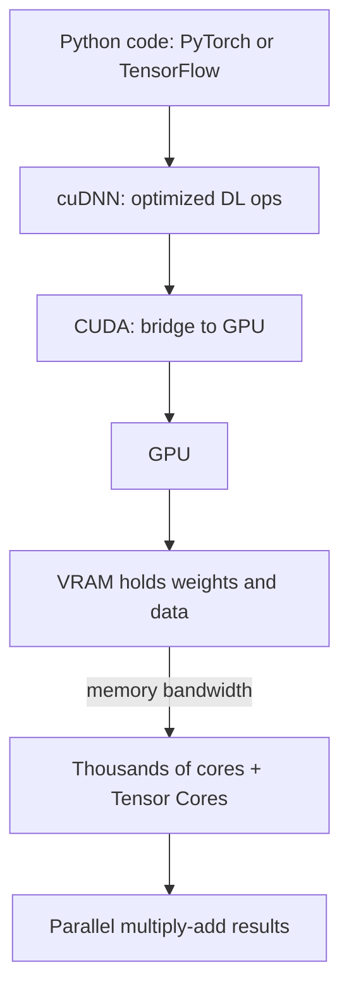

# How does a GPU work for Deep Learning?

> **Step 16: AI Infrastructure, Deployment, and System Design** · ⏱️ 24 min read · [Read original](https://outcomeschool.com/blog/how-does-a-gpu-work-for-deep-learning)

## TL;DR
Deep learning is mostly matrix multiplication, which is millions of small, independent multiply-add operations. A GPU has thousands of simple cores that run them in parallel, backed by fast VRAM, Tensor Cores and the CUDA software stack, so it is far faster than a CPU for this work.

## Key Concepts
- **CPU vs GPU** — CPU: a few powerful cores for complex tasks. GPU: thousands of simple cores for many simple calculations at once.
- **Matrix multiplication** — a huge number of independent multiply-add steps; the core of neural networks.
- **VRAM** — the GPU's own memory (the "desk"); the model and data must fit in it.
- **Memory bandwidth** — how fast numbers move between memory and cores (the "width of the door").
- **Tensor Cores** — units that do blocks of matrix math in one shot.
- **Lower precision** — FP32 (32-bit), FP16/BF16 (16-bit, about 2x faster, half memory), INT8 (8-bit, often for inference). Converting a trained model down is quantization.
- **CUDA / cuDNN** — NVIDIA's platform to run code on the GPU, and its library of optimized deep learning ops.
- **NVLink** — high-speed GPU-to-GPU connection.

## How It Works
**Analogy:** one math professor (CPU core) solving a million sums in a line vs thousands of students (GPU cores) each solving one sum together.

**Serial vs parallel:** each output cell in a matrix product (e.g., $(1\times5)+(2\times7)=19$) is independent, so work can be handed to thousands of cores at once.

**Memory matters:** a GPU needs both compute and the ability to feed it. Large models need large VRAM (24, 40, 80 GB examples). Training needs even more for extra working numbers.

**Software stack:** PyTorch/TensorFlow, then cuDNN, then CUDA, then GPU. In PyTorch, `.to("cuda")` moves tensors so `x @ y` runs on the GPU.

### Training vs inference
| Point | Training | Inference |
|---|---|---|
| Goal | Teach the model | Use the trained model |
| Math | Forward and backward | Forward only |
| GPU need | Very high | Lower |
| When | Once, while building | Every user request |

### Multiple GPUs
- **Data parallelism** — full model copy per GPU, data split, GPUs sync.
- **Model parallelism** — model split across GPUs when too big for one VRAM; results passed between them.

### Why NVIDIA
Right hardware (cores, Tensor Cores, VRAM, bandwidth, NVLink) plus mature software (CUDA, cuDNN, framework support). Alternatives exist: Google TPU, LPU.

## Diagram

## Key Takeaways
- Deep learning = matrix multiplication = millions of independent multiply-adds, ideal for parallel hardware.
- CPU: few smart cores; GPU: thousands of simple cores.
- Model must fit in VRAM; otherwise split across GPUs.
- Tensor Cores plus FP16/BF16/INT8 give big speedups with little quality loss.
- Most people use CUDA/cuDNN indirectly via PyTorch or TensorFlow.
- Training (forward + backward) is much heavier than inference (forward only).
