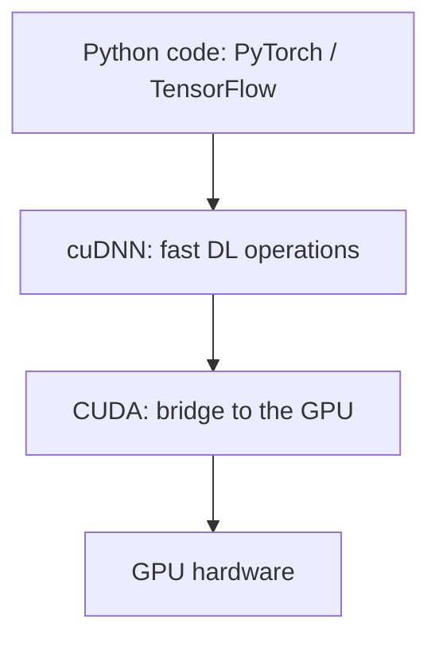
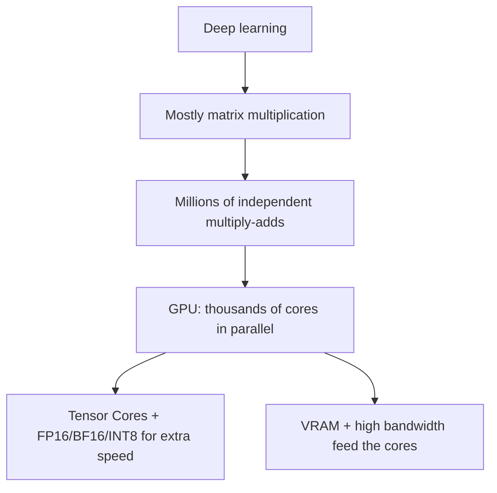
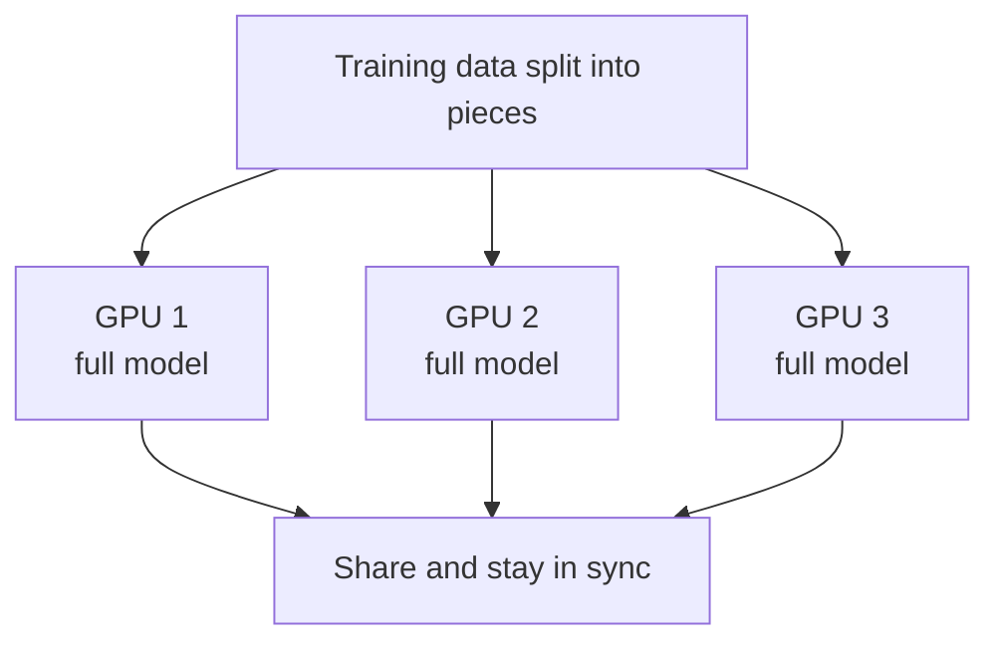

# How does a GPU work for Deep Learning?

> **Step 16: AI Infrastructure, Deployment, and System Design** · ⏱️ 24 min read · [Read original](https://outcomeschool.com/blog/how-does-a-gpu-work-for-deep-learning)

## TL;DR
Deep learning is mostly matrix multiplication, which is millions of small, independent multiply-add operations. A GPU has thousands of simple cores that run them in parallel (a CPU has a few powerful cores working mostly serially). Fast VRAM and memory bandwidth feed the cores, Tensor Cores and lower precision speed it up further, and CUDA/cuDNN let frameworks like PyTorch use it. Multiple GPUs scale to huge models.

## Key Concepts
- **GPU** — Graphics Processing Unit; built for graphics (millions of independent pixels), repurposed for AI.
- **CPU** — few (4 to 64) powerful cores for complex tasks and decisions.
- **Neural network / weights** — big collection of adjustable numbers; main work = multiplication and addition.
- **Matrix / matrix multiplication** — grid of numbers; many multiply-add steps.
- **Serial vs parallel** — one after another vs many at once.
- **VRAM** — GPU's own memory (the "desk") holding weights and data.
- **Memory bandwidth** — speed of moving numbers between memory and cores (width of the "door").
- **Tensor Core** — unit that does a small block of matrix math in one shot.
- **FP32 / FP16 / BF16 / INT8** — 32-bit float; 16-bit float (BF = brain floating point, made for DL); 8-bit integer.
- **Quantization** — deliberately converting a trained model to lower precision.
- **CUDA** — NVIDIA's platform to run code on the GPU; **cuDNN** — CUDA Deep Neural Network library of optimised DL ops.
- **Data / model parallelism, NVLink** — multi-GPU strategies and NVIDIA's fast GPU interconnect.
- **Training vs inference** — learning vs using a trained model.

## How It Works

### CPU vs GPU
| Point | CPU | GPU |
|---|---|---|
| Cores | A few (4 to 64) | Thousands |
| Power per core | Very powerful and smart | Simpler |
| Best at | Complex tasks, decisions, running apps | Many simple calculations at once |
| Style | A few things, very fast | Huge number of things together |

Analogy: one math professor solving a million sums one by one (CPU) vs thousands of students each solving one sum at once (GPU). For one hard problem the professor wins; for a million simple sums the students win. Deep learning is the second kind.

### Why matrix multiplication
Example: [[1,2],[3,4]] x [[5,6],[7,8]]; top-left = (1x5)+(2x7) = 19. Each output cell is independent of the others. Real matrices have thousands of rows and columns, so one multiplication = millions of independent multiply-adds: perfect for parallel hardware. CPU: add 1 -> add 2 -> ... serial. GPU: hands out thousands at once. Turns days into hours.

### Memory
- Numbers sit in VRAM and flow to cores through the memory bandwidth; high bandwidth stops cores idling. Good GPU needs both compute and feeding speed.
- **Model must fit in VRAM**: billions of weights need many GB just for weights, and training needs more for extra working numbers. Typical GPUs: 24, 40, 80 GB. Too big -> split across GPUs. VRAM decides how big a model you can run, not only speed.

### Tensor Cores and precision
FP32 = high precision, more space/time. FP16/BF16 = half the space, roughly 2x faster. INT8 = smallest, fastest, often used for inference. Neural nets do approximate pattern matching, so tiny rounding rarely matters: nearly no quality loss. Tensor Cores + lower precision are a main reason modern GPUs are so fast.

### Software stack

```python
x = torch.randn(1000, 1000).to("cuda")
y = torch.randn(1000, 1000).to("cuda")
result = x @ y   # runs on GPU cores and Tensor Cores
```
Most people never write CUDA/cuDNN directly. TensorRT-LLM is a further NVIDIA layer just for running finished LLMs fast.

### Training vs inference
| Point | Training | Inference |
|---|---|---|
| Goal | Teach the model | Use the trained model |
| Math | Forward and backward | Forward only |
| GPU power | Very high | Lower |
| When | Once, while building | Every time a user asks |
Training is the most expensive part; INT8 is common for inference.

### Multiple GPUs
- **Data parallelism**: full model copy on each GPU, split the data, each trains on its piece, then share and stay in sync; faster training.
- **Model parallelism**: model too big for one GPU, so split it into parts on different GPUs that pass results along; runs models larger than one VRAM.
- **NVLink**: high-speed GPU-to-GPU link.

### Why NVIDIA
Right hardware (thousands of cores, Tensor Cores, large VRAM, high bandwidth, NVLink) plus mature software (CUDA, cuDNN; PyTorch and TensorFlow built on them, so code just works). Alternatives: Google TPU (same job), LPU (chip that only runs already-trained language models). LLMs with billions of weights train on huge NVIDIA clusters, thousands of GPUs for weeks.

## Diagram(s)

### Why GPUs fit deep learning


### Data parallelism


## Trade-offs & Pitfalls
- Choose GPUs by VRAM as well as speed.
- Lower precision trades a little exactness for 2x speed and half memory.
- Training needs far more power and VRAM than inference.
- Multi-GPU needs fast interconnects (NVLink) or communication slows it.

## FAQ
- Train on a CPU? -> Yes but slow, mostly serial.
- FP16/BF16 hurts quality? -> Almost not at all.
- Need to write CUDA? -> No; use PyTorch/TensorFlow, `.to("cuda")`.
- Model too big for VRAM? -> model parallelism across GPUs with NVLink.
- Inference as heavy as training? -> No, forward only, plus INT8.

## Key Takeaways
- Deep learning = giant pile of independent multiply-adds (matrix multiplication).
- CPU: few strong cores, serial; GPU: thousands of simple cores, parallel.
- VRAM capacity limits model size; bandwidth keeps cores fed.
- Tensor Cores plus FP16/BF16/INT8 give large speedups with little quality loss.
- CUDA, cuDNN and frameworks hide the low-level work.
- Scale with data or model parallelism over NVLink; NVIDIA wins on hardware plus software.
