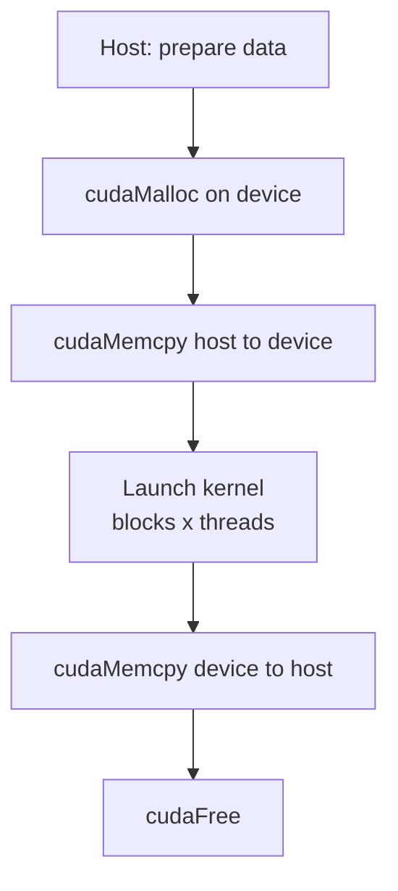
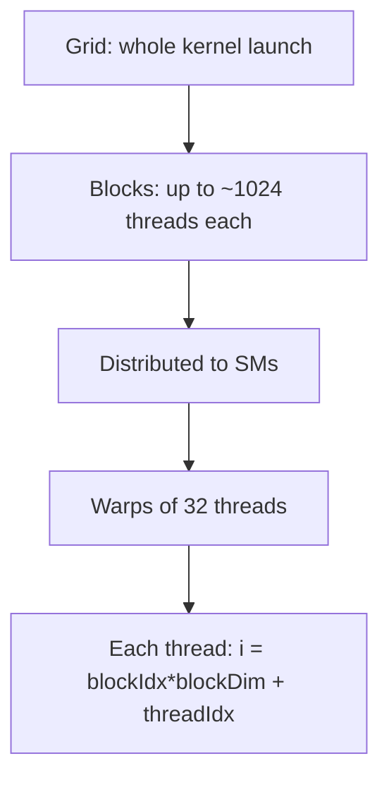

# How do CUDA Kernels work?

> **Step 16: AI Infrastructure, Deployment, and System Design** · ⏱️ 23 min read · [Read original](https://outcomeschool.com/blog/how-do-cuda-kernels-work)

## TL;DR
A CUDA kernel is a function written once for a single thread and executed by thousands of GPU threads in parallel, each using built-in indexes to find its own piece of data. Threads are grouped into blocks and grids, run on Streaming Multiprocessors in warps of 32, and use a memory hierarchy (global, shared, registers). Almost every operation inside an AI model is a CUDA kernel, usually from NVIDIA libraries.

## Key Concepts
- **CPU vs GPU** — CPU: few powerful cores, one task after another (master chef). GPU: thousands of small cores in parallel (5,000 helpers peeling 10,000 potatoes). AI = millions of independent multiplies/adds.
- **CUDA** — NVIDIA platform to write code (C, C++, Python...) that runs on GPU cores. Before CUDA, data had to be disguised as a picture.
- **Kernel** — function that runs on the GPU, executed by many threads; written once for one thread.
- **Thread / Block / Grid** — worker / group of threads (up to ~1024; can share memory and talk) / group of blocks = one kernel launch.
- **Host / Device** — CPU + RAM / GPU + VRAM; separate memories.
- **`__global__`** — marks a kernel: called from host, runs on device.
- **Index variables** — `threadIdx.x`, `blockIdx.x`, `blockDim.x` (starting from 0).
- **SM (Streaming Multiprocessor)** — work unit with many cores; modern GPUs have 100+.
- **Warp** — 32 threads executing the same instruction together.
- **Warp divergence** — threads in a warp taking different branches, executed one path after another.
- **nvcc / .cu** — CUDA source extension and NVIDIA's compiler (handles host C++ and device kernels).
- **cuBLAS** — NVIDIA library of ready-made math kernels.

## How It Works

### Thread organization
Thread = one helper; block = a team at one table (can share memory); grid = whole kitchen. At launch you give number of blocks and threads per block. A block is capped (~1024 threads) so use many blocks; blocks are effectively unlimited, giving millions of threads. Indexes can be 1D, 2D (.y, images/matrices) or 3D.

### Host/device workflow
1. Prepare data on host.
2. `cudaMalloc` on device.
3. `cudaMemcpy` host to device.
4. Launch kernel.
5. `cudaMemcpy` device to host.
6. `cudaFree`.
Copying takes time (chef carries potatoes to another room).

### First kernel: vector add c[i] = a[i] + b[i], n = 1,000,000
CPU: for loop, one million iterations in sequence. CUDA:
```cuda
__global__ void add(int n, float *a, float *b, float *c) {
    int i = blockIdx.x * blockDim.x + threadIdx.x;
    if (i < n) c[i] = a[i] + b[i];
}
int threadsPerBlock = 256;
int blocks = (n + threadsPerBlock - 1) / threadsPerBlock;   // 3907
add<<<blocks, threadsPerBlock>>>(n, d_a, d_b, d_c);
```
- Loop is gone; each thread handles one i.
- Round-up gives 3907 blocks x 256 = 1,000,192 threads, so `if (i < n)` lets extra threads do nothing.
- `<<<blocks, threadsPerBlock>>>` is launch syntax; `d_` prefix = device pointers.

### How a thread finds its work
$$i=\text{blockIdx.x}\times\text{blockDim.x}+\text{threadIdx.x}$$
Examples (blockDim = 256): block 0 thread 0 -> 0; block 0 thread 5 -> 5; block 1 thread 0 -> 256; block 2 thread 10 -> 522. Each i is unique: table number and seat number tell the helper which potato to pick.

### Inside the GPU
- Blocks are distributed over SMs; each SM takes a few, finishes, then takes more.
- Inside an SM threads run in warps of 32 sharing one instruction (fetched once, applied to 32 threads), which is why CUDA is fast.
- Warp divergence: an `if` splitting threads makes the warp run both paths serially. Keep threads doing the same thing. The `i < n` check diverges only in the last block, so it is harmless.

### Memory
| Memory | Scope | Speed |
|---|---|---|
| Global (VRAM, 24 or 80 GB) | All threads; holds d_a, d_b, d_c | Large but slow (~100x slower than shared) |
| Shared | Per-SM, threads of same block (whiteboard at the table) | Small, very fast |
| Registers | Per thread (variable i; notepad) | Fastest |

Trick: load a chunk from global into shared once, let block threads reuse it many times, write result back. Useless for vector add (each number used once), but huge for matrix multiplication; same idea behind Flash Attention.

### Why it matters for AI
Models are weights; inputs are multiplied and added across layers, so nearly everything is matrix multiplication where every output is independent. One matmul kernel launched with millions of threads. `torch.matmul(a, b)` calls an optimised NVIDIA kernel (e.g. cuBLAS) with many extra speed tricks; TensorRT-LLM fuses and tunes kernels. Each generated word triggers thousands of kernels in sequence.

## Diagram(s)

### Host and device flow


### Thread hierarchy and execution


### Memory hierarchy


## Trade-offs & Pitfalls
**Works well** when: same operation over lots of data (matmul, image processing, simulation); independent calculations; enough work that time saved exceeds host-device copy time.
**Fails or does not help** when:
- Small tasks (copying 10 numbers costs more than adding on CPU).
- Sequential dependencies (step 2 needs step 1).
- Heavy branching causes warp divergence.
- Data too big for GPU memory, so constant copying becomes the bottleneck.

| CPU | GPU |
|---|---|
| Few powerful cores (4 to 64) | Thousands of small cores |
| One task after another | Same task on lots of data at once |
| Logic, decisions, OS | Math on big tables, graphics, AI |
| No copying needed | Data copied to and from GPU |

## FAQ
- Need to write CUDA for PyTorch? -> No; `torch.matmul` calls optimised kernels (cuBLAS).
- Why `if (i < n)`? -> rounded-up launch has extra threads.
- Threads per block? -> usually up to 1024; use many blocks.
- Warp divergence? -> threads in a warp take different paths, run serially.
- Compile? -> `.cu` file with `nvcc`.

## Key Takeaways
- Write the kernel once for one thread; the GPU runs it thousands of times in parallel.
- Global index = blockIdx x blockDim + threadIdx gives each thread unique data.
- Host and device memories are separate: allocate, copy, launch, copy back, free.
- Blocks run on SMs; threads execute in warps of 32, so avoid divergence.
- Global memory is big and slow, shared is small and fast, registers fastest; stage data in shared memory.
- GPUs lose on small, sequential, branchy or oversized workloads.
- Nearly every AI operation is a CUDA kernel, usually from NVIDIA libraries.
