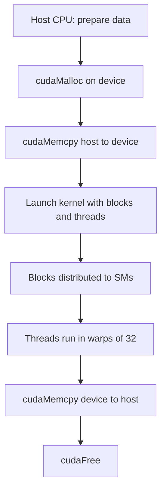

# How do CUDA Kernels work?

> **Step 16: AI Infrastructure, Deployment, and System Design** · ⏱️ 23 min read · [Read original](https://outcomeschool.com/blog/how-do-cuda-kernels-work)

## TL;DR
A CUDA Kernel is a function written once for a single thread and run by thousands of GPU threads in parallel, each computing its own index to pick its piece of data. Nearly every operation in an AI model is such a kernel.

## Key Concepts
- **CUDA** — NVIDIA's platform for writing programs that run on the GPU.
- **Kernel** — function that runs on the GPU (`__global__`), executed by many threads.
- **Thread / Block / Grid** — thread is one worker; block is a group (max usually 1024 threads, can share memory); grid is all blocks of a launch.
- **Host / Device** — CPU + RAM vs GPU + VRAM; separate memories, so data must be copied.
- **SM (Streaming Multiprocessor)** — work unit in the GPU; blocks are distributed across SMs.
- **Warp** — 32 threads executing the same instruction together.
- **Warp divergence** — threads in a warp take different branches, so both paths run serially.

## How It Works
### Host workflow
1. Prepare data on host. 2. `cudaMalloc` on device. 3. `cudaMemcpy` host to device. 4. Launch kernel. 5. `cudaMemcpy` device to host. 6. `cudaFree`.

### Vector add kernel
```c
__global__ void add(int n, float *a, float *b, float *c) {
    int i = blockIdx.x * blockDim.x + threadIdx.x;
    if (i < n) c[i] = a[i] + b[i];
}
add<<<blocks, threadsPerBlock>>>(n, d_a, d_b, d_c);
```
The loop disappears; each thread handles one `i`. For $n$=1,000,000 and 256 threads per block: blocks = $\lceil n/256 \rceil$ = 3907, giving 1,000,192 threads, so the `if (i < n)` guard stops extras.

### Finding its work
$$i = \text{blockIdx.x} \times \text{blockDim.x} + \text{threadIdx.x}$$
Example: thread 10 in block 2 gives $2\times256+10=522$. Every thread gets a unique `i`. Dimensions can be 1D, 2D (`.y`), or 3D.

### Memory hierarchy
| Memory | Scope | Speed |
|---|---|---|
| Global (VRAM) | All threads | Large, slow (~100x slower than shared) |
| Shared | Threads in one block | Small, fast |
| Registers | Per thread | Fastest |

Common trick: load a chunk to shared memory once, reuse it many times, write back (key to matmul and Flash Attention).

### When it works
Works well: same op on lots of data, independent calculations, enough work to outweigh copy cost. Fails: tiny tasks, sequential dependencies, heavy branching, data larger than GPU memory.

In PyTorch, `torch.matmul` calls optimized NVIDIA kernels (e.g., cuBLAS); an LLM generating a word launches thousands of kernels. Code lives in `.cu` files compiled with `nvcc`.

## Diagram


## Key Takeaways
- Write the kernel once for one thread; the GPU runs it thousands of times.
- Each thread computes a unique global index from blockIdx, blockDim, threadIdx.
- Host and device memories are separate, so copying costs time.
- Warps of 32 run in lockstep; avoid divergence.
- Use shared memory to cut slow global memory access.
- GPUs help only for large, parallel, independent work.
