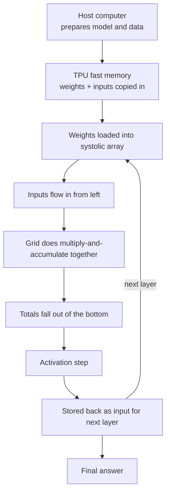
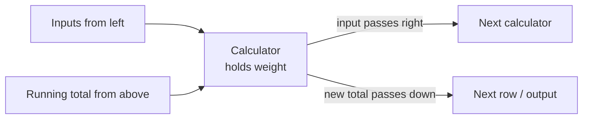

# How does a Google TPU work?

> **Step 16: AI Infrastructure, Deployment, and System Design** · ⏱️ 16 min read · [Read original](https://outcomeschool.com/blog/how-does-a-google-tpu-work)

## TL;DR
A TPU (Tensor Processing Unit) is a Google-built chip specialised for machine learning math. Its core is a systolic array: a grid of tiny multiply-and-accumulate calculators that pass data to neighbours instead of going back to memory. It trades flexibility for large speed and power-efficiency gains on matrix multiplication.

## Key Concepts
- **Tensor** — a grid of numbers (single number, list, or table).
- **TPU** — chip that eats grids of numbers and returns new grids, very fast.
- **CPU** — smart, flexible, does one or a few things at a time.
- **GPU** — thousands of smaller workers running in parallel; still flexible, which costs speed and power.
- **Matrix multiplication** — combining two tables of numbers; the core ML operation.
- **Weight** — number learned in training; decides how important an input is.
- **Multiply-and-accumulate (MAC)** — multiply two numbers, add to a running total.
- **MXU (Matrix Multiply Unit)** — main TPU part, contains the systolic array.
- **Systolic array** — grid of MAC calculators; "systolic" from heartbeat-like rhythmic data pulses.
- **Activation** — simple rule deciding result strength, e.g. negatives become zero.
- **Host** — normal computer that controls the TPU and feeds it work.
- **Edge TPU** — tiny TPU for small devices (cameras, sensors).

## How It Works

### Why Google built it
- Around 2013 voice/photo search and translation (all ML) were growing. If everyone used voice search a few minutes a day, Google would need to double its data-center computers: too costly.
- Normal chips do many things reasonably well; ML needs one kind of math billions of times. So Google built a chip from scratch for only that.

### The core operation
Matrix multiplication reduces to multiply-and-accumulate. Example: inputs 2, 3, 4 and weights 5, 6, 7:

$$(2\times5)+(3\times6)+(4\times7)=10+18+28=56$$

A neural network does this billions of times, so a chip that does MAC extremely fast wins.

### Systolic array
- Example grid: 128 x 128 = 16,384 calculators on one chip.
- Normal chips send each result back to memory and fetch the next number (slow, power-hungry).
- In a systolic array, calculators pass results directly to neighbours, like water down steps. Data keeps moving; calculators stay busy.

### Data flow in the grid
- Weights load first and stay in place, one per calculator.
- Inputs enter from the left and move right, one step at a time.
- Running totals flow top to bottom.
- Each calculator meets input + stored weight + total from above: multiplies, adds, passes the total down.
- Finished totals fall out the bottom: thousands of MACs in one smooth wave with almost no memory trips.

### Full journey (8 steps)
1. Host prepares model and data.
2. Weights and inputs copied into TPU fast memory (built close to calculators, saves time and power).
3. Weights loaded into the array.
4. Inputs flow in from the left, pulse by pulse.
5. Every calculator does MAC and passes results on.
6. Totals exit the bottom.
7. Activation step.
8. Results stored back and become input for the next layer; repeat until final answer.

## Why it is fast and power efficient
| Reason | Detail |
|---|---|
| One job well | Gives up CPU-style flexibility for matrix multiplication speed |
| Thousands of calculators | Huge amount of math at the same instant |
| Less memory talk | Biggest reason: memory movement dominates time and power in normal chips; systolic flow avoids most |
| Simpler numbers | ML often needs low precision: less energy, faster, more calculators fit on the chip |

Result: far more ML math per second with far less electricity, so Google serves huge models to billions without piles of new data centers.

## Where TPUs are used
- Google Search, Translate, Photos (faces, places, objects), voice assistants.
- Training very large models, including LLMs.
- Rentable by other companies via Google Cloud, no hardware purchase.
- Edge TPU runs ML on-device without sending data to a data center.

## Trade-offs & Pitfalls
- Not general-purpose: cannot run normal programs, browse the web, or play regular games; CPU still needed.
- Works best on large amounts of similar math; small or irregular tasks suit CPU or GPU better.
- Needs a host computer to control it.
- An LPU specialises further by dropping training and running only trained language models.

## FAQ
- TPU better than GPU? → For large similar ML math, faster and more power efficient; GPU flexibility costs speed/power; small or irregular tasks favour CPU/GPU.
- Use TPUs without buying hardware? → Yes, via Google Cloud.
- Used for LLM training? → Yes.
- Works without a normal computer? → No, needs a host.

## Key Takeaways
- TPU = chip specialised for matrix multiplication (multiply-and-accumulate).
- Systolic array: grid of MAC cells, weights stationary, inputs flow right, sums flow down.
- Speed comes from avoiding memory trips, not just parallelism.
- Lower-precision numbers save energy and allow more calculators.
- Trade-off: flexibility given up for speed and power efficiency.
- Motivation: Google's 2013 projection of doubling data centers for voice search.
