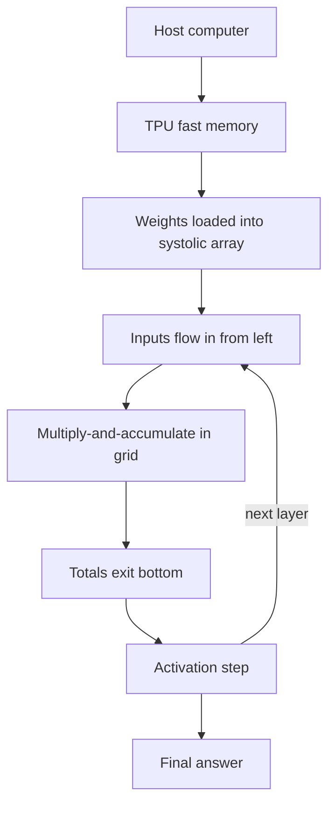

# How does a Google TPU work?

> **Step 16: AI Infrastructure, Deployment, and System Design** · ⏱️ 16 min read · [Read original](https://outcomeschool.com/blog/how-does-a-google-tpu-work)

## TL;DR
A TPU (Tensor Processing Unit) is a Google-built chip specialized for machine learning math. Its core is a systolic array that does matrix multiplication by passing data between neighboring calculators, avoiding slow memory trips, making it fast and power efficient.

## Key Concepts
- **Tensor** — a grid of numbers (a single number, list, or table).
- **Multiply-and-accumulate** — multiply two numbers and add into a running total; e.g., $(2\times5)+(3\times6)+(4\times7)=56$. Neural networks do this billions of times.
- **MXU (Matrix Multiply Unit)** — the main part of the TPU.
- **Systolic array** — grid of tiny multiply-accumulate calculators (e.g., 128 x 128 = 16,384) where results pass directly to neighbors, in rhythmic pulses like a heartbeat.
- **Edge TPU** — tiny TPU for cameras and sensors.

## How It Works
**Why built:** around 2013, Google realized that if everyone used voice search a few minutes a day, it would need to double its data center computers. It needed a chip doing ML math faster and with less power than normal chips.

**CPU vs GPU vs TPU:** CPU is one smart flexible worker; GPU is thousands of workers in parallel but still flexible; TPU gives up flexibility for speed and efficiency on matrix math.

### Data flow in the array
- Weights are loaded and stay in place, one per calculator.
- Inputs enter from the left and move right.
- Running totals move top to bottom.
- Each calculator: input x weight + running total, pass on. Finished totals fall out the bottom.

### Full journey
1. Host prepares model and data.
2. Weights and inputs copied into TPU fast memory (close to calculators).
3. Weights loaded into the array.
4. Inputs flow in pulse by pulse.
5. Multiply-and-accumulate everywhere in parallel.
6. Totals exit the bottom.
7. Activation step (e.g., negatives to zero).
8. Result feeds the next layer; repeat.

### Why fast and efficient
1. Does one job extremely well. 2. Thousands of calculators in parallel. 3. Far fewer memory trips (the big one). 4. Simpler, smaller numbers, so more calculators fit on the chip.

### Uses and limits
Used in Search, Translate, Photos, voice assistants, large model training, and rentable via Google Cloud. Not general-purpose: cannot run normal programs; weaker for small or irregular tasks.

## Diagram

## Key Takeaways
- TPU = Google's ASIC for matrix multiplication.
- Systolic array keeps data flowing between neighbors, avoiding memory round trips.
- Trades flexibility for speed and power efficiency.
- Needs a host computer; cannot replace a CPU.
- Edge TPU brings ML to small devices.
