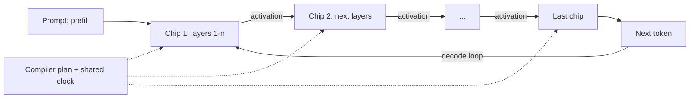

# How does an LPU work?

> **Step 16: AI Infrastructure, Deployment, and System Design** · ⏱️ 26 min read · [Read original](https://outcomeschool.com/blog/how-does-an-lpu-work)

## TL;DR
An LPU (Language Processing Unit, term from Groq) is a chip built only to run an already-trained LLM as fast as possible. LLM token generation is memory bound, so the LPU keeps weights in on-chip SRAM, has the compiler plan every clock cycle, and links hundreds of chips on one shared clock like an assembly line.

## Key Concepts
- **Inference only** — an LPU cannot train.
- **Memory bound** — producing one token requires reading every weight, but each weight gets just one multiply and one add; moving weights is the bottleneck, not math.
- **HBM vs SRAM** — GPU weights sit in HBM outside the chip (about 3 TB/s); LPU keeps them in on-chip SRAM (about 80 TB/s).
- **Deterministic execution** — the compiler decides everything before the chip runs, so timing is exact (no caches, branch predictors, or runtime schedulers).
- **Activation** — small bundle (few KB) passed between chips; weights never move.
- **Prefill vs decode** — prefill processes the known prompt together (compute bound); decode generates one token per trip (memory bound).

## How It Works
**Why GPUs struggle:** token generation is a chain; each token needs the previous one. Rough math for a 70B model in 8-bit (70 GB): $70/3000 \approx 23$ ms per token, about 43 tokens/s per user. Batching raises total throughput but not single-user speed, and a GPU spends area on guessing hardware.

**Idea 1, keep the model on chip:** with SRAM, $70/80000 \approx 0.875$ ms per token, about 1,100 tokens/s (about 26x faster). Numbers are rough, for illustration.

**Trade-off:** SRAM is tiny (about 230 MB per chip), so a 70 GB model needs about $70000/230 \approx 305$ chips. Layers are sliced across chips; only small activations travel.

**Idea 2, no guesswork:** the compiler schedules which unit does what on which clock cycle. Like a railway timetable vs a traffic crossing. Frees chip area for compute and SRAM, and gives exact latency.

**Idea 3, a network that never waits:** chips share a synchronized clock; the data arrives on a planned cycle, with no handshake, acknowledgement, or retry.

**Assembly line:** each chip is a station holding its weights; the activation is the car. Once chip 1 passes work on, it starts the next request, keeping the line full.

### LPU vs GPU
| Point | GPU | LPU |
|---|---|---|
| Built for | Any parallel math, train and infer | Trained LLM inference |
| Weights live in | HBM | SRAM |
| Memory per chip | Tens of GB | About 230 MB |
| Chips for large model | A few | Hundreds |
| Planning | Hardware at runtime | Compiler beforehand |
| Timing | Varies | Exact |
| Batching | Needed for throughput | Not needed |
| Training | Yes | No |
| Flexibility | Very high | Low |

**Good fit:** chat, voice, live translation, agents, reasoning models, predictable latency. **Poor fit:** training, small setups, new/changed models (plan must be rebuilt), long conversations (KV cache uses scarce SRAM), offline batch jobs where a big GPU batch is cheaper.

## Diagram

## Key Takeaways
- LLM decode is memory bound: win by moving data less, not computing more.
- LPU trades memory size for memory speed (SRAM), then spreads the model over hundreds of chips.
- Only tiny activations move between chips; weights stay put.
- Compiler-planned, deterministic execution removes caches, predictors, and network waiting.
- Great for single-user latency; not for training or flexibility.
