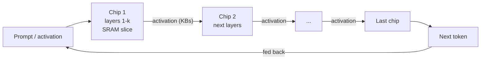
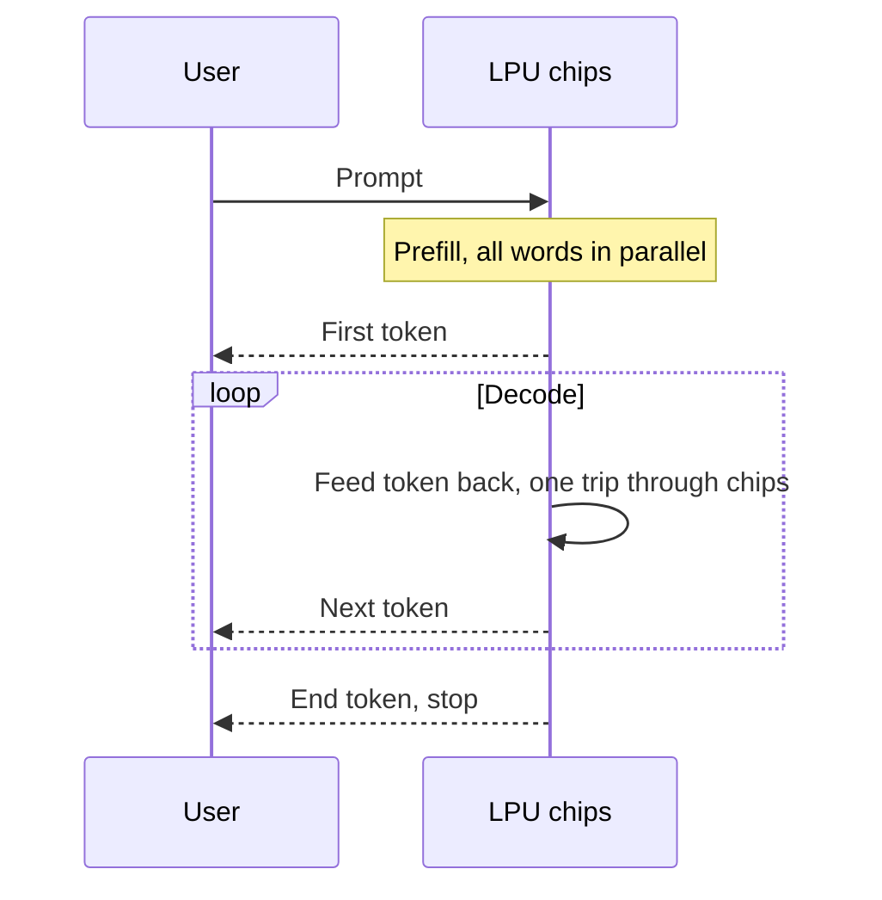

# How does an LPU work?

> **Step 16: AI Infrastructure, Deployment, and System Design** · ⏱️ 26 min read · [Read original](https://outcomeschool.com/blog/how-does-an-lpu-work)

## TL;DR
An LPU (Language Processing Unit, term from Groq) is an inference-only chip for running an already-trained LLM as fast as possible. Token generation is memory bound, so the LPU keeps all weights in on-chip SRAM across hundreds of chips, and a compiler schedules every clock cycle in advance (deterministic execution). It gives up memory size, flexibility and training for very high single-user token speed.

## Key Concepts
- **LPU** — specialist chip for inference of a trained language model; not for training.
- **CPU / GPU** — CPU is a general worker doing few things at a time; GPU is a big team for parallel math.
- **Token** — small piece of text; LLMs generate one at a time, each depending on the previous (a chain).
- **Weights / parameters** — learned numbers; "70B" = 70 billion. At 8 bits (1 byte) each, about 70 GB.
- **Memory bound vs compute bound** — memory bound: time is spent moving weights, not computing.
- **HBM** — High Bandwidth Memory beside the GPU chip; fast but off-chip.
- **Bandwidth** — bytes the memory can deliver per second.
- **SRAM** — memory inside the chip next to compute; far faster than HBM but small and costly.
- **Batching / throughput** — serve many users per weight read; raises total tokens/s, not per-user speed.
- **Activation** — small bundle of numbers (a few KB per token) passed between chips.
- **Compiler** — turns the model into an exact instruction plan, here fixed before the chip runs.
- **Clock cycle** — one beat of the chip's internal clock (over a billion per second).
- **Deterministic execution** — same work always takes the same time; "software-defined hardware".
- **Prefill / decode** — prompt processing (parallel) vs token-by-token generation.
- **Time to first token (latency)** — wait until the first word appears.
- **KV cache** — saved summary of what the model already read; grows with conversation.

## How It Works

### Generation is a chain
Loop: read the entire model, compute next token, append, stop at an end token. Token N+1 needs token N, so adding workers does not help; only making each link faster does.

### The bottleneck is memory
- Each token needs every weight read once, with just one multiply and one add per weight. The chip idles waiting for data.
- Chef analogy: chef cooks in seconds but the recipe books are across the road; a faster chef does not help.

### Why a GPU struggles
Numbers for a 70B model at 8-bit on a GPU with about 3 TB/s HBM:

$$
t=\frac{70\text{ GB}}{3000\text{ GB/s}}\approx 23\text{ ms/token}\approx 43\text{ tokens/s}
$$

- That is the ceiling even in the perfect case.
- Batching: read once, serve many users; high throughput, but each user's chain is still slow, and filling a batch adds delay.
- GPU flexibility (caches, runtime schedulers, reorder queues) costs area and power and makes timing unpredictable.
- Two problems: model too far away; chip spends effort guessing.

### Idea 1: keep the model on chip (SRAM)
With about 80 TB/s on-chip SRAM:

$$
t=\frac{70}{80000}\approx 0.875\text{ ms}\approx 1100\text{ tokens/s}
$$

About 26x faster for a single user, no batching. (Rough numbers; the gap matters, not the digits.) A person reads about 5 words/s, so text appears in paragraphs.

**Catch:** SRAM is expensive and takes chip space; an LPU chip has about 230 MB.

$$
\frac{70{,}000\text{ MB}}{230\text{ MB}}\approx 305\text{ chips}
$$

- Trade: give up memory size to gain memory speed.
- Fix: slice the model by layers, one slice per chip, held permanently.
- Only activations (a few KB) move between chips, not weights (hundreds of MB): the huge thing stays still.

### Idea 2: remove guesswork (compiler plans everything)
- Normal processors decide at run time: cache guesses, branch predictor, dynamic scheduler.
- LPU: compiler knows every layer and multiplication and plans which unit does what, and which data is on which wire, on each exact cycle. The chip only follows the plan.
- Analogy: traffic crossing (GPU) vs railway timetable (LPU).
- Wins: (1) area from caches/predictors/schedulers goes to compute and SRAM; (2) exact timing, latency known to the clock cycle in advance.

### Idea 3: a network that never waits
- Normal chip-to-chip links have messages, acks, collisions, queues, whose small delays pile up across hundreds of chips.
- LPU chips share a synchronized clock and the compiler plans inter-chip movement: e.g. chip 7 knows data from chip 6 arrives on a wire at cycle 4,120. No handshake, acknowledgement or retry.
- The cluster behaves like one big chip.

### The assembly line
Chip = station; weight slice = tools kept at the station; activation = the car; compiler = factory schedule. When chip 1 hands off, it immediately starts the next request, so the line stays full.

### Request lifecycle
1. Model loaded once; each chip stores its slice in SRAM; weights never move again.
2. Prompt read: all words known, pushed together (**prefill**). Compute bound, a GPU handles it well (see Prefill-Decode Disaggregation).
3. First token produced through all chips (time to first token).
4. Token fed back; repeat journey (**decode**), the memory-bound part the LPU fixes. (Speculative decoding is a software alternative.)
5. Each trip yields one token; stream is smooth and fast.
6. End token stops the loop.

## Why it is fast (summary)
- Weights never travel (SRAM). - Only small activations move. - No spend on guessing. - Timing planned, not discovered. - Chips never negotiate (shared clock). - Line stays full.

## LPU vs GPU
| Point | GPU | LPU |
|---|---|---|
| Built for | Any parallel math, training and inference | Running trained language model |
| Weights live in | HBM, beside chip | SRAM, inside chip |
| Memory speed | about 3 TB/s | about 80 TB/s |
| Memory per chip | tens of GB | about 230 MB |
| Chips for large model | a few | hundreds |
| Who plans work | Hardware at runtime | Compiler before running |
| Caches / branch prediction | Yes | No |
| Chip-to-chip | Messages, waiting, replies | Shared clock, no waiting |
| Timing | Varies | Exact, known in advance |
| Single-user speed | Moderate | Very high |
| Batching | Needed for good total output | Not needed for speed |
| Training | Yes | No |
| Flexibility | Very high | Low |

## Trade-offs & Pitfalls
- **Works well:** chat, voice assistants/live translation, AI agents (many model calls per task), reasoning models (e.g. 2,000 thinking tokens), workloads needing predictable latency.
- **Does not work well:**
  - Cannot train (weights change, extra bookkeeping memory needed).
  - Needs many chips (hundreds) for one model; no small setup.
  - Inflexible: new model or number format means rebuilding the whole plan.
  - KV cache lives in precious SRAM and grows with conversation length.
  - Cost per token: offline batch jobs (e.g. labelling a million documents overnight) can be cheaper on a GPU with large batches.
- **Use GPU** for training, experimentation, varied models, big offline batches (TensorRT-LLM helps). **Use LPU** for a fixed trained model where answer speed is felt (chat, voice, agents, reasoning).

## FAQ
- Who created it? → Term by Groq; ideas are general.
- More compute speeds up generation? → No for one user; memory bound, win by moving less data.
- Prefill or decode? → Mainly decode; prefill is compute bound.
- Does splitting across hundreds of chips slow it? → No; only KB activations move, shared clock, no waiting.

## Key Takeaways
- LLM generation is a sequential chain and memory bound: every token reads all weights.
- GPU ceiling for 70B 8-bit: about 23 ms/token (about 43 tok/s); SRAM: under 1 ms (about 1,100 tok/s).
- LPU trades memory size for speed: 230 MB/chip, about 305 chips for 70B.
- Compiler-scheduled, deterministic execution removes caches, predictors, and network handshakes.
- Weights stay put; only small activations flow along the chip pipeline.
- Great for latency-sensitive inference; poor for training, flexibility, and offline batch cost.
