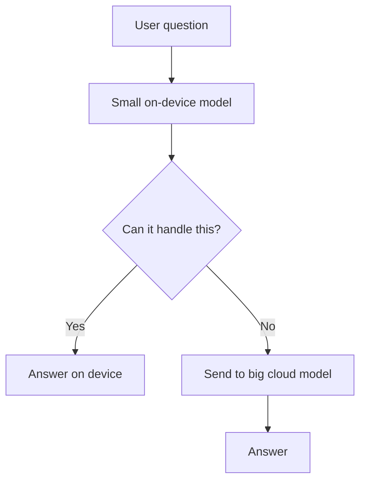

# Cloud vs On-device Model Deployment

> **Step 16: AI Infrastructure, Deployment, and System Design** · ⏱️ 29 min read · [Read original](https://outcomeschool.com/blog/cloud-vs-on-device-model-deployment)

## TL;DR
Deployment means choosing where a trained model runs for inference. In the cloud, data travels to the model; on-device, the model travels to the data. Each wins on different axes, and most real products end up hybrid.

## Key Concepts
- **Deployment** — a model plus a place where it runs.
- **Training vs inference** — training (almost always cloud) is heavy; inference is answering one question. This blog is about inference.
- **Cloud deployment** — big model on a data center server; device is a messenger.
- **On-device (edge) deployment** — model runs on the phone, car, camera, etc.
- **On-premise** — company's own servers; data leaves the device but stays inside the organization.
- **Hybrid** — small on-device model handles easy requests, big cloud model handles hard ones.
- **Federated learning** — devices learn locally and send only small updates, never raw data.

## How It Works
Compression for devices: **quantization** (fewer bits, e.g., 4 vs 16), **pruning** (remove low-value parts), **distillation** (small model learns from big one).

### Deciding rules
1. **Latency:** cloud round trip is about 50 to 200 ms; a car at 100 km/h travels about 5 m in 200 ms. Instant or unreliable network: on-device.
2. **Privacy:** privacy is a distance (on-device, on-premise, cloud). Deeply personal or legally restricted data: on-device.
3. **Model size:** cloud can host hundreds of billions of parameters; phones a few billion at most, compressed. Need maximum intelligence: cloud. The gap is closing yearly.
4. **Cost:** cloud cost grows with every request; on-device is a one-time engineering cost then flat, but the cost shifts to the user (battery, storage, heat). Huge user base on simple repeated task: on-device.
5. **Shipping:** cloud updates reach everyone instantly; on-device needs downloads and app updates, and some users never update. Frequent changes or no big download: cloud.
6. **Offline:** no network means a cloud feature fails. Must work offline: on-device.

### Comparison
| Point | Cloud | On-device |
|---|---|---|
| Data | Travels to server | Stays on device |
| Internet | Required | No |
| Speed | Network round trip | No round trip |
| Model size | Very large | Small, compressed |
| Quality | Highest | Good for focused tasks |
| Cost to us | Per request forever | Mostly one-time |
| Updates | Instant | App update, slow |
| Visibility | Logs available | Hard to see |

### Examples
Face unlock, keyboard prediction, noise cancellation, offline translation, self-driving: on-device. ChatGPT, image generation: cloud. Voice assistant: hybrid. Hospital reports: on-premise.

## Diagram

## Key Takeaways
- Cloud: data goes to the model. On-device: the model goes to the data.
- On-device wins on latency, privacy, offline use, and per-request cost; cloud wins on capability, updates, and visibility.
- Quantization, pruning, and distillation shrink models for devices but cannot match huge cloud models on hard reasoning.
- On-device cost does not vanish; it moves to the user's battery and storage.
- Hybrid is where most serious products land; on-premise suits regulated data.
