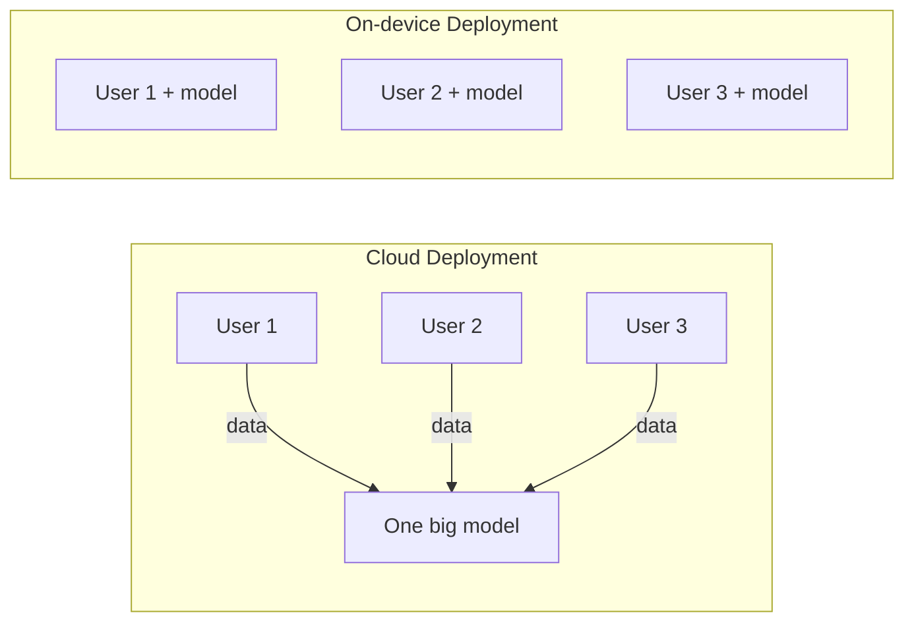
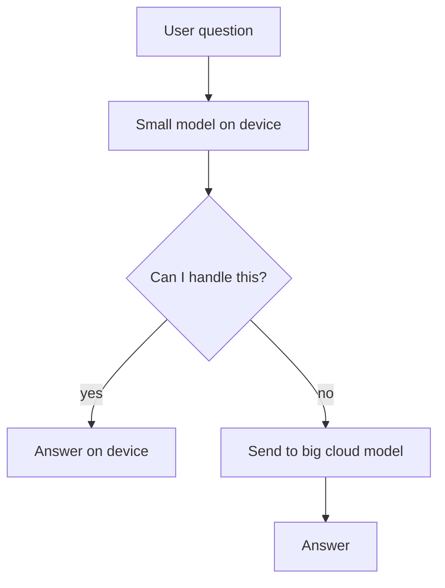
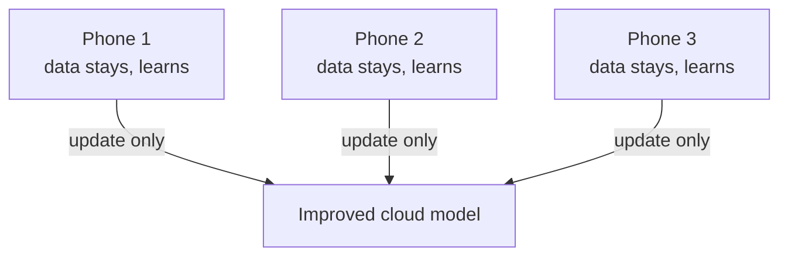

# Cloud vs On-device Model Deployment

> **Step 16: AI Infrastructure, Deployment, and System Design** · ⏱️ 29 min read · [Read original](https://outcomeschool.com/blog/cloud-vs-on-device-model-deployment)

## TL;DR
Deployment = model + a place where it runs. In Cloud Deployment the data travels to one big model on a server; in On-device (Edge) Deployment the model travels to the data and runs on the user's device. Cloud wins on intelligence, updates and visibility; device wins on latency, privacy, offline use and per-request cost. Most real products end up hybrid.

## Key Concepts
- **Deployment** — putting a model somewhere real users can run it.
- **Training vs inference** — training = learning (thousands of machines, weeks, almost always cloud); inference = answering one question (lighter). This blog is about inference.
- **Cloud Deployment** — model on a data-center server; the device is just a messenger.
- **On-device / Edge Deployment** — model inside phone, laptop, watch, car, camera, sensor; no network request.
- **On-premise** — model on the company's own servers in its own building; data leaves the device but not the company.
- **Parameters** — learned numbers; more usually means more capable but bigger and memory-hungry.
- **Quantization** — fewer bits per number (e.g. 4 vs 16 bits can shrink to a quarter, keeping most quality).
- **Pruning** — remove parts that contribute little.
- **Distillation** — train a small model to copy a big one (student/professor).
- **Hybrid** — small on-device model for easy work, cloud model for hard tasks.
- **Federated Learning** — learning happens on-device; only small updates go to the cloud, never raw data.

## How It Works

### The one big difference
Cloud: one model, data moves to it. On-device: many copies of the model, nothing moves.

### Six decision dimensions (each yields a rule)
1. **Round trip (speed).** Cloud trip phone -> tower -> cables -> data center and back: about 50-200 ms on a good link, worse on weak. Fine for chat; not for a self-driving car (at 100 km/h, 200 ms is about 5 m blind; a 2 s network drop is over 50 m). Also noise cancellation, camera effects, keyboard, face unlock. *Rule: instant answer or untrusted network -> on-device.*
2. **Privacy.** Cloud data leaves the user's hands even if encrypted. On-device: nothing to intercept; user need not trust you. Sensitive: hospital, bank, keyboard, photos; laws on data movement. Privacy is a distance: on-device (never leaves) < on-premise (stays in company) < cloud (leaves company). *Rule: deeply personal or legally restricted data -> on-device.*
3. **Model size.** Cloud: many chips, hundreds of GB memory, no battery, hundreds of billions of parameters. Phone: limited memory/battery/heat; a few billion parameters at most, compressed. Cloud model hundreds of GB; phone model a few hundred MB to a few GB. Shrink via quantization, pruning, distillation. Compressed models still lose on hard reasoning, long documents, deep knowledge, though the gap closes yearly. *Rule: max intelligence -> cloud.*
4. **Cost.** Cloud: pay per request forever, grows with users. On-device: heavy upfront engineering (shrink, multi-device support, testing), then flat regardless of 10 or 10 million users. Curves cross: cloud cheaper before, far costlier after. Catch: cost moves to the user (battery, storage, heat). *Rule: huge user base with simple repeated task -> on-device.*
5. **Shipping.** Cloud: fix Monday, everyone has it by afternoon. On-device: (a) model must be downloaded (a 2 GB model makes a 2 GB app or a wait and mobile-data cost, users abandon); (b) cannot fix quickly, only via app update (illustratively about 30% by day 3, 70% by week 2, 85% by month 2, plateau about 90%); old broken versions linger. Devices vary (3-year-old budget vs flagship), so test widely. *Rule: change often or cannot afford large download -> cloud.*
6. **Offline.** Traveller without SIM translating a sign: cloud gives spinner then error; on-device works with zero bars. Also villages, basements, metros, planes. *Rule: must work offline -> on-device.*

### Hybrid approach
Small on-device model asks "can I handle this?" Yes -> answer locally; no -> send to cloud.

- Voice assistant: wake word always on-device; "set a timer", "flashlight" on-device; "write a poem about the monsoon" goes to cloud.
- Gives speed + privacy for common case, full intelligence for rare hard case, and a basic fallback when the network is gone. See LLM Routing.

### Federated Learning
Phones learn locally from their data; only small updates travel to an improved cloud model. Example: phone keyboard.

## Real examples
| Feature | Where | Why |
|---|---|---|
| Face unlock | On-device | Instant, offline, personal |
| Keyboard prediction | On-device | Every keystroke |
| Call noise cancellation | On-device | Real time |
| Offline sign translation | On-device | No network when needed |
| Self-driving | On-device | Delay/drop can cause accident |
| ChatGPT long answer | Cloud | Very large model |
| Text-to-image | Cloud | Heavy, drains battery |
| Search own photos | On-device or hybrid | Private, index on phone |
| Voice assistant | Hybrid | Simple local, hard cloud |
| Hospital reports | On-premise | Data cannot leave network |

Pattern: instant/private/offline -> device; deep intelligence -> cloud; both -> hybrid.

## Cloud vs On-device
| Point | Cloud | On-device |
|---|---|---|
| Runs | Data-center server | User's device |
| Data | Travels to server | Never leaves |
| Internet | Always | No |
| Speed | Slower (round trip) | Faster |
| Model size | Hundreds of billions of params | Few billion at most, compressed |
| Quality | Highest | Good for focused tasks |
| Privacy | Weaker | Stronger |
| Cost to us | Per request forever | Mostly one-time |
| Cost to user | Internet data | Battery, storage, heat |
| Updates | Instant | App update, late adoption |
| Hardware | One type | Thousands of devices |
| Visibility | Logs, quick fixes | Hard to see |
| Best for | Hard reasoning, long docs, generation | Instant, private, repeated, offline |

## Trade-offs & Pitfalls
- Cloud cons: needs internet, round-trip latency, data leaves device, pay per request, server outage hits everyone. Cloud pros: any model size, instant updates, one model for all devices, logs.
- Device cons: small/weaker model, battery drain and heat, device fragmentation, slow update rollout, poor visibility. Device pros: offline, fast, private, no per-request bill.
- On-premise: privacy of device plus power of cloud, but you buy and maintain hardware (hospitals, banks, government).

### When to use which
- **Cloud:** strongest model needed, users online, frequent model changes, comfortable bill, model too large, need logs/quality measurement.
- **On-device:** instant response, very personal data, offline, huge users on simple task, narrow task.
- **Hybrid:** mostly easy with few hard requests; privacy and speed for common case; safe fallback.
- **On-premise:** data legally cannot leave org, need big model, org can run hardware.

## FAQ
- Edge Deployment? → Same as on-device.
- On-device always cheaper? → No; cloud cheaper until users grow; cost moves to user.
- Small model matches big? → No on hard reasoning, long docs, knowledge; gap closing.
- Learn on device? → Yes, Federated Learning.
- On-premise = on-device? → No; data leaves device but stays in company network.

## Key Takeaways
- Cloud: data travels to the model; on-device: model travels to the data.
- Training is cloud; the choice is about where inference runs.
- Device wins on latency, privacy, offline, per-request cost; cloud wins on intelligence and fast iteration.
- Shrink models with quantization, pruning, distillation, but expect a capability gap.
- On-device fixes ship slowly (app updates); cloud fixes reach everyone in hours.
- Hybrid routes easy tasks locally and hard ones to the cloud; most products end here.
- Federated learning improves models without raw data leaving devices.
