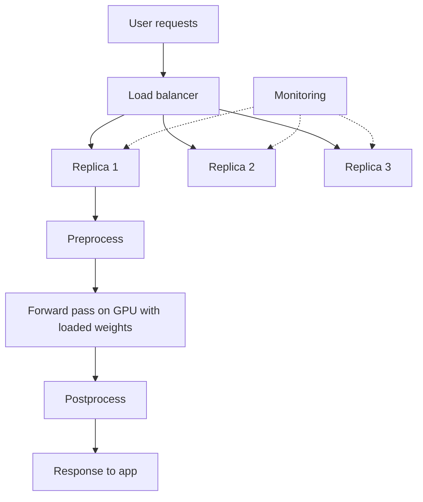

# How does Model Serving work?

> **Step 16: AI Infrastructure, Deployment, and System Design** · ⏱️ 17 min read · [Read original](https://outcomeschool.com/blog/model-serving)

## TL;DR
Model Serving puts a trained model behind an API so applications can send input and get predictions in real time. It handles loading, preprocessing, batching, scaling, monitoring, and versioning so the model can focus on making predictions.

## Key Concepts
- **Inference** — running the model on new input; serving is how we do it for real users.
- **Endpoint** — the API address where requests arrive.
- **Preprocess / forward pass / postprocess** — raw input to numbers, model math, numbers to a friendly answer.
- **Batching** — run several requests together in one GPU pass.
- **Latency vs throughput** — time for one request vs requests served per unit time.
- **Replica** — one running copy of the served model.
- **Load balancer** — spreads requests across replicas.
- **Online vs batch serving** — real-time with user waiting vs scheduled bulk runs.
- **Rollback** — switch back to an older model version.

## How It Works
### Six steps
1. Load weights into memory (often GPU), once at startup.
2. Expose an endpoint.
3. Accept a request.
4. Preprocess.
5. Forward pass.
6. Postprocess and return.

Weights stay in memory so each request avoids slow disk reads.

### Batching and the trade-off
A GPU handles many ops at once; one request leaves it idle (a bus with one passenger). Batching waits briefly for several requests.

| Batch size | Latency | Throughput |
|---|---|---|
| Small | Low | Low |
| Large | Higher | High |

Live chat favors low latency; background jobs favor throughput.

### Scaling
Run many replicas (e.g., ten replicas at 100 req/s each is about 1,000 req/s) behind a load balancer.

### Online vs batch
| Point | Online | Batch |
|---|---|---|
| Runs | On demand | On a schedule |
| User waiting | Yes | No |
| Example | Chat reply, fraud check | Overnight recommendations for ten million users |

### Frameworks
TensorFlow Serving; NVIDIA Triton (many libraries, GPU-focused, good for PyTorch); vLLM (LLMs, high throughput).

### Monitoring and versioning
Monitor latency, failures, GPU load, prediction quality. Version models and canary a new one (e.g., 5% traffic) while watching metrics; roll back if it misbehaves.

## Diagram

## Key Takeaways
- Serving = model + API + everything needed to run inference reliably for users.
- Load weights once at startup; never per request.
- Batching trades a little latency for a lot of throughput.
- Scale horizontally with replicas behind a load balancer.
- Choose online vs batch by asking whether someone is waiting.
- Canary rollouts and rollbacks make model updates safe.
