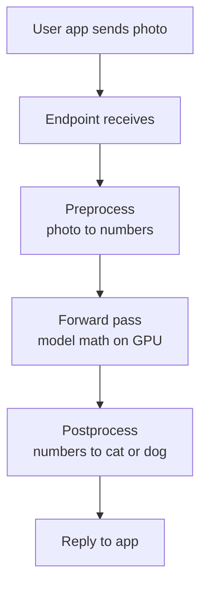
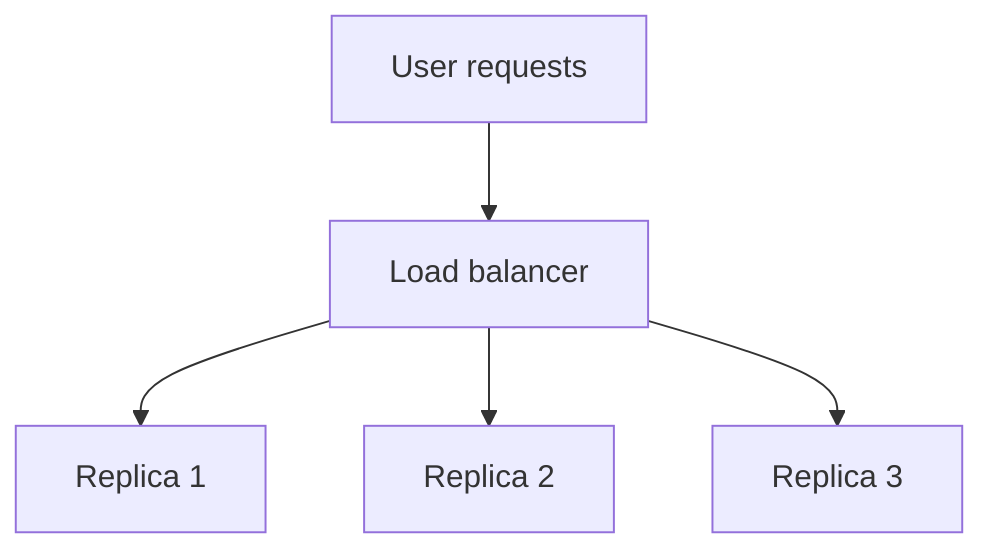
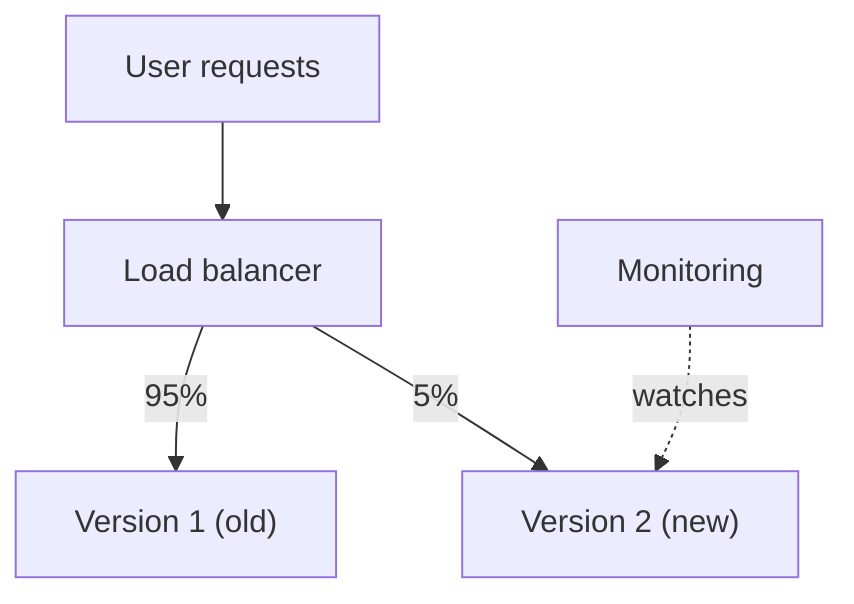

# How does Model Serving work?

> **Step 16: AI Infrastructure, Deployment, and System Design** · ⏱️ 17 min read · [Read original](https://outcomeschool.com/blog/model-serving)

## TL;DR
Model Serving puts a trained model behind an API so apps can send input and get predictions in real time. The serving system loads weights once, exposes an endpoint, pre/post-processes, runs the forward pass, batches requests for GPU efficiency, scales via replicas behind a load balancer, and stays reliable through monitoring and versioning.

## Key Concepts
- **Model Serving** — connects a trained model on disk to real users via an API.
- **Inference** — running the model on new input; serving is how we do it for real users in real time (not the same thing).
- **Endpoint** — API address where apps send requests.
- **Preprocessing / postprocessing** — raw input to numeric form; raw output to clean answer.
- **Forward pass** — model math from input to output.
- **Weights** — numbers learned in training (millions for small models, billions for LLMs).
- **Batching** — grouping requests into one GPU run.
- **Latency vs throughput** — time for one request vs requests per time.
- **Replica** — one running copy of the served model.
- **Load balancer** — traffic manager spreading requests across replicas.
- **Online (real-time) vs batch (offline) serving**.
- **Serving framework** — ready-made tool handling endpoint, batching, request handling.
- **Monitoring, versioning, rollback**.

## How It Works

### Why we need it
A raw model file cannot accept requests; is slow to load (cannot reload per request); one copy cannot handle thousands of requests/s; input must be converted; and something must keep it healthy. Serving solves all that so the model only predicts.

### The six steps
1. Load weights into memory (often onto a GPU), once at startup.
2. Expose an endpoint.
3. Accept a request (photo, sentence).
4. Preprocess input.
5. Forward pass.
6. Postprocess and return the result.

### Loading weights
Reading from disk per request is far too slow, so weights load once and stay resident. GPUs run thousands of operations at once, which suits mostly multiply/add forward passes. Loading is a one-time startup cost; afterwards requests never touch disk.

### Batching
A GPU with one request is mostly idle (empty bus, one passenger). Example: 4 photos handled one-by-one in 4 runs versus a single forward pass for all four. Batching waits for a few requests, adding a small delay, but serves far more in total; tune batch size per use case. (Continuous Batching in LLMs keeps the GPU busy each step.)

### Latency vs throughput
Coffee shop analogy: one barista makes a cup fast (low latency) but few cups per minute (low throughput).

| Batch size | Latency | Throughput |
|---|---|---|
| Small | Low | Low (GPU not full) |
| Large | Higher | High (GPU well used) |

Live chat wants low latency; background processing of millions of items wants throughput.

### Scaling
If one replica handles 100 req/s, ten handle about 1,000 req/s. The load balancer (like a bank greeter) sends each request to a free replica; all replicas hold the same model, so any can answer; scale by adding replicas.

### Online vs batch serving
| Point | Online | Batch |
|---|---|---|
| When | Now, on demand | Later, scheduled |
| User waiting | Yes | No |
| Speed need | Low latency | Can be slow |
| Example | Chat reply, fraud check at "pay" | Overnight recommendations for 10 million users |

Key question: is someone waiting right now? If no, batch is cheaper and simpler.

### Serving frameworks
- **TensorFlow Serving** — for TensorFlow models.
- **NVIDIA Triton** — flexible, many libraries (e.g. PyTorch), uses GPUs very well.
- **vLLM** — made for LLMs, high throughput.
They provide endpoint, batching, request handling; you plug in the model.

### Monitoring and versioning
- **Monitoring**: request time, failure count, GPU busy-ness, prediction correctness; alerts early.
- **Versioning**: label versions; switch the endpoint to a new one; **rollback** instantly if worse.
- **Canary-style rollout**: small traffic share to the new version first, watch monitoring, then move everyone.

## Trade-offs & Pitfalls
- Batching: slightly higher latency per request, much higher throughput.
- Bigger batches help cost; smaller keep responses instant.
- Rolling out a new model to everyone at once risks widespread bad predictions; use partial traffic plus rollback.

## FAQ
- Inference = serving? → No; inference is running the model, serving wraps it for real users with preprocessing, batching, scaling.
- Does batching slow requests? → Slightly, in exchange for much higher throughput.
- Framework for an LLM? → vLLM; for PyTorch, Triton.
- Rollback? → Switch endpoint back to the old version; enabled by versioning.

## Key Takeaways
- Serving = model behind an API with startup loading, endpoint, pre/post-processing.
- Weights load once into GPU memory; the forward pass is the per-request work.
- Batching trades small latency increase for large throughput gain.
- Replicas plus a load balancer give horizontal scaling.
- Online serving when the user waits; batch serving for scheduled bulk work.
- Frameworks (TF Serving, Triton, vLLM) provide the common machinery.
- Monitoring plus versioned gradual rollout with rollback keeps serving reliable.
