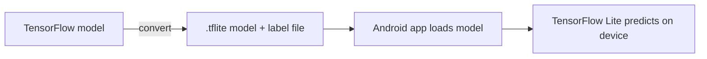

# Android TensorFlow Lite Machine Learning Example

> **Step 16: AI Infrastructure, Deployment, and System Design** · ⏱️ 3 min read · [Read original](https://outcomeschool.com/blog/android-tensorflow-lite-machine-learning-example)

## TL;DR
TensorFlow Lite is TensorFlow's lightweight solution for mobile and embedded devices, letting an Android app run an ML model on the device itself with low latency. The tricky part is converting a normal TensorFlow model into the `.tflite` format.

## Key Concepts
- **TensorFlow Lite** — lightweight TensorFlow for mobile and embedded devices; on-device inference.
- **.tflite model** — converted model format TensorFlow Lite accepts.
- **Label file** — accompanies the model to map outputs to names.
- **Android Neural Networks API** — enables hardware acceleration.

## How It Works
**Why it is fast and suitable for mobile**
- On-device inference with low latency.
- Small binary size.
- Hardware acceleration via the Android Neural Networks API.

**Techniques for low latency**
- Kernels optimized for mobile apps.
- Pre-fused activations.
- Quantized kernels, giving smaller and faster fixed-point models.

**Using it in an Android app**
1. Convert the TensorFlow model into a `.tflite` model (the most tricky part).
2. Obtain the `.tflite` model and its label file.
3. Add both to the Android app, load the model, and predict output with the TensorFlow Lite library.

The author provides a complete sample object detection app, with the classifier example credited to Google's TensorFlow examples.

## Diagram

## Key Takeaways
- TensorFlow Lite = on-device ML inference for Android with low latency and small size.
- A regular TensorFlow model must be converted to `.tflite` first.
- Optimized kernels, fused activations, and quantization make it fast.
- Hardware acceleration is available through the Android Neural Networks API.
