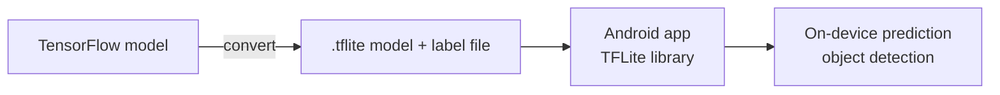

# Android TensorFlow Lite Machine Learning Example

> **Step 16: AI Infrastructure, Deployment, and System Design** · ⏱️ 3 min read · [Read original](https://outcomeschool.com/blog/android-tensorflow-lite-machine-learning-example)

## TL;DR
TensorFlow Lite is TensorFlow's lightweight solution for mobile and embedded devices. It runs ML inference on the Android device itself with low latency. The tricky part is converting a normal TensorFlow model to the `.tflite` format; then load it with a label file in the app to predict (the blog's sample does object detection).

## Key Concepts
- **TensorFlow Lite** — lightweight TensorFlow for mobile/embedded; on-device inference.
- **.tflite model** — special format TFLite accepts; different from a normal TensorFlow model.
- **Label file** — maps model outputs to names; used alongside the `.tflite` model.
- **Android Neural Networks API** — hardware acceleration backend supported by TFLite.
- **Quantized kernels** — fixed-point math for smaller, faster models.

## How It Works

### Why TFLite is good on mobile
- On-device inference with low latency, hence fast.
- Small binary size, good for mobile devices.
- Hardware acceleration via the Android Neural Networks API.

### Techniques for low latency
- Kernels optimized for mobile apps.
- Pre-fused activations.
- Quantized kernels (smaller and faster fixed-point models).

### Using it in an Android app
1. Convert the TensorFlow model to a `.tflite` model (the most important tricky part).
2. Obtain the `.tflite` model plus the label file.
3. Load both in the Android app and predict output using the TFLite library.
4. The author provides a complete running object-detection sample app (classifier example credited to Google's TensorFlow examples).

## FAQ
- Normal TensorFlow model directly? → No, convert to `.tflite` first.
- Why fast? → Low-latency on-device inference, optimized kernels, pre-fused activations, quantized kernels, small binary.
- Hardware acceleration on Android? → Yes, via Android Neural Networks API.

## Key Takeaways
- TFLite = TensorFlow for mobile/embedded, on-device inference.
- Fast because of mobile-optimized kernels, pre-fused activations, quantization.
- Small binary size suits mobile; supports Android NNAPI acceleration.
- Must convert the model to `.tflite`; then bundle it with a label file in the app.
